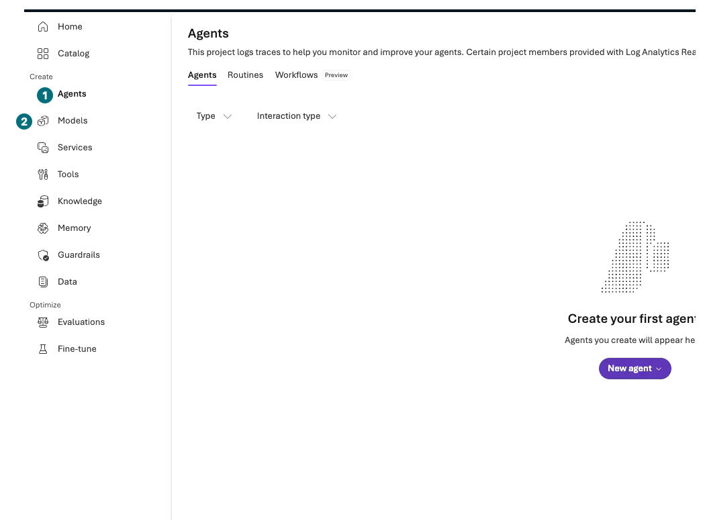

## 목표

기본 코스는 브라우저 두 창에서 **문서를 근거로 답하는 Contoso 구매 안내 에이전트**를 만듭니다. 설치·터미널·Cloud Shell·Codespaces·API key는 필요 없습니다. 선택 **L12–L14만** 코드가 필요한 Hosted·MAF를 별도 Python 환경과 설명된 터미널 명령으로 진행합니다.

**진행 방식:** 포털 따라 하기. 기본 L00–L10은 약 **4시간 45분**, 공통 마무리 L19는 10분입니다. 승인·배포 대기 시간은 별도입니다.

**먼저 할 일:** 이 가이드 옆에 [Azure portal](https://portal.azure.com/)과 [Microsoft Foundry](https://ai.azure.com/)를 각각 새 창으로 엽니다.

**확인할 결과:** 사용할 조직·구독, 비용 승인, 실습 범위를 적었습니다. 아직 자원을 만들거나 질문을 보내지 않습니다.

## 개념과 실습 지도

**경험할 기능:** Microsoft Azure의 자원 관리와 Microsoft Foundry의 모델·에이전트·평가 화면.

**무엇이며 왜 중요한가요?** Azure portal은 자원·권한·비용을, Foundry portal은 모델·지시문·문서 검색·응답을 다룹니다. 카탈로그를 보는 것과 유료 배포·호출은 다릅니다.

**어떻게 사용하나요?** 각 장의 표를 위에서 아래로 한 줄씩 수행합니다. 오른쪽의 확인값이 맞아야 다음 줄로 갑니다.

**어디서 실행하나요?** 기본은 두 포털이며 파일은 브라우저/파일 선택 창에서 다룹니다. L12–L14는 전체 ZIP의 소스·흐름도·명령 해설을 사용합니다. 포털에서 못 하는 작업을 수동 Chat으로 가장하지 않습니다.

### 화면과 영상을 읽는 순서

번호가 있는 화면 → 바로 아래의 클릭·입력 안내 → 단계 표의 확인값 순서입니다. 이미지를 누르면 크게 볼 수 있고, `자막 영상` 링크는 같은 장면으로 이동합니다. 번호 화면은 **기존 한국어 실행 녹화에서 추출**했으며 번호만 안내 주석으로 추가했습니다. 화면의 접미사·시각·비용을 내 실행값으로 복사하지 않습니다.

## 준비

조직 계정, 사용할 Microsoft Azure 구독, 자원 생성 권한, 비용 승인이 필요합니다. 권한이 없으면 관리자에게 **대상 범위와 필요한 작업**을 요청합니다. 구독 전체 관리자 권한을 실습 편의로 요청하지 않습니다.

## 실행

### 1. 두 포털과 내 기록 준비

| 단계 | 클릭·입력 | 확인할 화면·값 | 실패하면 |
| --- | --- | --- | --- |
| 1 | Azure portal 링크를 새 창으로 열고 로그인합니다. | 우측 계정 메뉴의 조직이 허용된 실습 조직입니다. | 다른 조직이면 Directory를 선택합니다. 다른 사람의 계정을 쓰지 않습니다. |
| 2 | 위쪽 검색에 `Subscriptions`를 입력하고 해당 서비스를 엽니다. | 사용할 구독의 이름과 상태 `Enabled`를 확인합니다. | 구독이 없으면 관리자에게 확인하고 읽기 경로로 전환합니다. |
| 3 | Microsoft Foundry 링크를 별도 창으로 열어 같은 조직으로 로그인합니다. | 새 Microsoft Foundry 경험이 표시됩니다. 전환 스위치가 있으면 `New Foundry`를 켭니다. | Classic 화면이면 새 경험 전환 여부를 확인합니다. |
| 4 | 개인 메모에 조직, 구독, 허용 지역, 담당자, 승인된 비용·호출 상한을 적습니다. | 두 창이 같은 허용 범위를 가리킵니다. | 불일치하면 생성 버튼을 누르지 않습니다. |
| 5 | 아래 학습 범위를 읽고 기본 또는 읽기 경로를 선택합니다. | 실습·관찰·수동 비교·미실행을 구분했습니다. | 메뉴가 없다는 이유로 보안이나 지역을 임의 변경하지 않습니다. |

**먼저 위치만 보기: Microsoft Azure의 자원 생성 폼**

**1 이름 / 2 지역:** L01에서 채울 위치입니다. 지금은 두 포털과 승인 범위만 준비하며 `Create`를 누르지 않습니다.

[자막 영상 01 · 00:10](../downloads/portal/index.html?clip=01-environment&t=10&lang=ko#01-environment)

**메뉴에서 길 찾기: Microsoft Foundry의 Agents와 Models**

**1 Agents / 2 Models:** 녹화 UI에서는 `Create` 그룹 아래에 있습니다. 장의 `Build → 기능명` 안내는 같은 기능명을 찾으라는 뜻입니다. `Evaluations`는 `Optimize` 아래, 모델 카탈로그는 `Catalog`에 있습니다. `Traces`와 `Monitor`는 에이전트를 연 뒤의 탭입니다.

[자막 영상 01 · 03:02](../downloads/portal/index.html?clip=01-environment&t=182&lang=ko#01-environment)

번호가 붙은 화면은 [실제 포털 녹화](../downloads/portal/index.html)의 해당 장면입니다. 화면을 누르면 크게 볼 수 있고, 바로 아래 영상 링크는 같은 시각으로 이동합니다. 내 프로젝트의 이름·버전·결과는 직접 확인합니다. 관찰만 한 기능은 실행 성공으로 세지 않습니다.

### 2. 끝까지 같은 대상을 따라가기

| 장 | 내가 하는 일 | 결과의 의미 |
| --- | --- | --- |
| L01–L03 | 전용 자원 그룹·프로젝트·모델을 만들고 모델 Chat에 질문 1건 | 모델 응답 확인. 구매 도구 실행 아님 |
| L04–L05 | `contoso-policy`를 만들고 합성 정책 3개를 File search에 업로드 | 문서에 근거한 정책 안내 |
| L06 | 도구가 없는 상태에서 구매 요청을 시험하고 초안 경계를 점검 | **실제 재고 조회·초안 함수 실행 아님** |
| L07 | 허용된 읽기 전용 원격 MCP 도구를 조건부로 연결 | 실제 도구 호출 기록이 있을 때만 도구 실행 |
| L08 | 별도 비교용 v1/v2 에이전트를 같은 12개 dev 질문으로 평가 | 학습용 비교. 운영 출시·과거 검증을 대체하지 않음 |
| L09–L10 | L05 정책 에이전트의 안전 응답과 같은 요청의 Trace 확인 | 응답·필터·권한·도구 결과를 분리 |
| L11·L15–L18 | 명시된 포털 설정 관찰·조건부 시험·판단 | 미지원·미실행을 성공으로 세지 않음 |
| L12 | Hosted 소스·오프라인 패키징, 별도 승인 배포·1회 호출 | 패키지 생성과 실제 Microsoft Azure 배포를 구분 |
| L13–L14 | 실제 MAF SDK의 전달·분기·그룹 채팅·핸드오프 | 기본 fixture는 Microsoft Azure 모델·품질 증거가 아님 |
| L19 | 내가 만든 자원과 남는 비용 기록 | 창을 닫는 것과 자원 중지·삭제는 다름 |

### 3. 비용·실행 경계 정하기

개인 실습 예산을 먼저 정합니다. 예를 들어 환경 1개, 모델 2개, 정책 3파일, Chat 전송 48회 이하, 평가 2회×12행 이하, 자동 실행·학습·PTU·주문 0회로 제한할 수 있습니다. **이는 요청 수 상한의 예이며 금액 상한이 아닙니다.** 평가 내부 judge 호출과 로그·저장소 요금도 발생할 수 있습니다.

위는 기본 코스의 예입니다. L12의 Search 데이터·embedding·Hosted 배포·권한과 L13–L14의 live 모델 호출은 각각 추가 승인·예산입니다. 오프라인 패키징·SDK fixture는 자원 생성·모델 청구가 없지만 실제 코드 실행이며 **실행 없이 읽기**와는 다릅니다.

원하는 모델·버전·지역이 없으면 **진행 차단**으로 기록합니다. 대체 모델을 썼다면 별도 실험이며 기존 기준 모델의 성공으로 합산하지 않습니다. 읽기 경로에서는 화면 예시·정책·판단표만 읽고 생성·저장·전송을 누르지 않습니다.

## 성공 기준

두 포털의 역할, 같은 프로젝트를 이어 쓰는 순서, 유료 동작과 읽기 동작의 차이를 설명할 수 있습니다. 문서 인용은 실제 주문 권한이 아니며 학습 진도 체크도 Microsoft Azure 실행 증거가 아닙니다.

## 막혔을 때

로그인 창이 안 뜨면 브라우저의 팝업 차단을 확인하고 포털 링크를 직접 새 창으로 엽니다. 인증서·조직 보안 경고를 우회하지 않습니다. 계정·비밀번호·인증 코드를 녹화하거나 공유하지 않습니다.

## 정리

현재는 자원을 만들지 않았습니다. 기록은 개인 위치에 보관하고 공개 캡처에서는 이메일·구독 ID·테넌트 ID를 가립니다.

**이 장에서 남길 것:** 허용된 구독·지역·비용·요청 상한과 기본/읽기 경로 선택.

**다음:** [L01 전용 실습 환경 만들기](#l01).

