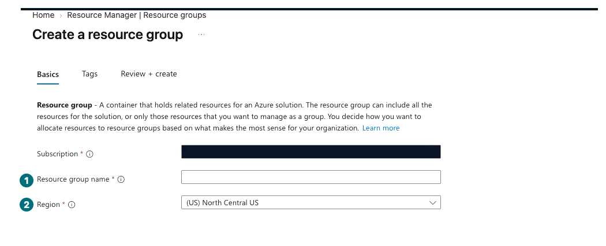
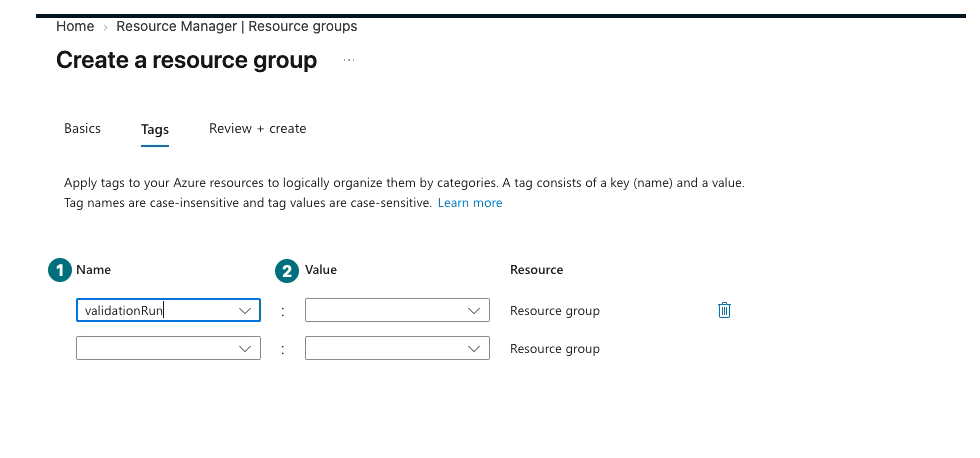
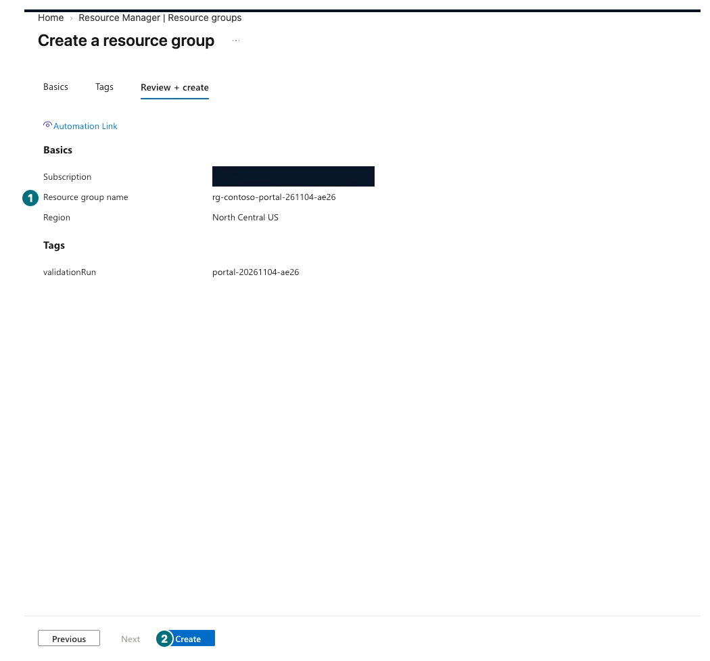
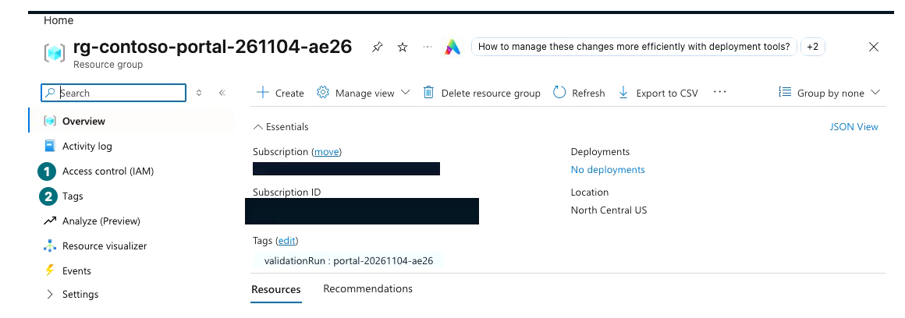
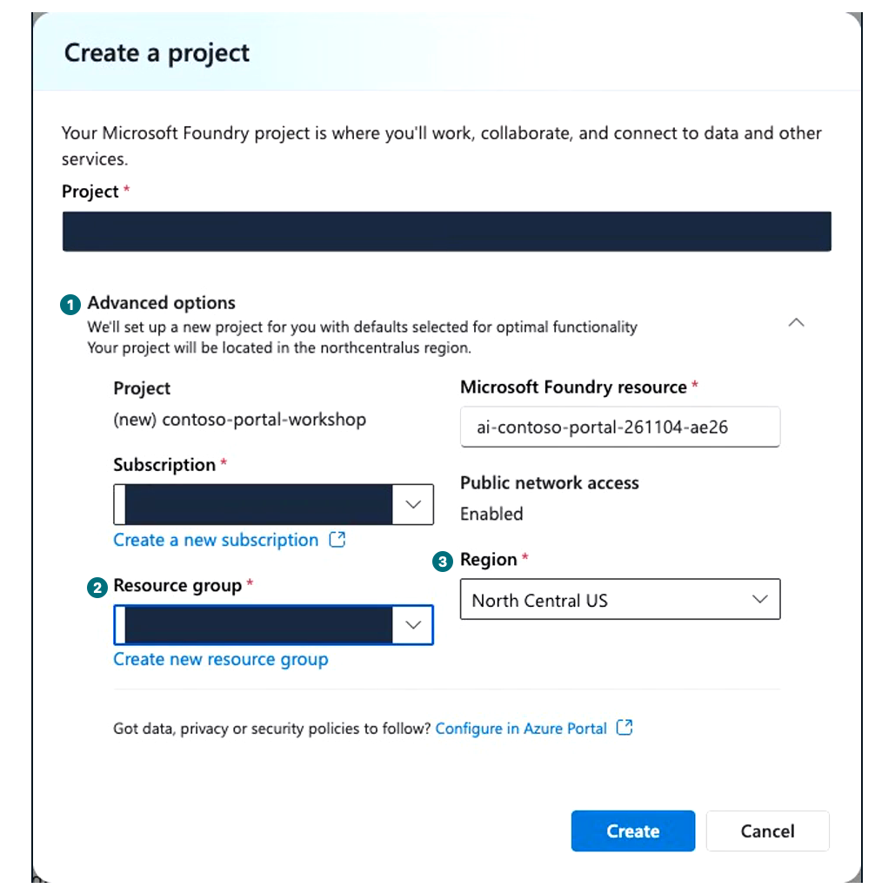
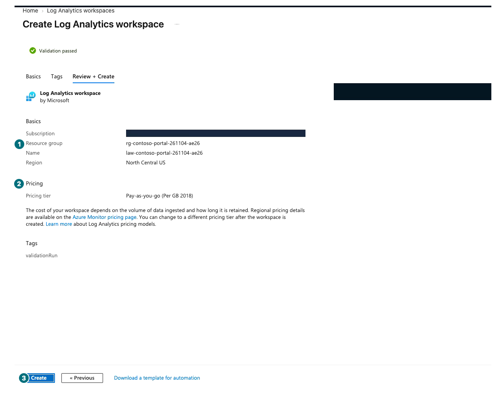
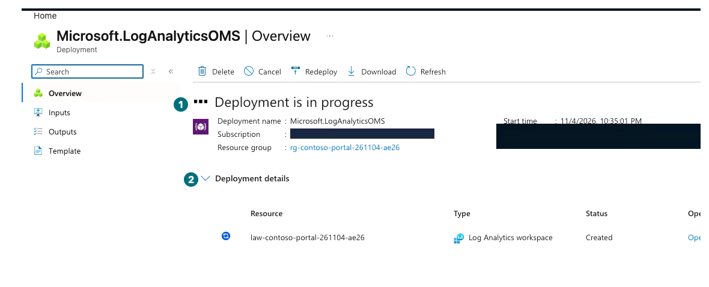
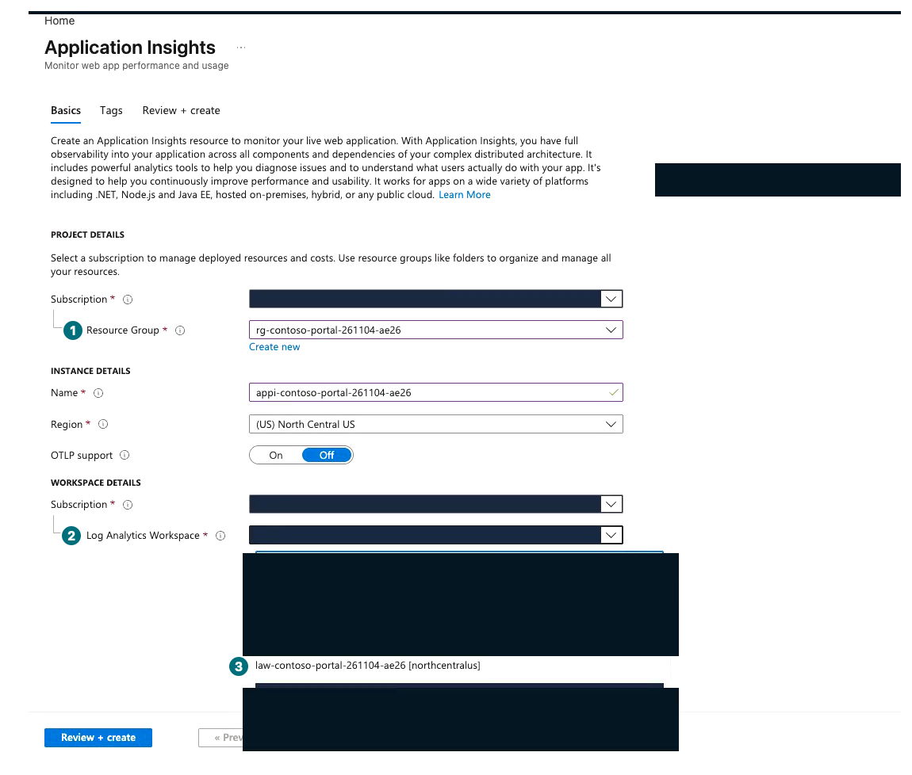
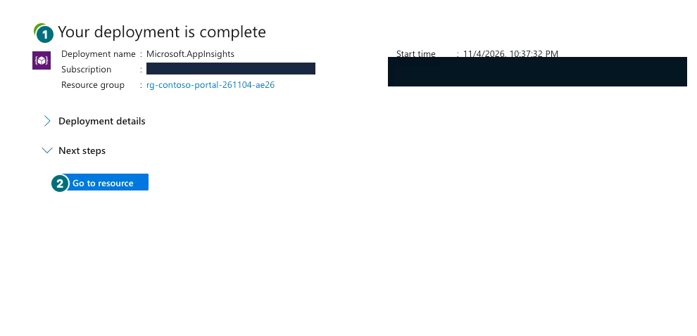

## 목표

Azure portal에서 **내 전용 리소스 그룹**, Microsoft Foundry에서 **새 Microsoft Foundry resource와 project**를 만듭니다. 실제 호출 전에 권한과 로그 연결을 확인합니다.

**진행 방식:** 포털 직접 생성. 승인된 구독·지역에서 환경 1개만 만듭니다.

**먼저 할 일:** L00에서 비용·소유 범위를 확인하고 이름의 `<내접미사>`를 날짜+짧은 임의 문자열로 정합니다. 예: `261104-a7b2`.

**확인할 결과:** 자원 그룹·Microsoft Foundry resource·project가 같은 허용 범위에 있고 개인 소유 기록에 남았습니다.

## 개념과 실습 지도

**경험할 기능:** Resource group, Microsoft Foundry project, IAM 읽기, Application Insights 연결.

**무엇이며 왜 중요한가요?** 리소스 그룹은 Microsoft Azure 자원을 묶는 관리 범위, project는 에이전트·데이터·연결의 작업 공간입니다. 로그인했다고 생성·호출·권한 부여가 모두 가능한 것은 아닙니다.

**어떻게 사용하나요?** 생성 폼의 자동 기본값을 그대로 누르지 않고 구독·자원 그룹·지역·이름을 매번 확인합니다.

**어디서 실행하나요?** Azure portal과 Foundry portal. 설치·코드·환경 파일은 사용하지 않습니다.

## 준비

허용 구독, 비용 담당자, 지역(예: `North Central US`), 요청 상한을 준비합니다. 아래 이름은 **내 접미사로 바꿉니다**. 기존 교육·운영 자원을 이름만 보고 재사용하지 않습니다.

| 기록할 항목 | 내 입력 예 |
| --- | --- |
| 리소스 그룹 | `rg-contoso-portal-<내접미사>` |
| Microsoft Foundry resource | `ai-contoso-portal-<내접미사>` |
| Project | `contoso-portal-workshop` |
| 소유 태그 | `validationRun=portal-<내접미사>` |
| 로그 자원 | 같은 전용 그룹의 Application Insights·Log Analytics workspace |

네트워크 정책상 private 구성이 필요하면 생성 전 담당자에게 요청합니다. 기본 public access 화면을 보고 조직 승인이 있다고 간주하지 않습니다.

## 실행

### 1. Azure portal: 전용 그룹 만들기

**Basics: 내 이름과 승인 지역부터 입력**

**1 이름:** `rg-contoso-portal-<내접미사>`를 입력합니다. **2 지역:** 승인된 지역을 고릅니다. 구독은 가려진 예시가 아니라 내 개인 기록과 대조합니다.

[자막 영상 01 · 00:10](../downloads/portal/index.html?clip=01-environment&t=10&lang=ko#01-environment)

**Tags: 이름만 쓰고 넘어가지 않기**

**1 Name:** `validationRun`. **2 Value:** `portal-<내접미사>`. 화면은 Value 입력 전입니다. 두 칸을 모두 채운 뒤 Review로 갑니다.

[자막 영상 01 · 00:39](../downloads/portal/index.html?clip=01-environment&t=39&lang=ko#01-environment)

| 단계 | 클릭·입력 | 확인할 화면·값 | 실패하면 |
| --- | --- | --- | --- |
| 1 | [Azure portal](https://portal.azure.com/) 위 검색에서 `Resource groups`를 열고 `Create`를 누릅니다. | `Create a resource group → Basics`입니다. | 로그인 조직·생성 권한을 확인합니다. |
| 2 | `Subscription`에서 허용 구독을 직접 고릅니다. | L00의 구독과 같습니다. | 동명이면 구독 상세 ID를 개인 기록과 대조합니다. |
| 3 | `Resource group name`에 내 그룹 이름을 입력합니다. | 기존 그룹과 다른 이름입니다. | 충돌하면 새 접미사를 정하고 기록 전체를 맞춥니다. |
| 4 | `Region`에서 승인된 지역을 고릅니다. | 지역 표시가 내 기록과 같습니다. | 모델 지원을 위해 지역을 바꾸려면 먼저 승인받습니다. |
| 5 | `Next: Tags`에서 위 소유 태그를 한 행 추가합니다. | Name과 Value가 모두 입력됐습니다. | 태그를 생성 권한이나 금액 한도로 해석하지 않습니다. |
| 6 | `Review + create`를 눌러 구독·그룹·지역·태그를 읽습니다. | 검증 완료 후 `Create`가 활성화됩니다. | 정책 오류면 내용을 보존하고 담당자에게 전달합니다. |
| 7 | `Create`를 **한 번** 누릅니다. | Notifications에 `Resource group created`가 나옵니다. | 실패·대기 중이면 중복 생성하지 않습니다. |
| 8 | 알림의 `Go to resource group`을 누릅니다. | Overview의 이름·구독·지역·Tags가 맞습니다. | 목록이 오래된 경우 Refresh 후 같은 그룹을 찾습니다. |

**Review: 범위를 읽고 한 번만 Create**

**1 검토:** 내 그룹 이름·지역·태그를 대조합니다. **2 Create:** 맞을 때 한 번만 누릅니다. 대기 중이면 재제출하지 않습니다.

[자막 영상 01 · 00:47](../downloads/portal/index.html?clip=01-environment&t=47&lang=ko#01-environment)

**생성 후: Overview에서 소유 범위 다시 확인**

**1 IAM:** 뒤의 권한 읽기 단계에서 사용합니다. **2 Tags:** 내 `validationRun`을 확인합니다. 그림의 그룹 이름을 내 소유 자원으로 간주하지 않습니다.

[자막 영상 01 · 01:04](../downloads/portal/index.html?clip=01-environment&t=64&lang=ko#01-environment)

### 2. Microsoft Foundry: project 만들기

**Advanced options: 자동 그룹 대신 방금 만든 그룹**

**1 펼치기:** resource·구독까지 읽습니다. **2 그룹:** 내 기존 전용 그룹을 선택합니다. **3 지역:** 승인 지역을 확인합니다. 기본 public access도 조직 승인과 대조한 뒤 생성합니다.

[자막 영상 01 · 01:20.5](../downloads/portal/index.html?clip=01-environment&t=80.5&lang=ko#01-environment)

| 단계 | 클릭·입력 | 확인할 화면·값 | 실패하면 |
| --- | --- | --- | --- |
| 1 | [Microsoft Foundry](https://ai.azure.com/)를 새 창으로 열고 같은 조직으로 로그인합니다. | 계정의 Directory가 L00과 같습니다. | 로그인·MFA 화면은 녹화하지 않습니다. |
| 2 | `Create new project`를 누릅니다. 처음 화면에서는 `Create new`일 수 있습니다. | 프로젝트 생성 창입니다. | `New Foundry` 전환이 기존 프로젝트 선택만 요구하면 취소 후 홈의 Create new를 사용합니다. |
| 3 | 자원 유형을 묻는 경우 `Microsoft Foundry resource (Recommended) → Next`를 선택합니다. | `Create a project`가 열립니다. | `AI hub resource`를 선택하지 않습니다. |
| 4 | `Project`에 `contoso-portal-workshop`을 입력하고 `Advanced options`를 펼칩니다. | 구독·그룹·Microsoft Foundry resource·지역을 직접 볼 수 있습니다. | 자동 생성 이름으로 바로 Create를 누르지 않습니다. |
| 5 | `Subscription`을 고르고 `Resource group`에서 방금 만든 **기존 전용 그룹**을 선택합니다. | `(new) rg-...` 기본값이 아닌 내 그룹입니다. | 목록에 없으면 구독·새로 고침을 확인합니다. |
| 6 | `Microsoft Foundry resource`에 `ai-contoso-portal-<내접미사>`를 입력합니다. | 계정 이름 검증이 통과합니다. | 전역 이름 충돌이면 승인 범위 내 새 이름으로 기록을 맞춥니다. |
| 7 | `Region`과 public/private network 조건을 확인합니다. | 승인한 처리·접근 조건입니다. | 필요한 보안 설정은 `Configure in Azure Portal`에서 담당자와 준비합니다. 우회하지 않습니다. |
| 8 | 모든 값을 다시 읽고 `Create`를 한 번 누릅니다. | `Setting up Microsoft Foundry for you` 후 프로젝트가 열립니다. | 수 분 대기는 정상입니다. 알림·오류를 보고 중복 제출하지 않습니다. |
| 9 | 필요한 경우 `New Foundry`를 켜고 **내 새 프로젝트**를 선택해 `Let's go`를 누릅니다. | Agents·Models가 있는 내 새 프로젝트입니다. 메뉴 그룹 이름은 L00의 화면을 참고합니다. | 지원 지역·권한이 없으면 차단으로 기록합니다. |
| 10 | `Manage → Project details`에서 프로젝트와 상위 resource를 확인합니다. | 전용 그룹·지역·이름이 기록과 맞습니다. | endpoint나 키를 복사해 공개하지 않습니다. |

### 3. 기존 권한 읽기

| 단계 | 클릭·입력 | 확인할 화면·값 | 실패하면 |
| --- | --- | --- | --- |
| 1 | Azure portal의 내 Microsoft Foundry resource에서 `Access control (IAM) → View my access`를 엽니다. | 생성·모델 배포·agent/파일·호출 작업에 필요한 기존 권한을 확인합니다. | `Contributor`만으로 모든 데이터 작업·권한 부여가 된다고 가정하지 않습니다. |
| 2 | 역할 설명과 scope를 읽고 필요한 작업을 개인 기록에 적습니다. | 관리-plane·데이터-plane·로그 읽기를 구분했습니다. | 추가 role assignment는 담당자에게 정확한 대상·scope·작업으로 요청합니다. 직접 확대하지 않습니다. |

`Foundry User`/`Azure AI User` 등 역할 이름만으로 지원 작업을 추정하지 말고 공식 RBAC 문서에서 실제 작업과 scope를 확인합니다. 역할 부여에는 별도의 `roleAssignments/write`가 필요합니다. Trace 읽기에는 `Log Analytics Reader`, 보호된 로그에는 추가 `Privileged Monitoring Data Reader`가 필요할 수 있습니다. 실습을 위해 Owner를 부여하지 않습니다.

### 4. Azure portal: 전용 로그 자원 만들기

이미 **내 소유 기록과 일치하는** 두 로그 자원이 있으면 생성하지 않고 5절로 갑니다. 새로 만들 때는 workspace를 먼저 만들어 자동 생성·공유 workspace 연결을 피합니다. 로그 수집·보관에도 요금이 생길 수 있습니다.

**Workspace Review: 전용 그룹과 요금제를 읽기**

**1 그룹:** 내 전용 그룹인지 확인합니다. **2 Pricing:** 승인한 사용량 기반 조건인지 읽습니다. **3 Create:** 이름·지역·태그까지 맞을 때 한 번만 제출합니다.

[자막 영상 01 · 01:51](../downloads/portal/index.html?clip=01-environment&t=111&lang=ko#01-environment)

| 단계 | 클릭·입력 | 확인할 화면·값 | 실패하면 |
| --- | --- | --- | --- |
| 1 | Azure portal 위 검색에 `Log Analytics workspaces`를 입력하고 Services의 같은 항목을 엽니다. | workspace 목록입니다. | 동명의 개별 자원 대신 서비스 목록을 엽니다. |
| 2 | `Create`를 누르고 허용 구독을 고릅니다. | `Create Log Analytics workspace → Basics`입니다. | 다른 구독이면 제출하지 않습니다. |
| 3 | Resource group에서 **기존 전용 그룹**을 선택합니다. | 1절에서 만든 그룹입니다. | `(new)`나 공유 그룹을 선택하지 않습니다. |
| 4 | Name에 `law-contoso-portal-<내접미사>`, Region에 승인 지역을 고릅니다. | 이름과 지역이 소유 기록과 같습니다. | 이름 충돌이면 제출 전 기록을 맞춥니다. |
| 5 | `Next: Tags`에서 같은 `validationRun` 태그를 한 행 추가합니다. | Name·Value 모두 입력됐습니다. | 빈 추가 행은 입력한 태그가 아닙니다. |
| 6 | `Review + Create`에서 구독·그룹·지역·가격 유형을 읽습니다. | 승인한 사용량 기반 요금제이며 약정/장기 보존을 추가하지 않았습니다. | 비용 조건을 모르면 보류합니다. |
| 7 | `Create`를 한 번 누르고 완료 화면을 기다립니다. | `Your deployment is complete`이며 만든 workspace를 열 수 있습니다. | 실패·진행 중에는 재제출하지 않습니다. |

**아직 진행 중이면 기다리기**

**1 전체 상태:** 아직 `Deployment is in progress`입니다. **2 세부 행:** `Created` 한 줄만으로 전체 완료라 하지 않습니다. 완료를 확인할 때까지 기다리고 새 Create를 누르지 않습니다.

[자막 영상 01 · 02:13.5](../downloads/portal/index.html?clip=01-environment&t=133.5&lang=ko#01-environment)

**Application Insights: 기존 workspace를 직접 선택**

**1 그룹:** 같은 전용 그룹입니다. **2 선택기:** Workspace를 펼칩니다. **3 대상:** 방금 만든 내 `law-contoso-portal-<내접미사>`를 고릅니다. 자동 `(new)` workspace는 선택하지 않습니다.

[자막 영상 01 · 02:29](../downloads/portal/index.html?clip=01-environment&t=149&lang=ko#01-environment)

| 단계 | 클릭·입력 | 확인할 화면·값 | 실패하면 |
| --- | --- | --- | --- |
| 1 | 위 검색에서 Services의 `Application Insights`를 열고 `Create`를 누릅니다. | `Create Application Insights → Basics`입니다. | workspace 생성 화면과 혼동하지 않습니다. |
| 2 | 같은 구독·기존 전용 그룹을 선택합니다. | 새 그룹/공유 그룹이 아닙니다. | 자동 기본값을 다시 확인합니다. |
| 3 | Name에 `appi-contoso-portal-<내접미사>`, Region에 같은 승인 지역을 입력합니다. | 이름·지역이 기록과 맞습니다. | 새 지역으로 임의 변경하지 않습니다. |
| 4 | Workspace를 펼쳐 **방금 만든 `law-contoso-portal-<내접미사>`**를 선택합니다. | `(new)` 자동 workspace가 아니라 기존 내 workspace입니다. | 목록이 비면 구독·지역·생성 완료를 확인합니다. |
| 5 | `Next: Tags`에서 같은 소유 태그를 추가합니다. | OTLP 등 추가 기능·장기 보존은 임의로 켜지 않았습니다. | 필요한 기능은 별도로 승인받습니다. |
| 6 | `Review + create`에서 workspace까지 대조하고 `Create`를 한 번 누릅니다. | 검증을 통과한 정확한 두 자원 연결입니다. | workspace가 다르면 제출 전 고칩니다. |
| 7 | `Your deployment is complete` 후 자원을 열고 workspace 연결을 확인합니다. | Application Insights와 workspace가 모두 전용 그룹에 있습니다. | 연결 생성 성공을 실제 Trace 수집 성공으로 쓰지 않습니다. |

**Insights 완료: 자원 생성과 Trace 수집은 별개**

**1 완료 표시:** 이번 배포의 완료입니다. **2 Go to resource:** workspace 연결을 다시 읽습니다. 실제 Trace 수집은 아래 연결 후 L10에서 확인합니다.

[자막 영상 01 · 02:46](../downloads/portal/index.html?clip=01-environment&t=166&lang=ko#01-environment)

### 5. Microsoft Foundry: 키 없이 로그 연결

| 단계 | 클릭·입력 | 확인할 화면·값 | 실패하면 |
| --- | --- | --- | --- |
| 1 | `Manage → Project details → Connected resources`를 엽니다. | 내 프로젝트의 연결 목록입니다. | Manage의 기본 Users 화면은 연결 목록이 아닙니다. |
| 2 | `Add connection`에서 `Application Insights` 카드를 누르고 `Continue`를 누릅니다. | 인증 방식·자원 선택 폼입니다. | 카드의 라디오가 안 눌리면 카드 제목을 누릅니다. |
| 3 | `Auth Type`을 `Project Managed Identity`로 선택합니다. | 기본 `API Key`가 아닙니다. | 키를 복사하거나 인증 제한을 해제하지 않습니다. |
| 4 | 자원 선택기에서 내 `appi-contoso-portal-<내접미사>`를 선택합니다. | 같은 구독·전용 그룹의 정확한 대상입니다. | 목록이 비면 4절의 생성 결과를 확인합니다. 공유 자원으로 대체하지 않습니다. |
| 5 | 범위를 확인하고 `Connect`를 한 번 누릅니다. | 연결 목록에 대상과 `Project Managed Identity`가 표시됩니다. | 오류 원문을 남기고 임의 권한 확대 없이 보류합니다. |
| 6 | 연결을 다시 열어 대상·인증 방식·보존 조건을 기록합니다. | 연결 저장 성공과 실제 수집 검증을 분리했습니다. | 수집은 L10에서 새 요청의 Trace로 확인합니다. 과거 요청에 소급 적용하지 않습니다. |

### 다른 날 다시 시작

두 포털에 로그인 → 내 전용 그룹 확인 → 프로젝트 선택 → 모델 배포 상태 확인 순으로 재개합니다. **새 환경을 다시 만들지 않습니다.** 이전 설치 경로의 책갈피도 이 포털 재개 절로 연결됩니다.

## 성공 기준

그룹 생성 성공, Microsoft Foundry resource와 project의 존재·정확한 scope를 확인했습니다. 로그 연결은 성공/차단을 구분했습니다. 개인 기록에 자원 ID·태그·시각·담당자·보존/재확인 날짜가 있으며 비밀은 없습니다.

## 막혔을 때

403이면 실패 작업·대상 scope·오류 ID를 남깁니다. 지역 제한·정책 거부를 다른 구독·공개 네트워크로 우회하지 않습니다. 생성 중 화면이 닫혔다면 Azure portal에서 **같은 전용 그룹**의 자원·Deployments·Activity log를 먼저 확인합니다.

## 정리

자원은 계속 유지합니다. 그룹 자체보다 모델 사용·파일 저장·로그·검색 자원의 요금이 중요합니다. 새 그룹을 만들었다고 예산 상한이 자동 설정되는 것은 아닙니다.

**이 장에서 남길 것:** 전용 그룹·Microsoft Foundry resource·project의 소유 기록, 기존 권한 확인, 로그 연결 결과, 남길 기간.

**다음:** [L02 내 모델 배포 만들기](#l02).

