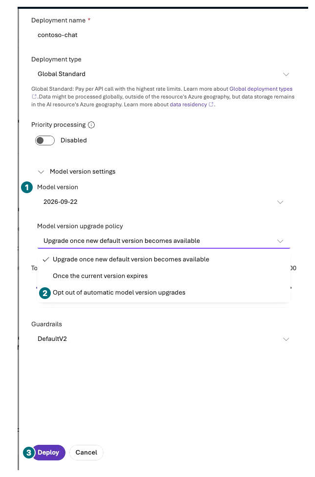
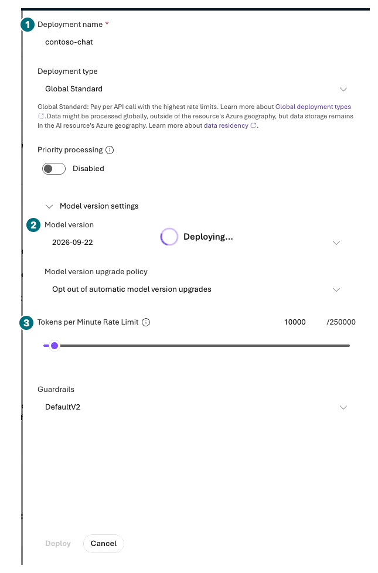
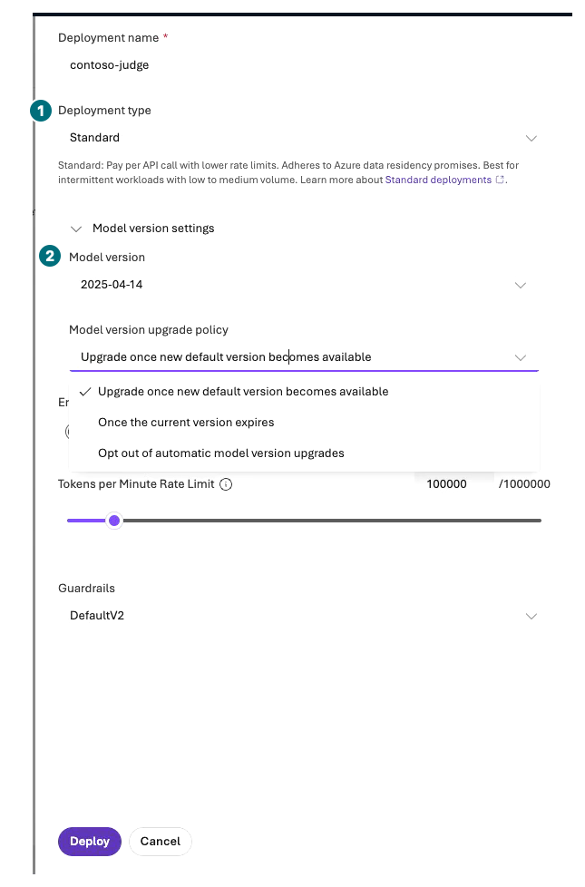

## 목표

카탈로그 모델을 실제 배포하고 **모델 ID·버전·deployment name·배포 유형·TPM**을 구분합니다. 모델과 평가 judge 두 배포까지만 준비합니다.

**진행 방식:** 포털 직접 배포. PTU·학습·추가 modality 배포는 하지 않습니다.

**먼저 할 일:** L01의 새 프로젝트와 허용 모델·지역·처리 위치·비용을 확인합니다.

**확인할 결과:** `contoso-chat`과 평가를 선택한 경우 `contoso-judge`의 실제 배포 상태·버전·한도.

## 개념과 실습 지도

**경험할 기능:** Model catalog, base-model deployment, quota, version.

**무엇이며 왜 중요한가요?** 모델 이름은 제품, deployment name은 내가 호출할 배포 이름입니다. Global·Data Zone·지역 배포는 처리 위치가 다르고 TPM은 청구 금액 상한이 아닙니다.

**어떻게 사용하나요?** 정확한 모델·버전의 배포 폼을 열고 사용자 지정 설정을 확인한 후 한 번 제출합니다.

**어디서 실행하나요?** Microsoft Foundry → Build → Models → Deploy → Deploy a base model.

## 준비

| 용도 | Model ID | 기준 version | 내 deployment name |
| --- | --- | --- | --- |
| 답변 | `gpt-6-sol` | `2026-09-22` | `contoso-chat` |
| L08 채점 | `gpt-4.1` | `2025-04-14` | `contoso-judge` |

모델이 없으면 **기준 모델 미가용**으로 멈춥니다. 임의 대체 모델로 기존 기준의 검증 성공을 주장하지 않습니다. 별도 대체 실험은 모델·버전·지역과 제한을 명확히 남깁니다.

## 실행

### 1. 답변 모델 배포

| 단계 | 클릭·입력 | 확인할 화면·값 | 실패하면 |
| --- | --- | --- | --- |
| 1 | 프로젝트를 확인하고 `Build → Models`를 엽니다. | 내 프로젝트의 배포 목록입니다. | 공용 카탈로그와 내 배포 목록을 구분합니다. |
| 2 | `Deploy → Deploy a base model`을 누릅니다. | Catalog의 Models 페이지입니다. `Available in my project` 필터를 확인합니다. | 별도 창이 안 떠도 실패가 아닙니다. 현재 페이지와 필터를 확인합니다. |
| 3 | `gpt-6-sol`을 검색해 **정확한 모델 카드**를 선택합니다. | 공급자·모델 ID가 맞습니다. | 비슷한 이름·최신 추천 모델로 바꾸지 않습니다. |
| 4 | 모델 상세에서 `Deploy → Custom settings`를 누릅니다. | `Deploy gpt-6-sol` 폼입니다. 빠른 `Default settings`는 선택하지 않습니다. | 모델 카드 열람과 실제 생성 제출을 구분합니다. |
| 5 | Deployment name에 `contoso-chat`을 입력합니다. | 기존 내 배포와 중복되지 않습니다. | 이미 같은 조건으로 만들었다면 재사용합니다. |
| 6 | `Model version settings`를 펼쳐 `2026-09-22`와 업데이트 정책을 확인합니다. | 비교 중 버전을 고정하려면 승인된 `Opt out of automatic model version upgrades`를 선택하고 만료 전 재검토일을 적습니다. | 버전이 없으면 제출하지 않습니다. 자동 업데이트 중지는 영구 지원을 뜻하지 않습니다. |
| 7 | 허용된 사용량 기반 유형(예: `Global Standard/GlobalStandard`)을 고릅니다. | 처리 위치가 조직 허용 조건에 맞고 PTU가 아닙니다. Priority는 끄고 기본 guardrail을 유지합니다. | Global 처리가 금지되어 있으면 승인된 지원 유형이 준비될 때까지 중단합니다. |
| 8 | TPM을 개인 실습에 필요한 허용 최소값으로 설정하고 정확한 값을 적습니다. | 해당 모델·SKU의 최소·증가 단위와 남은 quota 안입니다. | quota가 없으면 요청을 멈춥니다. 임의로 새 지역·계정에 배포하지 않습니다. |
| 9 | 비용·설정을 재확인하고 `Deploy`를 한 번 누릅니다. | 목록의 상태가 `Succeeded/Ready`가 됩니다. | Failed라면 오류 코드·배포 이름을 보존합니다. |
| 10 | 배포 상세에서 version·type·TPM·업데이트 정책을 다시 읽습니다. | 폼 입력값과 실제 생성값이 같습니다. | 이름이 같아도 버전이 달라졌으면 별도 조건으로 기록합니다. |

**제출 전: 자동 업데이트 정책까지 확인**

**1 버전**을 확인하고 **2 Opt out of automatic model version upgrades**는 승인된 고정 비교에만 선택합니다. **3 Deploy:** 비용·유형·TPM까지 확인한 뒤 한 번 제출합니다.

[자막 영상 02 · 00:28](../downloads/portal/index.html?clip=02-model-agent&t=28&lang=ko#02-model-agent)

**배포 폼: 이름·버전·TPM을 각각 읽기**

**1 이름:** `contoso-chat`. **2 버전:** `2026-09-22`. **3 TPM:** 승인한 값을 내 기록에 적습니다. 이 장면은 이미 `Deploying...` 중이며 실제 평가 전 조정값과 다를 수 있습니다. 재클릭하지 말고 완료 후 Details를 다시 읽습니다.

[자막 영상 02 · 00:33](../downloads/portal/index.html?clip=02-model-agent&t=33&lang=ko#02-model-agent)

### 2. 평가 judge 준비

L08의 유료 평가를 선택했다면 위 절차를 `gpt-4.1 / 2025-04-14 / contoso-judge`에 한 번만 반복합니다. 답변 모델과 judge를 혼동하지 않습니다. 평가 전 두 배포의 quota를 확인하고, 부족하면 **행을 줄이거나 점수를 완화하지 말고 평가를 보류**합니다.

이 모델의 `Global Standard`가 `Unsupported region`이면 **같은 승인 지역의 `Standard` 지원 여부를 배포 유형 선택기에서 확인**합니다. 지원되고 비용·처리 위치가 허용된 경우에만 선택하며 실제 SKU를 기록합니다. 다른 project/지역 생성 버튼으로 우회하지 않습니다. L05의 File search가 기준 답변 모델과 호환되지 않을 때 이 배포를 명시적인 별도 도구 실험에 재사용할 수 있지만, L08의 답변 모델은 바꾸지 않습니다.

12행 평가에는 입력 문맥·출력·judge 요청이 더해집니다. 개인 1명 단건 Chat과 수강생 다수의 동시 평가에 필요한 TPM은 다릅니다. 포털에 표시되는 모델별 토큰/요청 단위를 보고 담당자와 조정합니다. 표시 TPM을 실제 사용 토큰이나 금액으로 적지 않습니다.

**Judge: 답변 배포와 다른 SKU일 수 있음**

**1 유형:** 이번 기록은 같은 승인 지역의 `Standard`입니다. **2 버전:** `2025-04-14`입니다. 업데이트 정책 드롭다운은 열린 중간 화면이므로 최종 선택·용량은 저장 후 Details에서 확인합니다.

[자막 영상 03 · 00:37](../downloads/portal/index.html?clip=03-retrieval-boundaries&t=37&lang=ko#03-retrieval-boundaries)

### 3. 카탈로그에서만 비교하기

`Discover → Models`의 비교/benchmark를 열고 모델의 도구·출력·modality 지원을 읽습니다. benchmark 순위는 내 구매 업무의 품질 점수가 아닙니다. Router, Batch, Flex, Priority, prompt caching, 영상·음성·embedding은 이 장에서 배포·호출하지 않습니다.

L11의 embedding이 필요하면 별도 추가 승인 대상입니다. `text-embedding-3-large`의 기본 3072차원과 1536차원 index는 자동 호환되지 않습니다. 수동 배포 두 개 외 embedding 배포 폼을 몰래 제출하지 않습니다. 포털이 의존성을 자동 생성할 수 있으므로 agent/파일 생성 뒤 Models를 다시 열고 실제 배포 전부를 자원·비용 기록에 포함합니다.

## 성공 기준

정확한 기준 모델·버전의 배포 성공 여부와 실제 한도를 적었습니다. 미가용·실패는 성공과 나누었습니다. PTU·추가 수동 모델 배포·유료 modality를 요청하지 않았습니다. 자동 의존성은 별도 공개하며 실제 배포가 두 개뿐이라고 단정하지 않습니다.

## 막혔을 때

`InsufficientQuota`, `SkuNotAvailable`, policy 오류를 구분합니다. 실패한 deployment의 상세를 먼저 읽고 중복 배포하지 않습니다. `429`는 요청 빈도·문맥·공유 사용량 문제일 수 있으며 한도 확장이 항상 해결책은 아닙니다.

## 정리

배포 이름과 정책을 개인 기록에 보관합니다. 사용량 기반 모델은 실제 토큰 사용과 다른 자원 비용을 따로 봅니다. quota·Budget 알림·TPM 어느 것도 자동 금액 차단을 보장하지 않습니다.

**이 장에서 남길 것:** 두 배포 각각의 모델 ID·version·name·type·TPM·상태·처리 위치와 미가용 사유.

**다음:** [L03 playground에서 첫 응답 받기](#l03).

