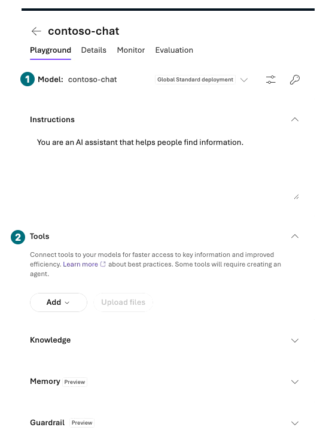
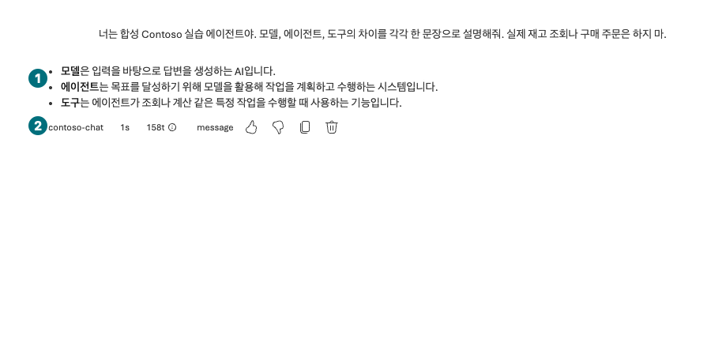

## 목표

배포한 모델의 Chat playground에서 질문 한 건을 보내고 입력·응답·사용량을 확인합니다. 모델 응답과 도구 실행을 구분합니다.

<div class="lab-brief" markdown="1">

**진행 방식:** 포털 직접 실습, 기본 전송 1회. 선택 비교를 하면 1회 추가입니다.

**먼저 할 일:** L02의 `contoso-chat` 배포 상태가 `Succeeded`인지 확인합니다.

**확인할 결과:** 내가 선택한 배포에서 받은 응답 원문과 실제 전송 시각이 있습니다.

</div>

## 개념과 실습 지도

**경험할 기능:** Model playground, Chat, 모델 매개변수.

**무엇이며 왜 중요한가요?** Playground는 포털이 모델에 요청을 보내는 시험 화면입니다. 화면에서 답이 나왔다고 Responses API의 모든 기능·SDK·업무 도구가 검증된 것은 아닙니다.

**어떻게 사용하나요?** 배포를 고르고 질문을 붙여 넣은 뒤 한 번만 전송합니다. 설정과 결과를 함께 적습니다.

**어디서 실행하나요?** Microsoft Foundry → Build → Models → 내 배포 → playground. 코드 보기나 터미널은 열지 않습니다.

## 준비

L01의 내 프로젝트와 L02의 모델 배포를 사용합니다. 다른 프로젝트의 같은 배포 이름을 선택하지 않습니다. 이 장에는 파일·재고 도구가 없습니다. 실제 영수증·개인정보를 첨부하지 않습니다.

## 실행

<div class="screen-step" markdown="1">

**전송 전: 배포 이름과 빈 Tools부터 확인**



**1 Model:** 내 `contoso-chat`인지 확인합니다. **2 Tools:** 이 장은 연결 없이 시험합니다. 이 그림은 제거 후 상태이지 Remove 버튼을 누르는 장면은 아닙니다.

[자막 영상 02 · 01:18](../downloads/portal/index.html?clip=02-model-agent&t=78&lang=ko#02-model-agent)

</div>

| 단계 | 클릭·입력 | 확인할 화면·값 | 실패하면 |
| --- | --- | --- | --- |
| 1 | Microsoft Foundry 상단 프로젝트 선택기에서 내 프로젝트를 선택합니다. | L01 기록의 프로젝트와 일치합니다. | 같은 이름이면 Manage의 자원 그룹도 대조합니다. |
| 2 | `Build → Models`에서 `contoso-chat`을 엽니다. | 모델 ID·버전·배포 유형이 L02 기록과 같습니다. | 배포가 없으면 L02로 돌아갑니다. |
| 3 | `Open in playground` 또는 모델의 Chat 시험 버튼을 누릅니다. | Chat 화면의 배포 선택값이 `contoso-chat`입니다. | 지원하지 않는 모델/API 조합이면 차단으로 기록합니다. |
| 4 | Tools에 기본 `Web search`가 있으면 `Actions for Web search → Remove`로 이 시험 구성에서 뺍니다. | 도구 목록이 비어 있습니다. Memory·Knowledge도 연결하지 않습니다. | 출처·추가 요금이 다른 Bing 호출을 기본 실습에 섞지 않습니다. |
| 5 | `Parameters`를 펼쳐 `Max Completion Tokens`를 지원 범위 안의 `512`로 설정하고 `Tab` 후 `Esc`로 닫습니다. | 실제 입력값과 Reasoning Effort 등 표시된 설정을 기록했습니다. | 없는 temperature·streaming·JSON 설정은 추가하지 않습니다. 출력이 잘리면 그대로 기록합니다. |
| 6 | 아래 질문을 Chat 입력칸에 붙여 넣습니다. | 질문만 입력되어 있고 비밀·실제 문서는 없습니다. | 다른 입력을 지우고 전송 전 내용을 다시 읽습니다. |
| 7 | `Send`를 한 번 누르고 응답 완료를 기다립니다. | 응답이 완료되거나 명시적 오류가 표시됩니다. | 429이면 재전송을 멈추고 요청 한도·배포 상태를 확인합니다. |
| 8 | 응답 원문, 시각, 배포, 표시되는 usage·지연·ID를 개인 기록에 남깁니다. | 표시되지 않은 값은 `포털 미표시`입니다. | 응답 ID나 토큰 수를 추정하지 않습니다. |

```prompt
너는 합성 Contoso 실습 에이전트야. 모델, 에이전트, 도구의 차이를 각각 한 문장으로 설명해줘. 실제 재고 조회나 구매 주문은 하지 마.
```

<div class="screen-step" markdown="1">

**전송 후: 응답과 사용 배포를 함께 읽기**



**1 답변:** 세 개념을 실제로 설명했는지 읽습니다. **2 하단:** 사용 배포·표시 사용량을 기록합니다. 구매 도구를 실행한 결과가 아닙니다.

[자막 영상 02 · 01:18](../downloads/portal/index.html?clip=02-model-agent&t=78&lang=ko#02-model-agent)

</div>

### 선택: 한 가지 설정만 비교

첫 응답을 보관한 뒤 `New chat`을 누릅니다. 모델이 지원하는 **최대 출력 토큰**을 줄이고 같은 질문을 1회 보냅니다. 설정이 실제로 저장됐는지 확인하고 길이·완료 여부를 비교합니다. 잘린 답변은 더 짧아서 좋은 답변이라고 판정하지 않습니다. 지원되지 않는 매개변수는 건너뛰고 이유를 적습니다.

## 성공 기준

응답을 받은 배포·입력·완료 상태를 연결했습니다. 내용에 오류가 있으면 그대로 기록합니다. 답변의 “조회했습니다”라는 문장만으로 도구 실행을 인정하지 않습니다. 구조화 출력·이미지·embedding은 이 한 건으로 검증하지 않았습니다.

## 막혔을 때

`401/403`은 로그인 조직과 프로젝트 접근 권한, `404`는 프로젝트·배포 이름, `429`는 quota·TPM·동시 요청을 확인합니다. 오류 화면의 request/correlation ID는 개인 기록에 남기되 원문 계정·구독 정보는 공개하지 않습니다.

## 정리

새 Chat은 대화 문맥을 분리하는 기능이지 과금 중지나 서버 기록 삭제가 아닙니다. 브라우저 창을 닫아도 배포는 남습니다.

<div class="lab-handoff" markdown="1">

**이 장에서 남길 것:** 전송 시각, 모델·버전·배포, 질문과 실제 응답, 표시된 사용량 또는 미표시 사유.

**다음:** [L04 역할을 정한 Prompt Agent 만들기](#l04).

</div>
