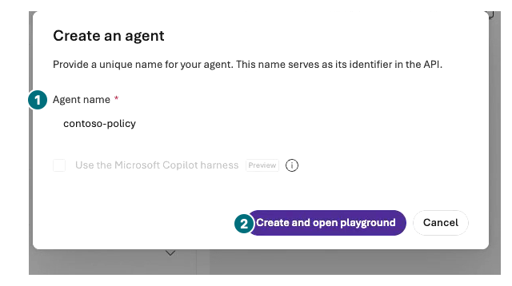
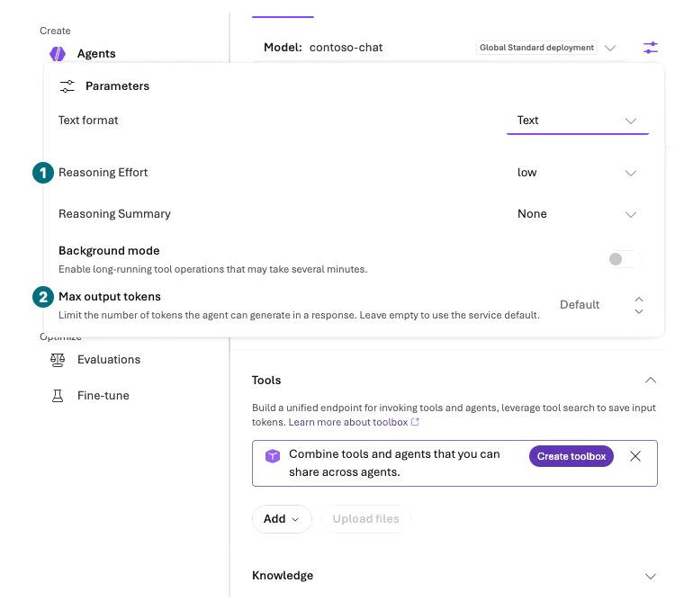
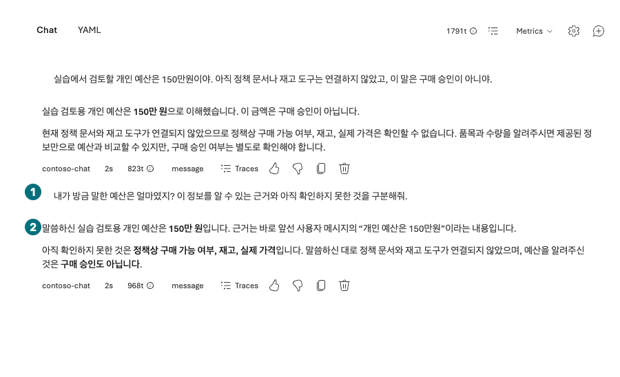
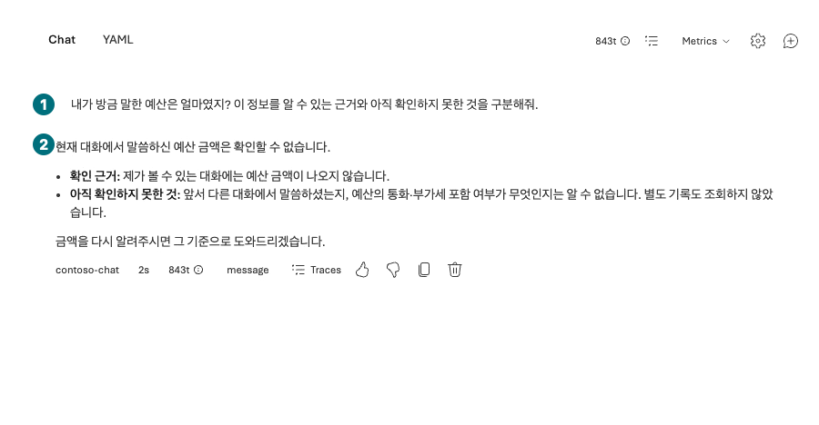

## 목표

포털에서 `contoso-policy` Prompt Agent를 만들고 Instructions와 대화 문맥의 차이를 확인합니다. 이 에이전트를 L05·L09·L10에서 계속 사용합니다.

<div class="lab-brief" markdown="1">

**진행 방식:** 포털 직접 실습, Chat 전송 최대 3회.

**먼저 할 일:** 내 프로젝트에서 `Build → Agents`를 엽니다.

**확인할 결과:** 이름·모델·지시문을 저장한 에이전트와 서로 다른 대화의 응답이 있습니다.

</div>

## 개념과 실습 지도

**경험할 기능:** Prompt Agent, Instructions, 저장된 버전, Conversation.

**무엇이며 왜 중요한가요?** Instructions는 매 요청에 적용할 행동 규칙이고 Conversation은 이번 대화의 맥락입니다. 둘 다 실제 데이터 접근권한이나 구매 승인 자체는 아닙니다.

**어떻게 사용하나요?** 같은 질문을 같은 대화·새 대화에서 비교하고 저장된 설정을 다시 엽니다.

**어디서 실행하나요?** Microsoft Foundry → Build → Agents → 에이전트 편집 화면과 Chat.

## 준비

L02의 모델이 준비되어 있어야 합니다. [기본 지시문 v2](../data/prompts/agent-v2.txt)를 브라우저에서 열고 전체 내용을 복사합니다. 아직 정책 파일과 업무 도구를 연결하지 않으므로 정책 수치·재고를 아는 것처럼 답하면 실패입니다.

## 실행

### 1. 에이전트 생성과 설정 저장

<div class="screen-step" markdown="1">

**Save as agent: 이름을 붙이고 편집 화면 열기**



**1 이름:** `contoso-policy`. **2 생성:** 같은 내 agent가 없을 때 한 번만 누릅니다. Copilot harness 선택란은 사용하지 않습니다.

[자막 영상 02 · 01:39](../downloads/portal/index.html?clip=02-model-agent&t=99&lang=ko#02-model-agent)

</div>

| 단계 | 클릭·입력 | 확인할 화면·값 | 실패하면 |
| --- | --- | --- | --- |
| 1 | 프로젝트를 확인하고 `Build → Agents → New agent → Build an agent`를 누릅니다. L03 화면에서는 `Save as agent`로 시작합니다. | Prompt Agent 생성 화면 또는 `Create an agent` 창입니다. | Code an agent·외부 agent 연결이 아닌 기본 Prompt Agent를 사용합니다. |
| 2 | Agent name에 `contoso-policy`를 입력하고 Text 모드를 유지한 뒤 `Create agent and open playground`를 한 번 누릅니다. Save as agent 경로의 버튼은 `Create and open playground`입니다. | 내 프로젝트의 version 1 편집 화면이 열립니다. | 이미 내 에이전트가 있으면 새로 만들지 않고 엽니다. Voice·Copilot harness는 고르지 않습니다. |
| 3 | Model에서 `contoso-chat`을 선택합니다. | L02의 실제 배포입니다. | 카탈로그 모델 이름과 배포 이름을 혼동하지 않습니다. |
| 4 | Instructions에 위 v2 파일의 **전체 내용**을 붙여 넣습니다. | 첫 줄과 마지막 줄이 파일과 일치합니다. | 일부만 복사했으면 전송 전 바로잡습니다. |
| 5 | Tools를 다시 읽습니다. 기본 Web search toolbox가 자동 추가됐다면 `Actions for <이름> toolbox → Remove`로 agent 연결에서 뺍니다. | 도구 목록이 비어 있습니다. Knowledge·Memory도 없습니다. | 모델 playground에서 제거했어도 새 agent에서 재확인합니다. 연결 제거는 toolbox 자원 삭제가 아닙니다. |
| 6 | `Parameters`의 `Max output tokens`를 `2048`, 지원되는 Reasoning Effort를 `low`로 두고 `Tab → Esc` 후 `Save`를 한 번 누릅니다. | 새 숫자 version·저장 완료를 확인합니다. 모델 playground의 한도가 자동 복사된다고 가정하지 않습니다. | 실패하면 Chat을 보내지 않습니다. Publish나 Improve instructions는 누르지 않습니다. |

<div class="screen-step" markdown="1">

**Instructions: 지시문 파일의 처음과 끝 확인**


**1 Model:** `contoso-chat`. **2 Instructions:** v2 파일 전체를 붙여 넣습니다. 일부만 보이는 입력칸은 스크롤해 마지막 줄도 대조하고 Save합니다.

[자막 영상 02 · 02:04.5](../downloads/portal/index.html?clip=02-model-agent&t=124.5&lang=ko#02-model-agent)

</div>

<div class="screen-step" markdown="1">

**Parameters: Default를 설정 완료로 오인하지 않기**



**1 Reasoning Effort:** 지원되면 `low`. **2 Max output tokens:** 이 장면은 아직 `Default`입니다. 내 실습에서는 `2048` 입력 → Tab → Esc → Save 후 다시 확인합니다.

[자막 영상 02 · 01:53](../downloads/portal/index.html?clip=02-model-agent&t=113&lang=ko#02-model-agent)

</div>

<div class="screen-step" markdown="1">

**Save 다음: 저장된 숫자 version 확인**


**1 Version:** 이번 녹화의 저장 결과는 `2`입니다. 내 화면의 실제 숫자를 적습니다. **2 Save:** Instructions·출력 설정을 바꾼 뒤 저장합니다. **3 Publish:** 이번 Chat 실습에는 누르지 않습니다.

[자막 영상 02 · 02:04.5](../downloads/portal/index.html?clip=02-model-agent&t=124.5&lang=ko#02-model-agent)

</div>

### 2. 같은 대화와 새 대화 비교

| 단계 | 클릭·입력 | 확인할 화면·값 | 실패하면 |
| --- | --- | --- | --- |
| 1 | `Chat`에서 첫 질문을 1회 보냅니다. | 아래 예산을 이번 대화의 사용자 진술로 다룹니다. | 정책이나 실제 승인이 확보됐다고 말하면 원문을 실패로 남깁니다. |
| 2 | 같은 대화에 두 번째 질문을 1회 보냅니다. | 앞선 예산을 기억하되 실제 구매를 하지 않습니다. | 기대 답변으로 수정하지 말고 실제 응답을 보관합니다. |
| 3 | `New conversation` 또는 `New chat`을 누른 뒤 두 번째 질문을 1회 보냅니다. | 이전 대화 예산을 모른다고 하거나 확인을 요청합니다. | 같은 Conversation인지 ID/시각을 대조합니다. |

첫 번째 입력:

```prompt
실습에서 검토할 개인 예산은 150만원이야. 아직 정책 문서나 재고 도구는 연결하지 않았고, 이 말은 구매 승인이 아니야.
```

두 번째 입력:

```prompt
내가 방금 말한 예산은 얼마였지? 이 정보를 알 수 있는 근거와 아직 확인하지 못한 것을 구분해줘.
```

<div class="screen-step" markdown="1">

**같은 대화: 앞선 사용자 진술을 근거로 답함**



**1 후속 질문:** 첫 예산 메시지와 같은 대화입니다. **2 답변:** 150만원의 근거는 사용자 진술이며 정책·재고·구매 승인은 아직 없다고 구분했는지 읽습니다.

[자막 영상 02 · 02:43](../downloads/portal/index.html?clip=02-model-agent&t=163&lang=ko#02-model-agent)

</div>

<div class="screen-step" markdown="1">

**응답 아래: Traces와 복사 위치**


**1 Traces:** 이 응답의 실행 기록을 엽니다. **2 복사:** 내 실제 답변 원문을 보관할 때 씁니다. 사진 속 모델·토큰은 이 녹화의 값이며 내 측정값으로 옮기지 않습니다.

[자막 영상 02 · 02:43](../downloads/portal/index.html?clip=02-model-agent&t=163&lang=ko#02-model-agent)

</div>

<div class="screen-step" markdown="1">

**새 대화: 같은 질문이어도 예산을 모름**



**1 질문:** 예산을 다시 제공하지 않았습니다. **2 답변:** 현재 대화에 금액이 없다고 설명합니다. 이것은 장기 Memory 회수 시험이 아닙니다.

[자막 영상 02 · 03:01](../downloads/portal/index.html?clip=02-model-agent&t=181&lang=ko#02-model-agent)

</div>

### 다시 열어 저장 확인

`Build → Agents` 목록으로 돌아갔다가 `contoso-policy`를 다시 엽니다. Instructions와 모델이 유지되는지 확인합니다. 화면에 표시된 숫자 버전과 대화 ID는 다른 식별자입니다. 새 Chat을 만드는 것과 장기 Memory를 저장하는 것도 다릅니다.

`Build → Models`도 다시 열어 자동 생성된 의존성을 확인합니다. 실제 녹화 환경에서는 agent 생성 무렵 `text-embedding-ada-002` 배포가 추가로 관찰됐습니다. Activity log로 원인을 확정하지 않았으며 직접 embedding 배포·호출을 수행한 증거로 쓰지 않습니다. 자동 생성된 배포와 연결을 뺀 toolbox도 삭제된 것이 아니므로 실제 자원·비용 기록에 남깁니다.

## 성공 기준

`contoso-policy`가 저장되어 있고 모델·지시문이 맞습니다. 같은 대화와 새 대화의 결과를 원문으로 비교했습니다. 도구가 없으므로 “재고 8개 확인”, “주문 완료” 같은 실행 주장을 인정하지 않았습니다.

## 막혔을 때

에이전트 생성은 되지만 호출이 403이면 관리-plane 생성 권한과 데이터-plane 호출 권한을 나누어 확인합니다. 키를 붙여 넣거나 공용 접근을 켜서 해결하지 않습니다. 자동 저장 표시가 없다면 목록으로 돌아가기 전에 저장 상태를 확인합니다.

## 정리

에이전트를 삭제하지 않습니다. 다음 장에서 같은 대상에 정책 3파일을 연결합니다. 대화 원문에는 합성 내용만 보관합니다.

<div class="lab-handoff" markdown="1">

**이 장에서 남길 것:** `contoso-policy`의 프로젝트·이름·표시된 버전, 지시문 v2, 같은/새 대화의 응답 차이.

**다음:** [L05 정책 파일로 답하기](#l05).

</div>
