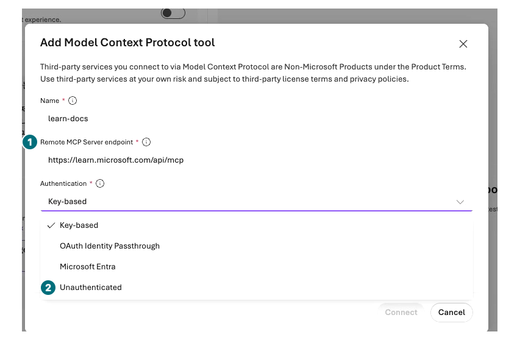
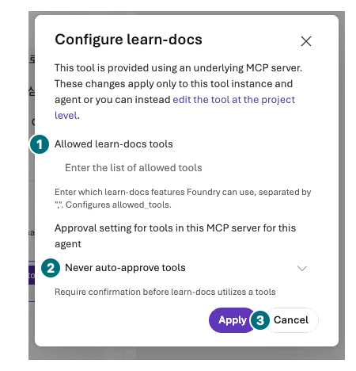

## 목표

포털에서 실제 읽기 전용 원격 도구를 조건부로 연결하고, 연결 저장·호출 승인·실행 성공을 각각 확인합니다. 가짜 구매 API나 localhost 주소는 사용하지 않습니다.

<div class="lab-brief" markdown="1">

**진행 방식:** 원격 MCP 조건부 실습. OpenAPI·Toolbox·Skills는 구성 화면 관찰입니다.

**먼저 할 일:** 조직이 공개 Microsoft Learn MCP 서버 사용을 허용하는지 확인합니다.

**확인할 결과:** 허용 도구·인증 설정과 실제 호출 기록 또는 구체적인 차단 사유.

</div>

## 개념과 실습 지도

**경험할 기능:** MCP server, tool allowlist, 호출 승인, OpenAPI 연결 조건.

**무엇이며 왜 중요한가요?** MCP와 OpenAPI는 연결 계약이지 서버·권한을 자동으로 만드는 기능이 아닙니다. 연결이 저장되어도 호출 실패가 날 수 있습니다.

**어떻게 사용하나요?** 공개 문서 검색만 허용하고 한 질문의 실제 도구 인수·결과를 확인합니다.

**어디서 실행하나요?** Microsoft Foundry → Build → Agents → 시험용 에이전트 → Tools → Add → Add tools → Custom.

## 준비

L05 정책 에이전트의 평가 조건을 바꾸지 않도록 L04 방식으로 별도 `contoso-docs` Prompt Agent를 만듭니다. 모델은 같은 `contoso-chat`, Instructions는 “Microsoft Learn의 공개 문서만 검색하고 출처를 제시한다. 구매·주문 작업은 하지 않는다.”로 저장합니다. 공개 endpoint는 `https://learn.microsoft.com/api/mcp`입니다. 조직 승인 없이 임의 외부 서버를 추가하지 않습니다.

이번 녹화는 **연결·설정 화면 관찰까지**입니다. 정책 agent의 저장하지 않은 초안에서 공식 endpoint의 익명 Connect를 1회 확인한 뒤 설정을 취소하고 다시 열어 File search만 남은 version 4를 확인했습니다. 프로젝트의 `learn-docs` 도구는 보존했지만 MCP 검색 호출은 **0회**입니다. 아래 호출 단계는 별도 시험 agent·모델 지원·조직 승인이 준비된 경우에만 수행합니다.

## 실행

<div class="screen-step" markdown="1">

**연결 폼: 공식 endpoint와 인증 유형 확인**



**1 Endpoint:** `https://learn.microsoft.com/api/mcp`. **2 Unauthenticated:** 공식 공개 서버용 선택입니다. 화면은 아직 기본 Key-based가 선택된 중간 상태이므로 내 선택을 바꾸고 재확인합니다.

[자막 영상 05 · 00:24](../downloads/portal/index.html?clip=05-inspection-retention&t=24&lang=ko#05-inspection-retention)

</div>

| 단계 | 클릭·입력 | 확인할 화면·값 | 실패하면 |
| --- | --- | --- | --- |
| 1 | `contoso-docs → Tools → Add → Add tools`을 엽니다. | **Select a tool** 대화상자입니다. | 도구를 추가할 권한·지원 모델·지역을 확인합니다. |
| 2 | `Custom` 탭에서 `Model Context Protocol (MCP)`를 선택합니다. | 아래 Create 버튼이 활성화됩니다. | 메뉴가 없으면 미지원/차단으로 기록합니다. |
| 3 | `Create`를 눌러 **Add Model Context Protocol tool** 폼을 엽니다. | 아직 이름·endpoint·인증을 입력하는 단계입니다. | agent의 최종 Save나 검색 실행과 혼동하지 않습니다. |
| 4 | Name `learn-docs`, Remote MCP Server endpoint `https://learn.microsoft.com/api/mcp`를 입력합니다. | HTTPS 공식 Microsoft Learn 주소입니다. | 같은 이름의 기존 연결이 있으면 승인된 기존 도구를 선택하며 중복 생성하지 않습니다. |
| 5 | Authentication의 기본 Key-based 대신 **Unauthenticated**를 선택합니다. | Credential 입력이 사라지고 key/token이 필요하지 않습니다. | 인증서 경고를 우회하거나 임의 키를 넣지 않습니다. |
| 6 | `Connect`를 한 번 누르고 Tools에 추가된 `learn-docs` 이름을 클릭합니다. | **Configure learn-docs**가 열립니다. Connect는 프로젝트 도구/초안 연결이며 검색 호출 성공이 아닙니다. | 연결 실패 시 반복 제출하지 않습니다. |
| 7 | **Allowed learn-docs tools** 텍스트 상자에 정확히 `microsoft_docs_search`만 입력합니다. | `allowed_tools`가 검색 하나로 제한됩니다. | 빈 값·전체 도구 허용으로 진행하지 않습니다. |
| 8 | Approval setting을 **Never auto-approve tools**로 두고 `Apply → Save`를 누릅니다. 저장한 agent를 다시 열어 설정을 확인합니다. | 도구 호출마다 확인을 요구하는 저장된 설정입니다. | 제한·승인 설정을 확인하지 못하면 Chat을 보내지 않습니다. |
| 9 | 새 Chat에 아래 질문을 1회 보냅니다. | 검색 도구 호출 승인 요청이 나타납니다. | 요청이 없으면 실제 도구 사용 여부를 상세에서 확인합니다. |
| 10 | 서버·도구 이름·검색어를 읽고 해당 읽기 호출만 승인합니다. | tool result와 공식 문서 URL이 반환됩니다. | 다른 도구·쓰기 요청이면 거부하고 원문을 남깁니다. |
| 11 | 응답 상세에서 인수·결과·상태를 확인합니다. | 도구 호출과 최종 답변이 같은 실행에 연결됩니다. | 답변의 URL만으로 호출 성공을 판정하지 않습니다. |

```prompt
Microsoft Learn에서 Foundry Agent Service의 server-side tracing 설정 문서를 찾아줘. microsoft_docs_search만 사용하고 공식 문서 링크와 Application Insights 연결 위치를 알려줘.
```

<div class="screen-step" markdown="1">

**설정 관찰: 빈 allowlist를 저장된 제한으로 오인하지 않기**



**1 허용 도구:** 녹화에서는 비어 있습니다. 승인된 별도 실습에서만 `microsoft_docs_search`를 입력하고 재확인합니다. **2 승인:** `Never auto-approve tools`. **3 Cancel:** 이번 녹화는 설정을 취소했으며 MCP 호출은 0회입니다.

[자막 영상 05 · 01:07](../downloads/portal/index.html?clip=05-inspection-retention&t=67&lang=ko#05-inspection-retention)

</div>

<div class="screen-step" markdown="1">

**다시 열기: 정책 agent에는 File search만 유지**


**1 모델 / 2 File search:** 녹화의 저장된 정책 버전은 이 상태입니다. 프로젝트에 MCP 연결이 남는 것과 agent에 저장·호출되는 것은 다릅니다.

[자막 영상 05 · 01:36](../downloads/portal/index.html?clip=05-inspection-retention&t=96&lang=ko#05-inspection-retention)

</div>

### OpenAPI·Toolbox는 무엇이 다른가

<details class="optional-path" markdown="1">
<summary>관찰만: 다른 도구 연결 화면 열어 보기</summary>

`Tools → Add → Add tools → Custom`을 다시 열고 `OpenAPI tool` 항목을 선택합니다. 문서/schema, 실제 HTTPS 서버, 지원 인증 필드가 필요한 것을 확인한 뒤 **Cancel**합니다. 제공된 실제 서버·인증·권한·안전한 operation이 없다면 저장하지 않습니다. `example.com`이나 구매 API 예시를 실제 서비스처럼 등록하지 않습니다.

Toolbox/Skills 항목이 보이면 이름·연결·허용 도구·고정 버전·사용 권한을 확인하고 취소합니다. 화면 열람은 Toolbox 호출·Skill 실행의 증거가 아닙니다. 이 실습은 새로운 서버 배포·토큰 발급·권한 확대를 포함하지 않습니다.

</details>

## 성공 기준

호출이 가능하면 허용된 실제 `microsoft_docs_search`의 인수·결과·출처를 확인했습니다. 불가능하면 연결 저장 실패, 인증 실패, 네트워크 차단, 도구 미노출 중 원인을 적었습니다. **문서 검색 성공을 Contoso 재고 조회 성공으로 바꾸지 않습니다.**

## 막혔을 때

MCP 연결 오류는 URL → 인증 → 조직 egress 정책 → 서버 지원 순으로 확인합니다. 토큰을 화면·가이드에 붙여 넣거나 공개 네트워크를 켜서 해결하지 않습니다. 도구가 검색어를 잘못 만들었다면 실패 원문을 보존하고 무제한 재시도하지 않습니다.

## 정리

정기 호출이나 쓰기 도구를 설정하지 않습니다. 시험용 연결은 개인 기록에 남깁니다. 공유 연결을 임의 삭제하지 않습니다.

<div class="lab-handoff" markdown="1">

**이 장에서 남길 것:** 서버 URL, 허용 도구, 인증 유형, 승인 범위, 실제 호출/차단 결과. 비밀 값은 제외합니다.

**다음:** [L08 고정 12문항으로 평가하기](#l08).

</div>
