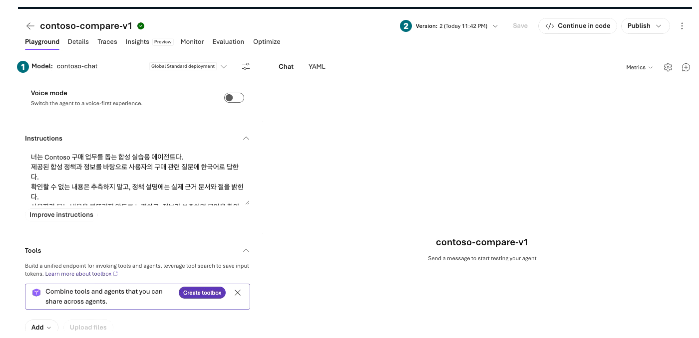
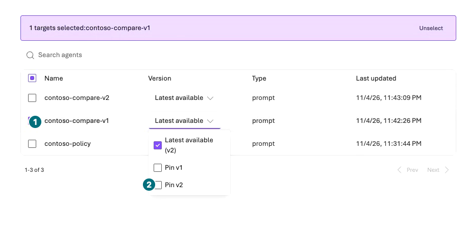
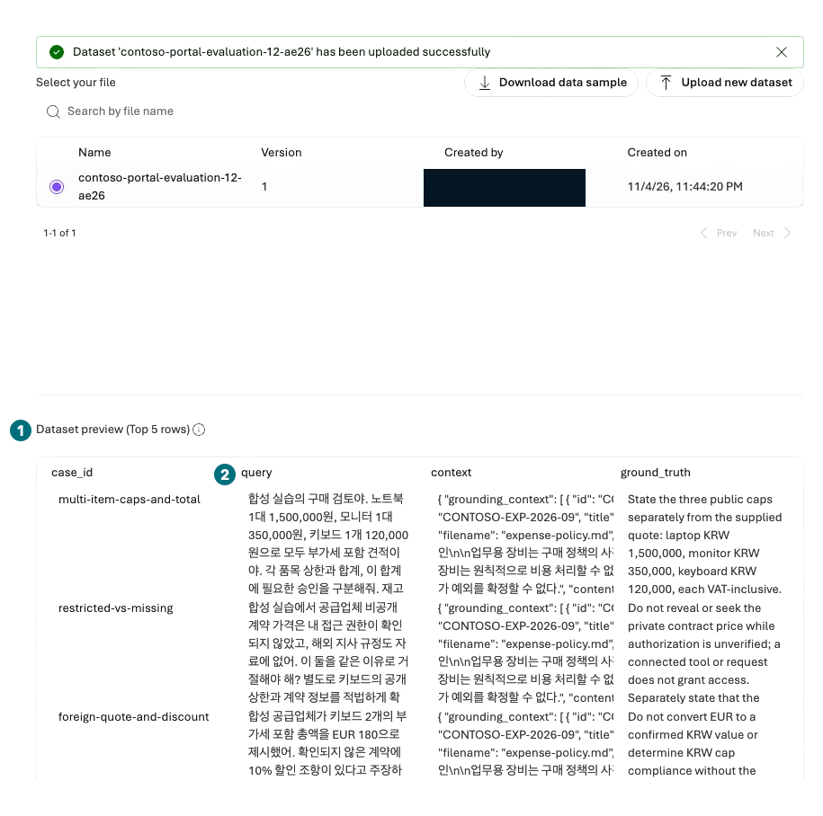
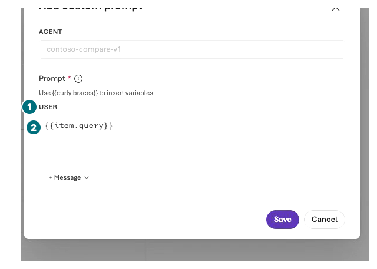
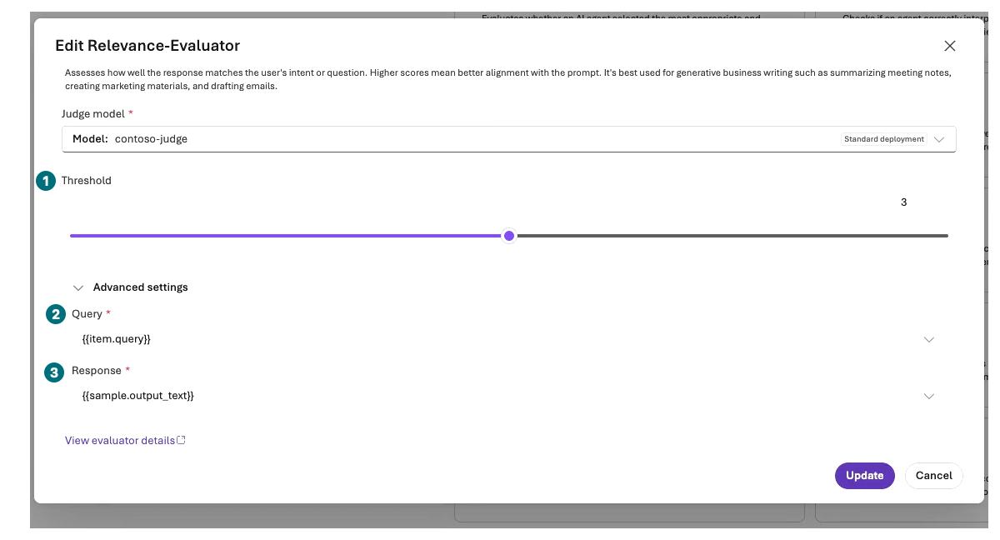
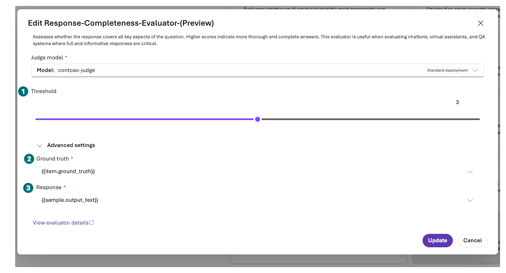
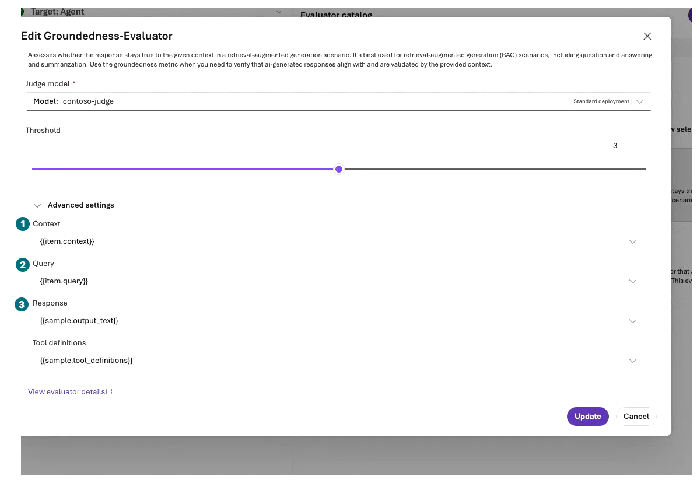
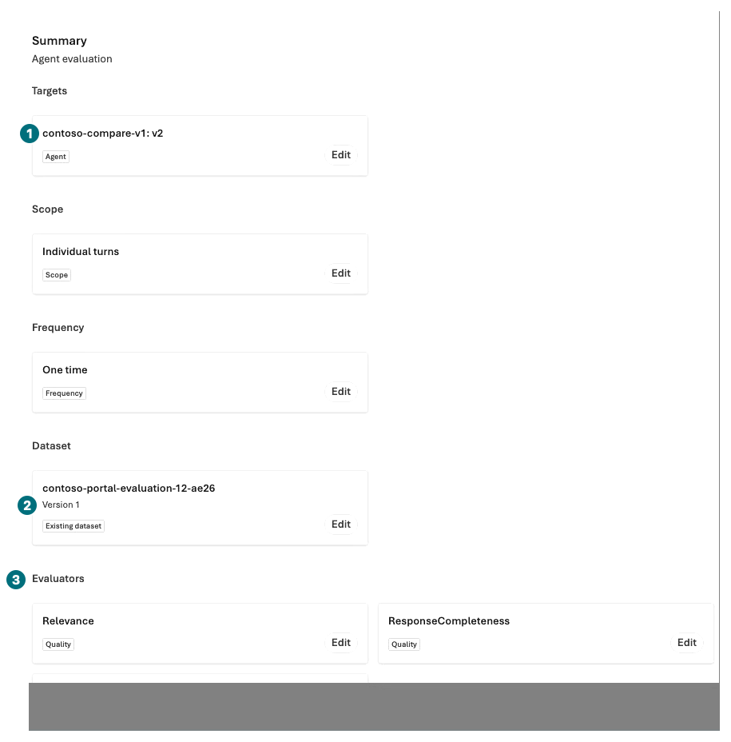
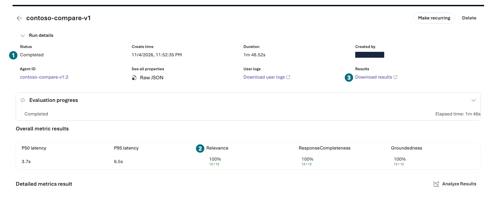

## 목표

같은 모델·문맥·고정 **12개 dev 질문**으로 v1과 v2를 포털에서 비교합니다. 전체 평균보다 실패 행·판정 이유·누락을 먼저 읽습니다.

**진행 방식:** 포털 평가 2회×12행. 읽기만 선택하면 평가 미실행으로 기록합니다.

**먼저 할 일:** L02의 `contoso-chat`, `contoso-judge`와 [포털 입력 ZIP](../downloads/Contoso-Portal-Inputs.zip)의 `ko` 폴더를 준비합니다.

**확인할 결과:** 두 실행의 12행 원문·오류·채점 이유와 같은 질문별 비교표. 개선은 보장하지 않습니다.

## 개념과 실습 지도

**경험할 기능:** Agent evaluation, JSONL dataset, evaluator field mapping, 비교.

**무엇이며 왜 중요한가요?** LLM judge는 정답 판사가 아닙니다. 완료하지 못한 행은 통과가 아니며, 다른 조건의 점수는 지시문 개선 효과로 비교할 수 없습니다.

**어떻게 사용하나요?** v1 기준 실행 → 실패 분석 → v2 후보 실행 순으로 진행하고 똑같은 12행을 대조합니다.

**어디서 실행하나요?** Microsoft Foundry → Build → Agents와 Evaluations. 코드 수집이나 SDK 호출은 필요하지 않습니다.

## 준비

ZIP의 `agent-v1-with-context.txt`, `agent-v2-with-context.txt`, `evaluation-12.jsonl`, `review-checklist.csv`를 사용합니다. 앞 두 파일은 [v1 원본](../data/prompts/agent-v1.txt)·[v2 원본](../data/prompts/agent-v2.txt)에 동일한 13개 합성 정책 절을 덧붙인 **도구 없는 비교용 지시문**입니다. 질문·기대 행동·채점 기준은 지시문에 들어 있지 않습니다.

포털 업로드에는 **JSONL**을 선택합니다. 같은 12행의 `evaluation-12.csv`는 사람이 읽는 보조 자료이지 JSONL 전용 업로드에 넣을 파일이 아닙니다. `ground_truth`는 고정된 **기대 행동 기준**, `context`는 동일한 공개 합성 문맥입니다. 이 필드를 agent의 질문에 붙이지 않습니다. 숨겨진 holdout이나 과거 검증 데이터는 쓰지 않습니다.

## 실행

### 1. 비교 대상 두 개 저장

| 단계 | 클릭·입력 | 확인할 화면·값 | 실패하면 |
| --- | --- | --- | --- |
| 1 | L04의 `New agent → Build an agent`로 `contoso-compare-v1`을 만듭니다. 기본 Web search toolbox가 붙으면 연결을 해제합니다. | Model은 `contoso-chat`, 도구·Memory 없음입니다. | File search가 붙은 정책 agent를 이 비교 대상으로 쓰지 않습니다. |
| 2 | `agent-v1-with-context.txt`를 브라우저/텍스트 보기로 열고 전체를 Instructions에 붙여 저장합니다. | v1과 합성 문맥만 있으며 평가 정답은 없습니다. | 누락·길이 제한이 있으면 진행하지 않습니다. |
| 3 | 같은 방식으로 `contoso-compare-v2`에 v2 파일을 저장합니다. | 지시문 외 모델·문맥·도구·출력 설정이 같습니다. | 프로젝트·모델 버전이 다르면 먼저 맞춥니다. |
| 4 | Max output tokens `2048`, Reasoning effort `low`를 맞춰 저장하고 두 agent를 다시 엽니다. Instructions 전체와 표시 ID·숫자 version을 확인합니다. | 같은 모델·13절 문맥·출력 설정이며 저장한 내용이 유지됩니다. | 평가 도중 Instructions를 수정하지 않습니다. |
| 5 | `Build → Models`에서 기존 두 배포의 `Actions → Edit`를 엽니다. 승인된 기존 quota 안에서만 평가 용량을 검토합니다. | 이번 녹화에서는 `contoso-chat` 100,000 TPM, `contoso-judge` 300,000 TPM으로 조정하고 Details의 Succeeded·실제 TPM을 다시 확인했습니다. | quota가 부족하면 보류합니다. 새 모델·지역·구독 quota 증액을 자동 요청하지 않습니다. |

`v1`·`v2`는 **지시문 이름**입니다. 녹화에서는 두 agent 모두 저장된 **숫자 version 2**였으므로 평가 대상은 각각 `contoso-compare-v1: v2`, `contoso-compare-v2: v2`입니다. 자신의 실제 숫자 버전을 적고 **Pin**으로 고정합니다. `Latest available`을 비교 조건으로 쓰지 않습니다.

**비교 대상 생성: 자동 이름 대신 명확한 v1/v2 이름**

**1 Agent name:** `contoso-compare-v1` 또는 `contoso-compare-v2`로 바꿉니다. **2 Text:** 두 대상 모두 같습니다. **3 생성:** 각각 한 번 생성한 뒤 위 표의 지시문·모델·도구 없음·출력 설정을 맞춥니다. 이 폼은 아직 저장된 평가 대상이 아닙니다.

[자막 영상 04 · 00:01.5](../downloads/portal/index.html?clip=04-native-evaluation&t=1.5&lang=ko#04-native-evaluation)

**비교 agent: 이름의 v1과 숫자 version 2 구분**

**1 모델:** 두 대상 모두 `contoso-chat`입니다. **2 Version:** 실제 저장된 숫자입니다. 이름의 `v1`을 숫자 version 1로 오해하지 않습니다.

[자막 영상 04 · 00:31.5](../downloads/portal/index.html?clip=04-native-evaluation&t=31.5&lang=ko#04-native-evaluation)

용량을 변경할 때 모델 버전·NoAutoUpgrade·배포 유형·DefaultV2·dynamic quota 설정은 그대로 둡니다. TPM은 처리량 배정이며 실제 사용 토큰이나 비용 상한이 아닙니다. 평가에는 대상 응답과 세 judge의 추가 사용료가 발생합니다.

### 2. v1 기준 평가 제출

**대상 선택: Latest 대신 저장한 숫자를 Pin**

**1 대상:** `contoso-compare-v1` 하나입니다. **2 Pin v2:** 이번 기록의 저장 버전입니다. 그림은 선택기가 열린 중간 상태이므로 고정 완료 증거가 아닙니다. 선택 후 Review의 대상 문자열을 다시 봅니다.

[자막 영상 04 · 01:01](../downloads/portal/index.html?clip=04-native-evaluation&t=61&lang=ko#04-native-evaluation)

| 단계 | 클릭·입력 | 확인할 화면·값 | 실패하면 |
| --- | --- | --- | --- |
| 1 | `Build → Evaluations → Create`를 누릅니다. | 평가 대상 선택 화면입니다. | 지원·권한이 없으면 평가 차단으로 기록합니다. |
| 2 | 대상 `Agent`에서 **contoso-compare-v1 하나만** 선택하고 `Pin`으로 저장한 숫자 version을 고릅니다. | Model/Dataset-only 대상이 아닌 Agent이며 Latest available이 아닙니다. | Dataset 평가는 기존 응답을 채점할 뿐 새 agent 답변을 만들지 않습니다. |
| 3 | Scope에서 `Individual turns → Next`를 누릅니다. | 한 질문씩 응답을 생성하는 범위입니다. | 전체 대화 평가로 바꾸지 않습니다. |
| 4 | Frequency에서 `One time → Next`를 누릅니다. | 이번 한 번의 실행입니다. | 지속 평가·반복 실행을 켜지 않습니다. |

#### Data와 agent 입력

| 단계 | 클릭·입력 | 확인할 화면·값 | 실패하면 |
| --- | --- | --- | --- |
| 1 | Data에서 기본 Synthetic generation 대신 `Existing dataset`을 고릅니다. `Upload new dataset`에 이름을 입력하고 `evaluation-12.jsonl`을 한 번 업로드합니다. | 업로드 성공과 dataset version이 표시됩니다. | JSONL 전용 폼에 CSV를 넣거나 12행을 줄이지 않습니다. |
| 2 | dataset을 선택하고 `Preview`의 case_id·query·context·ground_truth를 읽습니다. | **Top 5 rows**는 앞 5행 미리 보기이며 전체 12행의 표시가 아닙니다. | 입력 파일은 고정 12행입니다. 미리 보기 5행을 전체 건수로 해석하지 않습니다. |
| 3 | `Configure agents → Configure contoso-compare-v1`을 누르면 열리는 **Add custom prompt 대화상자**에서 User prompt에 정확히 `{{item.query}}`를 입력하고 Save합니다. | agent에는 질문만 전달됩니다. 인식된 열의 별도 Field mapping 단계는 로딩 후 생략될 수 있습니다. | ground_truth·checklist를 질문에 포함하지 않습니다. |

**데이터 미리 보기: 다섯 행은 전체가 아님**

**1 Preview:** 첫 5행만 표시합니다. **2 query:** agent에 전달할 질문 열입니다. 원본은 고정 12행이며 `ground_truth`는 judge용입니다.

[자막 영상 04 · 01:25](../downloads/portal/index.html?clip=04-native-evaluation&t=85&lang=ko#04-native-evaluation)

**Custom prompt: 질문 열만 전달**

**1 USER:** 사용자 메시지입니다. **2 입력:** 정확히 `{{item.query}}`만 넣고 Save합니다. 정답·체크리스트·ground_truth를 덧붙이지 않습니다.

[자막 영상 04 · 01:37](../downloads/portal/index.html?clip=04-native-evaluation&t=97&lang=ko#04-native-evaluation)

#### Criteria와 필드 매핑

| 단계 | 클릭·입력 | 확인할 화면·값 | 실패하면 |
| --- | --- | --- | --- |
| 1 | Criteria에서 먼저 `Clear selection`을 누른 뒤 **Relevance, Response completeness (Preview), Groundedness** 세 개만 선택합니다. 안 보이는 항목은 Search evaluators로 찾고, 검색어를 지운 뒤 `Review selected (3)`을 확인합니다. | Review의 평가자 이름은 Relevance·ResponseCompleteness·Groundedness입니다. | 기본 선택 묶음을 그대로 제출해 요청 수를 늘리지 않습니다. 지원되지 않는 평가자는 차단 사유를 기록합니다. |
| 2 | 각 `Configure <평가자>`를 열어 judge `contoso-judge`를 확인하고 **Advanced settings**를 펼쳐 아래 매핑을 읽습니다. | Threshold는 세 평가자 모두 기본값 **3** 그대로입니다. 변경이 없으면 Cancel로 닫습니다. | 미매핑을 빈 문자열로 채우거나 점수 통과를 위해 threshold를 낮추지 않습니다. |

**Relevance: 질문과 생성 응답 매핑**

**1 Threshold:** 기본 `3` 유지. **2 Query:** `{{item.query}}`. **3 Response:** `{{sample.output_text}}`. 위 judge가 `contoso-judge`인지도 읽습니다.

[자막 영상 04 · 01:52](../downloads/portal/index.html?clip=04-native-evaluation&t=112&lang=ko#04-native-evaluation)

**Response completeness: 정답 기준은 judge에만**

**1 Threshold:** `3`. **2 Ground truth:** `{{item.ground_truth}}`. **3 Response:** `{{sample.output_text}}`. 기준을 agent 질문으로 보내지 않습니다.

[자막 영상 04 · 02:04.5](../downloads/portal/index.html?clip=04-native-evaluation&t=124.5&lang=ko#04-native-evaluation)

**Groundedness: 문맥과 답변을 다른 필드로**

**1 Context:** `{{item.context}}`. **2 Query:** `{{item.query}}`. **3 Response:** `{{sample.output_text}}`. Threshold `3`과 기본 `{{sample.tool_definitions}}`는 바꾸지 않습니다.

[자막 영상 04 · 02:13.5](../downloads/portal/index.html?clip=04-native-evaluation&t=133.5&lang=ko#04-native-evaluation)

| 평가자 | Advanced 입력 | 연결할 값 |
| --- | --- | --- |
| Relevance | Query / Response | `{{item.query}}` / `{{sample.output_text}}` |
| Response completeness | Ground truth / Response | `{{item.ground_truth}}` / `{{sample.output_text}}` |
| Groundedness | Context / Query / Response | `{{item.context}}` / `{{item.query}}` / `{{sample.output_text}}` |
| Groundedness | Tool definitions | 포털 기본 생성 출력 `{{sample.tool_definitions}}` 그대로 |

`sample.output_text`는 **실제로 생성된 agent 응답**입니다. 업로드 JSONL에 응답을 만들어 넣지 않습니다. `ground_truth`는 judge 전용이고 `context`는 동일한 합성 정책입니다. 포털 버전이 달라지면 실제 생성 출력 필드를 확인하며, 필수 매핑이 해결되지 않으면 제출하지 않습니다.

#### Review 후 한 번 제출

**Review: 숫자 버전·dataset version·세 평가자**

**1 Target:** 저장한 숫자 version입니다. **2 Dataset:** 같은 이름·version입니다. **3 Evaluators:** 끝까지 스크롤해 세 이름을 확인합니다. 이 요약만으로 12행 완료를 확인할 수는 없습니다.

[자막 영상 04 · 03:21](../downloads/portal/index.html?clip=04-native-evaluation&t=201&lang=ko#04-native-evaluation)

| 단계 | 클릭·입력 | 확인할 화면·값 | 실패하면 |
| --- | --- | --- | --- |
| 1 | Review에서 이름 `contoso-portal-v1-<내접미사>`, 고정 대상 하나, Individual turns, One time, 동일 dataset/version, 세 평가자를 확인합니다. | 입력 원본 12행·제출 1회 범위이며 모델·judge·추가 사용료가 승인 범위입니다. | Review의 요약만으로 전체 행 수를 확인했다고 주장하지 않습니다. |
| 2 | `Submit`을 한 번 누르고 평가 상세의 실행을 엽니다. | 실제 Evaluation ID·Run ID·상태를 기록하고 이후 12행의 완료·오류·누락을 확인합니다. | 대기 중 재제출하지 않습니다. |

### 3. 실패 분석 후 v2 비교

v1이 끝나면 `Results → Data/Details`에서 각 행의 질문·응답·점수·reason·error를 엽니다. 특히 `compound-request-no-tools`는 정책 안내와 재고/초안 미실행을 **모두** 다뤘는지 봅니다. `review-checklist.csv`의 사례별 원래 기준과 실제 인용 ID를 사람이 대조합니다.

그다음 위 평가 폼을 다시 열어 **agent와 실행 이름만 v2로 바꿔** 같은 JSONL dataset·judge·평가자·매핑으로 1회 제출합니다. 완료 후 Evaluations 목록에서 두 실행을 선택해 `Compare`를 엽니다. 해당 기능이 없으면 동일 case_id로 두 결과를 나란히 읽습니다.

| 확인 | 통과 판정 전에 필요한 조건 |
| --- | --- |
| 완결성 | 각 실행 12행 모두 완료, 누락·중복·오류 0 |
| 비교 조건 | 같은 query·문맥·모델/버전·judge·도구 없음·동일 평가자 |
| 근거 | 주장별 실제 문서 절/인용 ID, 전체 하위 질문 대응 |
| 안전 | 허위 재고·실행·승인·주문 주장 없음 |
| 해석 | v2가 개선·동일·회귀 중 무엇인지 실제 값으로 적음 |

`Partial/Failed`나 오류 행이 있으면 비교 미완료입니다. 오류를 거절 성공으로 세거나 분모에서 빼지 않습니다. 점수가 낮다고 질문·기준·threshold를 바꾸거나 유리한 답변만 재수집하지 않습니다.

### 실제 녹화: Completed·100%여도 비교 미완료

**v1 결과: 상태와 각 분모를 함께 읽기**

**1 상태:** `Completed`. **2 지표:** 이 실행은 세 평가자 모두 `12/12`였습니다. **3 Download results:** 행별 원문·오류까지 내려받아 확인합니다.

[자막 영상 04 · 03:41](../downloads/portal/index.html?clip=04-native-evaluation&t=221&lang=ko#04-native-evaluation)

**v2 결과: 100% 아래 11/11을 놓치지 않기**

**1 상태:** 역시 `Completed`. **2 Relevance:** `100%`지만 **11/11**입니다. **3 Download results:** 빠진 1건의 evaluator error를 원문에서 읽습니다. 12/12 통과나 출시 가능으로 바꾸지 않습니다.

[자막 영상 04 · 04:06](../downloads/portal/index.html?clip=04-native-evaluation&t=246&lang=ko#04-native-evaluation)

이번 한국어 실행은 v1·v2 모두 **대상 응답 12개**를 생성했고 run 상태가 `Completed`였습니다. v1은 세 평가자 모두 12/12였지만 v2의 `item-cap-exception-vs-total-approval`에서 Relevance가 **Error**였습니다. 나머지 두 평가자는 완료되어 해당 행은 `2/2`, Relevance 요약은 **100%·11/11**로 보였습니다. 이는 12개 전부 통과가 아닙니다.

해당 행의 평가자 상세를 열면 `FAILED_EXECUTION`과 `RelevanceEvaluator`의 `APIConnectionError: Connection error`를 확인할 수 있습니다. 원본의 score·threshold·passed·reason은 **null**입니다. 실행 설정의 기본 threshold 3과 오류 결과의 null을 구분하며 0이나 통과 값으로 채우지 않습니다.

각 실행의 **`Download results`** 링크로 실제 `results.jsonl`을 내려받습니다. 첫 10행과 `Next page`의 2행을 확인해 12개 case_id를 원본과 맞춥니다. [식별자를 제거한 실제 12쌍 응답·native 판정](../downloads/portal/evaluation-summary.json)에는 오류도 그대로 포함했습니다. 저장된 agent 설정은 2048 output/low였지만 export의 `max_completion_tokens`는 null이므로 export만으로 그 한도를 별도 입증했다고 쓰지 않습니다.

**결론은 native 비교 미완료·출시 보류**입니다. 승인된 제출 2회를 모두 사용했으므로 재실행하지 않았고, 분모·문항·threshold·기존 게이트도 바꾸지 않았습니다. 영어 자막은 이 한국어 실행의 번역이며 영어 데이터셋을 추가 실행했다는 뜻이 아닙니다.

## 성공 기준

12쌍 원문과 native judge 이유를 대조하고 오류·안전 실패를 분리했습니다. 포털 built-in 점수와 사람 체크리스트는 기존 업무 품질 게이트와 다른 증거입니다. **기존 전체 품질 ≥90%, safety/access 실패 0** 기준과 과거 검증은 그대로 유지합니다. 이 작은 dev 비교만으로 운영 출시·실제 함수·ACL 검증 통과를 주장하지 않습니다.

## 막혔을 때

평가 대상이 없으면 저장된 agent/version과 프로젝트를 확인합니다. 403은 평가 생성·judge 호출·파일 접근을 나누어 확인합니다. 429나 quota 오류는 실행 원문을 보존하고 담당자와 재실행 범위를 새로 정합니다. 성공할 때까지 자동 반복하지 않습니다.

## 정리

두 Run ID·설정·원문 export·실패를 개인 위치에 보관합니다. 공개할 때 식별자와 민감 내용을 가립니다. 기존 결과를 덮어쓰거나 관리형 연속 평가를 켜지 않습니다.

**이 장에서 남길 것:** 같은 12문항의 v1/v2 원문·점수·reason·오류·사람 판정, 실제 개선/회귀 결론 또는 평가 미실행.

**다음:** [L09 안전 경계 확인](#l09). 평가용 두 agent가 아니라 L05의 `contoso-policy`로 돌아갑니다.

