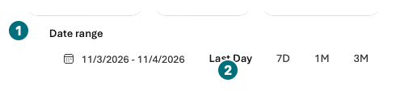
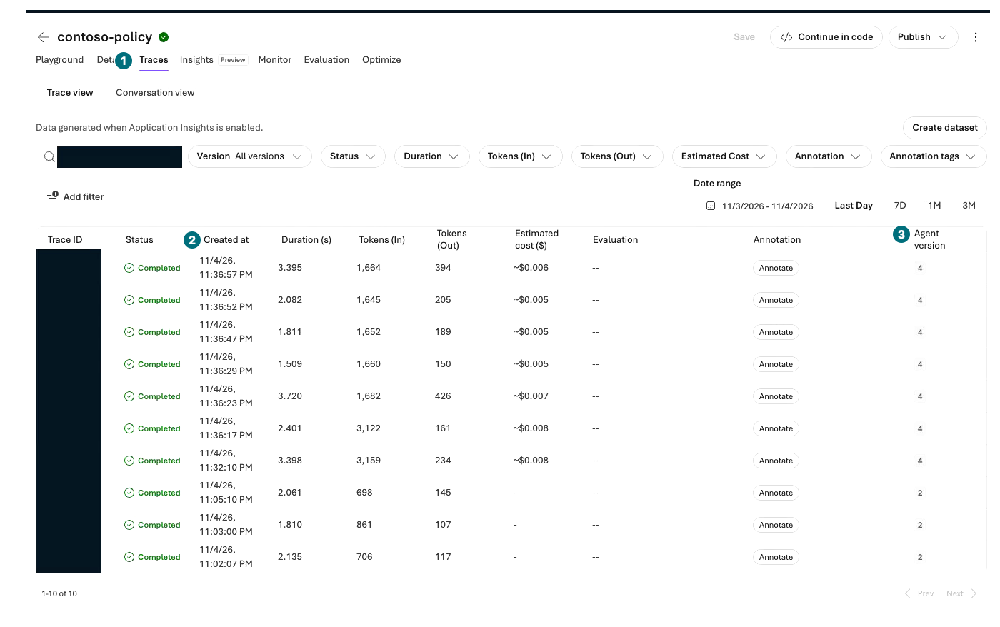
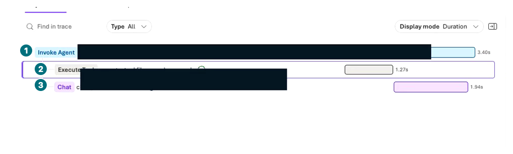
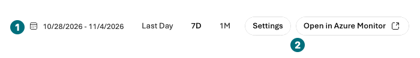

## 목표

내가 보낸 한 요청을 Traces에서 찾아 질문·검색·응답·지연·오류를 연결합니다. 관련 없는 성공 로그로 실패를 덮지 않습니다.

<div class="lab-brief" markdown="1">

**진행 방식:** 포털 직접 관찰. 연결 후 요청이 없다면 합성 질문 1회만 추가합니다.

**먼저 할 일:** L01에서 Application Insights를 연결했는지, L05/L09의 전송 시각·agent/version·표시 ID가 있는지 확인합니다.

**확인할 결과:** 같은 요청의 실제 trace/span 또는 로그 지연·권한·연결 문제의 구체적 기록.

</div>

## 개념과 실습 지도

**경험할 기능:** Server-side tracing, trace/span, Application Insights, Monitor.

**무엇이며 왜 중요한가요?** Trace는 요청의 실행 경로, span은 검색·모델 같은 구간입니다. 대시보드 평균만으로 특정 답변의 근거·함수 성공을 알 수 없습니다.

**어떻게 사용하나요?** 요청 시각·agent·ID로 범위를 좁히고 같은 실행의 부모/자식 span을 읽습니다.

**어디서 실행하나요?** Microsoft Foundry → Agents → 대상 → Traces, 필요하면 Azure portal → 연결된 Application Insights.

## 준비

로그는 **연결 후** 실행에 적용됩니다. 서버 tracing은 포털 연결로 활성화할 수 있지만 로컬 앱의 함수까지 자동 계측하지 않습니다. Trace가 보여도 원문 무제한 저장·공개 승인이 생기지 않습니다.

## 실행

### 1. 요청 시각·대상·기간 맞추기

| 단계 | 클릭·입력 | 확인할 화면·값 | 실패하면 |
| --- | --- | --- | --- |
| 1 | `Build → Agents → contoso-policy → Traces`를 엽니다. | 선택한 agent/version의 trace 화면입니다. | 다른 프로젝트·동일 이름의 agent를 확인합니다. |
| 2 | `Connect`가 보이면 L01의 Application Insights 연결을 확인합니다. | 전용 로그 자원에 연결되었습니다. | 연결할 권한·비용 승인이 없으면 차단으로 기록합니다. |
| 3 | 시간 필터를 마지막 요청 전후로 좁힙니다. | L05/L09의 시각이 범위에 포함됩니다. | 브라우저 로컬 시각과 UTC를 구분합니다. |
| 4 | 필요한 경우 아래 질문을 **연결 후 1회**만 보냅니다. | 새 전송 시각과 응답을 기록했습니다. | 이미 연결 후 요청이 있으면 추가 호출하지 않습니다. |
| 5 | 수 분 수집 지연을 기다리고 `Refresh`를 누릅니다. | 해당 시각·agent·conversation/response의 행이 나타납니다. | 빈 화면 때문에 Chat을 계속 보내지 않습니다. |

```prompt
Contoso 노트북 구매 상한과 200만원을 초과하는 주문의 승인자를 정책 문서 근거로 알려줘. 재고나 주문 실행은 하지 마.
```

<div class="screen-step" markdown="1">

**먼저 기간: 기본 Last Day를 그대로 믿지 않기**



**1 Date range:** 전송 시각이 포함되도록 맞춥니다. **2 Last Day:** 기본 빠른 범위일 뿐입니다. 로그가 비면 시간대·연결 이후 요청·수집 지연부터 확인하며 새 질문을 반복하지 않습니다.

[자막 영상 03 · 04:06](../downloads/portal/index.html?clip=03-retrieval-boundaries&t=246&lang=ko#03-retrieval-boundaries)

</div>

<div class="screen-step" markdown="1">

**Traces 목록: 시각과 agent version으로 같은 요청 찾기**



**1 Traces:** 대상 agent 안의 탭입니다. **2 Created at:** 전송 시각과 맞춥니다. **3 Agent version:** 저장된 실제 숫자와 대조한 뒤 해당 행을 엽니다.

[자막 영상 03 · 04:06](../downloads/portal/index.html?clip=03-retrieval-boundaries&t=246&lang=ko#03-retrieval-boundaries)

</div>

### 2. 같은 trace의 부모·자식 span 열기

| 단계 | 클릭·입력 | 확인할 화면·값 | 실패하면 |
| --- | --- | --- | --- |
| 1 | 같은 ID/시각의 trace를 선택하고 span 목록을 펼칩니다. | 실제 RAG 요청에는 `Invoke Agent` 아래 `Execute Tool file_search.msearch`와 `Chat gpt-4.1-2025-04-14`가 보였습니다. | 실제로 없는 span이나 업무 함수 실행을 있다고 가정하지 않습니다. |
| 2 | `Execute Tool`을 선택하고 **Input + Output**에서 queries와 반환 정책 본문을 읽습니다. | 이번에는 `procurement-policy.md` 실제 본문을 확인했습니다. 인용 preview는 열리지 않았으므로 이 trace와 업로드 원본을 대조했습니다. | 입력 질문이나 tool 이름만으로 검색 결과를 확인했다고 쓰지 않습니다. |

<div class="screen-step" markdown="1">

**Span 목록: 호출 전체 → 검색 → 생성 순서**



**1 부모 요청 / 2 검색 / 3 모델 생성:** 검색 구간을 선택하면 오른쪽 상세가 바뀝니다. 가린 식별자를 추정하지 말고 내 비공개 ID·시각으로 연결합니다. 이 그림에는 재고·주문 함수 span이 없습니다.

[자막 영상 03 · 04:18](../downloads/portal/index.html?clip=03-retrieval-boundaries&t=258&lang=ko#03-retrieval-boundaries)

</div>

<div class="screen-step" markdown="1">

**검색 span 상세: 이름이 아니라 실제 Input과 Output**


**1 Input + Output:** 검색어와 결과를 나란히 읽습니다. **2 Content source:** 실제 본문을 응답의 주장과 맞춥니다. ID 영역은 공개본에서 가렸으므로 내 요청 ID는 개인 기록으로 연결합니다.

[자막 영상 03 · 04:18](../downloads/portal/index.html?clip=03-retrieval-boundaries&t=258&lang=ko#03-retrieval-boundaries)

</div>

### 실행 하나를 읽는 표

| 관찰 | 판단 | 다음 행동 |
| --- | --- | --- |
| 검색 span에서 403 | 근거 검색이 권한 때문에 실패했을 가능성 | 연결·실행 identity·데이터 권한 점검. 모델 지식으로 대체 성공 처리 금지 |
| 모델 span이 길고 검색은 짧음 | 생성 구간 지연 후보 | 입력/출력 길이·모델·quota 점검. 동일 요청을 무제한 재전송하지 않음 |
| 함수 span이 없음 | 이 trace에는 함수 실행 증거 없음 | L06의 미실행 표시 유지 |
| 응답은 있지만 trace가 없음 | 연결·수집·읽기 권한 문제 가능 | 시각·로그 연결·보존·읽기 권한을 점검 |

### 3. Monitor의 기간을 맞추고 집계 읽기

| 단계 | 클릭·입력 | 확인할 화면·값 | 실패하면 |
| --- | --- | --- | --- |
| 1 | 대상 agent의 `Monitor → Overview/Tools`에서 같은 시간 범위를 봅니다. | 집계와 개별 trace를 구분합니다. 자동 평가·red teaming의 Configure는 누르지 않습니다. | 빈 집계·수집 지연을 0원·오류 없음으로 처리하지 않습니다. |

<div class="screen-step" markdown="1">

**Monitor 기간: trace의 날짜와 다시 대조**



**1 날짜 범위:** trace와 같은 관찰 기간으로 맞춥니다. **2 `Open in Azure Monitor`:** 별도 로그 화면의 진입점입니다. 녹화에서는 직접 로그 query를 실행하지 않았습니다.

[자막 영상 03 · 04:33](../downloads/portal/index.html?clip=03-retrieval-boundaries&t=273&lang=ko#03-retrieval-boundaries)

</div>

<div class="screen-step" markdown="1">

**Monitor: 기간·agent의 부분 집계 읽기**


**1 Estimated cost / 2 Total token usage:** 선택된 agent·기간의 값입니다. 모델 Chat·이후 평가·저장소·로그까지 포함한 전체 청구액이나 0원 증거가 아닙니다. Configure로 새 자동 작업을 만들지 않습니다.

[자막 영상 03 · 04:33](../downloads/portal/index.html?clip=03-retrieval-boundaries&t=273&lang=ko#03-retrieval-boundaries)

</div>

이번 평가 전 관찰에는 정책 agent 요청 10개·File search 호출 2개와 약 19K tokens·$0.04 추정이 표시됐습니다. 이는 해당 agent·표시 기간의 부분 집계이며 첫 모델 Chat·이후 비교 평가·파일·로그 보존 등의 **전체 Microsoft Azure 청구액이 아닙니다**. 직접 `Azure Logs` query나 client-side 함수 계측은 하지 않았습니다.

## 성공 기준

한 응답과 같은 trace를 식별하고 실제 나타난 구간·상태·지연·원인을 적었습니다. 빈 trace는 추적 성공으로 표시하지 않았습니다. 피드백·trace→dataset·연속 평가·알림 생성은 이 장에서 실행하지 않습니다.

## 막혔을 때

`Log Analytics Reader`가 필요할 수 있고 보호된 테이블은 추가 `Privileged Monitoring Data Reader`가 필요합니다. Contributor라고 무조건 로그를 읽을 수 있는 것은 아닙니다. IAM을 확대하지 말고 요청 작업과 scope를 담당자에게 전달합니다.

## 정리

계정·테넌트·구독 ID와 원문을 공개하지 않습니다. 로그 연결·보존·저장 비용은 남습니다. 캡처는 합성 질문과 필요한 최소 구간만 남깁니다.

<div class="lab-handoff" markdown="1">

**이 장에서 남길 것:** 응답↔trace 식별, 실제 span·시각·상태·실패 원인 또는 관찰 차단 사유.

**다음:** 기본 코스는 [L19 공통 마무리](#l12). 심화는 [L11 Search·Foundry IQ](#l13)부터 선택합니다.

</div>
