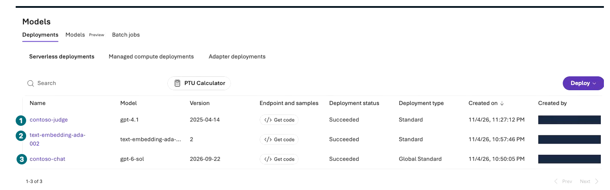
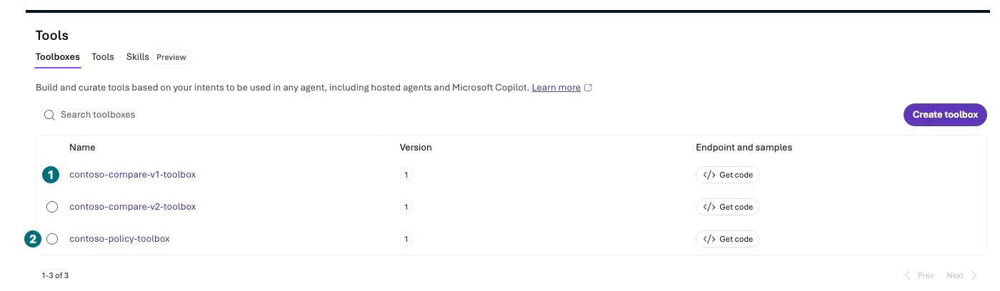
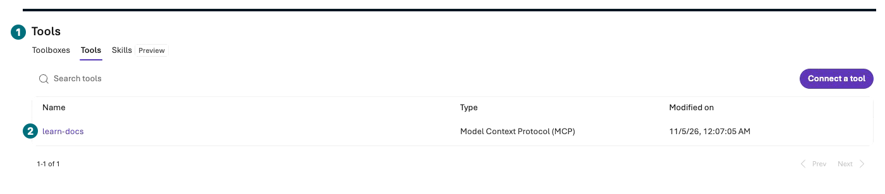

## 목표

내가 만든 자원과 자동 실행·데이터 보존·지속 비용을 포털에서 확인합니다. 기본은 보존이며 **명시적인 삭제 승인 없이 아무것도 지우지 않습니다.**

**진행 방식:** 기본은 읽기 전용 인계. 삭제·일정 중지·데이터 정리는 별도 승인 작업입니다.

**먼저 할 일:** Azure portal에서 전용 자원 그룹 이름을 다시 확인합니다.

**확인할 결과:** 실제 자원 목록, 추가 비용 가능성, 보존 담당·기한, 실행/관찰/미실행 구분.

## 개념과 실습 지도

**경험할 기능:** Resource group inventory·Cost analysis·Routines 상태·데이터 보존 점검.

**무엇이며 왜 중요한가요?** 탭을 닫아도 Search·compute·로그·파일·일정은 남습니다. Budget 알림도 지출 차단 장치가 아닙니다.

**어떻게 사용하나요?** 전용 scope의 자원을 목록으로 대조하고 비용·보존·삭제 여부를 명시적으로 인계합니다.

**어디서 실행하나요?** Azure portal의 전용 그룹·Microsoft Cost Management와 Microsoft Foundry의 내 프로젝트.

## 준비

L00에서 기록한 이름·생성 범위·상한을 준비합니다. Resource ID·구독·tenant·개인 계정은 비공개 기록에만 둡니다. 공유 결과에는 일반화한 자원 종류와 상태를 사용합니다.

## 실행

**내 범위부터: 그룹 이름·Tags를 대조**

**1 IAM / 2 Tags:** 내 소유 scope만 읽습니다. 그림의 그룹은 녹화 예시이며 내 삭제 대상으로 복사하지 않습니다. 기본 종료는 보존입니다.

[자막 영상 01 · 01:04](../downloads/portal/index.html?clip=01-environment&t=64&lang=ko#01-environment)

| 단계 | 클릭·입력 | 확인할 화면·값 | 실패하면 |
| --- | --- | --- | --- |
| 1 | Azure portal `Resource groups → 내 전용 그룹 → Overview`를 엽니다. | 정확한 그룹·구독·태그입니다. | 기본/공유 그룹이면 아무 변경 없이 멈춥니다. |
| 2 | Refresh 후 실제 자원 목록과 L00 기록을 대조합니다. | account/project·Application Insights·workspace와 추가 자원입니다. | 그룹 밖 workspace·Storage가 있는지 기록합니다. |
| 3 | Microsoft Foundry `Build → Models/Agents/Knowledge`의 내 자원을 확인합니다. | 배포·agent·3파일 저장소·연결 등 그룹 목록에 안 보이는 객체도 포함합니다. | 이름만 보고 삭제 대상을 추정하지 않습니다. |
| 4 | `Routines`에 내 일정이 있는지 읽습니다. | 기본 경로는 생성 0개입니다. | 실행 중이면 별도 정지 승인·담당자를 확보합니다. |
| 5 | Azure portal의 해당 scope `Cost Management → Cost analysis`를 엽니다. | 날짜·통화·그룹 filter와 실제/예상 비용입니다. | 0원이어도 집계 지연·남는 비용을 명시합니다. |
| 6 | Budget·alert가 있으면 읽습니다. | 알림은 hard spending cap이 아닙니다. | 새 알림·수신자·구독을 승인 없이 만들지 않습니다. |
| 7 | 파일·대화·Memory·evaluation·traces의 보존/민감정보 상태를 적습니다. | 확인한 정책과 실제 삭제 증거가 구분됩니다. | TTL만으로 삭제 완료를 주장하지 않습니다. |
| 8 | 아래 자원/증거 인계표를 작성합니다. | 무엇을 유지하고 누가 언제 검토할지 정해집니다. | 승인 없으면 `보존·비용 지속 가능`입니다. |

| 종류 | 확인할 것 | 기본 종료 상태 |
| --- | --- | --- |
| 모델 배포 | 이름·버전·SKU·TPM·호출 수 | 유지, 추가 요청 없음 |
| Agents·File search | 대상·파일 수·평가 결과·연결 | 유지, 데이터 보존 확인 |
| Application Insights·workspace | 실제 연결·수집·보존·비용 | 유지, 로그 접근 제한 |
| 조건부 Search·Storage·embedding | tier·replica·indexer 주기·보존 | 생성했으면 상시 비용 가능 |
| 조건부 Hosted·Memory·Routines | compute·항목·일정/실행 상태 | 미실행 또는 별도 승인된 정지 계획 |
| 녹화·화면 캡처 | 로그인·메일·키·사람 목록·구독 표시 | 원본 비공개, 검수본만 공유 |

**Models: 수동 배포 둘 외의 자동 의존성도 기록**

**1 Judge / 2 Embedding / 3 Chat:** 세 배포의 실제 상태를 적습니다. Embedding의 자동 생성 원인은 확정하지 않았고 Memory 성공 증거도 아닙니다. 이 화면에서는 삭제하지 않습니다.

[자막 영상 05 · 03:09](../downloads/portal/index.html?clip=05-inspection-retention&t=189&lang=ko#05-inspection-retention)

**Toolboxes: agent 연결 해제와 자원 삭제는 다름**

**1 비교용 / 2 정책용:** 중간의 v2 toolbox까지 세 행이 남아 있습니다. agent에서 연결을 뺐어도 프로젝트 객체는 별도로 남을 수 있습니다. 목록을 인계하고 임의 삭제하지 않습니다.

[자막 영상 05 · 03:25](../downloads/portal/index.html?clip=05-inspection-retention&t=205&lang=ko#05-inspection-retention)

**MCP: 미호출 연결도 잔여 목록에 포함**

**1 Tools / 2 learn-docs:** 연결은 보존됐고 검색 호출은 0회입니다. 연결 존재를 agent 저장·검색 실행으로 바꾸지 않습니다.

[자막 영상 05 · 03:45](../downloads/portal/index.html?clip=05-inspection-retention&t=225&lang=ko#05-inspection-retention)

**비용 해석: 이 그림은 전체 Cost analysis가 아님**

**1 추정 비용 / 2 토큰:** 평가 전의 일부 agent 집계입니다. 전체 청구액은 위 단계의 Microsoft Azure Cost analysis에서 내 scope·날짜로 따로 확인합니다. 비용 미노출·지연을 0원으로 기록하지 않습니다.

[자막 영상 03 · 04:33](../downloads/portal/index.html?clip=03-retrieval-boundaries&t=273&lang=ko#03-retrieval-boundaries)

### 삭제를 따로 승인받은 경우에만

그룹 전체 삭제는 **전용 그룹의 정확한 이름과 모든 하위 자원·데이터가 삭제된다는 영향**을 승인받은 뒤 수행합니다. 그룹 밖 workspace/연결, 공동 사용 자원, 보존해야 할 로그는 먼저 분리해 확인합니다.

승인된 대상에만 Azure portal `Resource group → Delete resource group`에서 확인 내용을 읽고 정확한 그룹 이름을 입력합니다. 제출 후 notification과 실제 목록 상태로 삭제 완료를 확인합니다. 이 절차를 읽은 것과 삭제 수행은 다릅니다. 현재 녹화 실행은 삭제 승인이 없어 **자원을 보존**합니다.

## 성공 기준

모든 실제 자원과 남는 비용·보존·자동 실행 상태를 인계했습니다. 실행·설정 관찰·수동 비교·미지원/차단을 구분했습니다. 새 포털 결과를 과거 SDK 검증 또는 전 모듈 Microsoft Azure 성공으로 포장하지 않았습니다.

## 막혔을 때

비용 화면 권한 부족·집계 지연은 그대로 기록합니다. 보이지 않는 자원을 삭제되었다고 판단하지 않습니다. 공유·기본 그룹·이름 불일치가 나오면 삭제하지 않습니다.

## 정리

기본 경로의 최종 상태는 **자원 보존, 추가 요청 중단, 지속 비용 가능**입니다. 공개할 HTML·Markdown·ZIP에는 검수된 합성 자료와 민감정보 없는 영상만 포함합니다.

**이 장에서 남길 것:** 실제 자원/비용/보존 인계표, 녹화 검수 상태와 승인되지 않아 수행하지 않은 작업.

**다음:** [문제 해결](#troubleshooting) 또는 [공식 출처와 실행 경계](#sources)를 확인하고 마칩니다.

