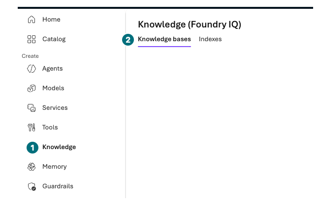

## 목표

File search와 Azure AI Search·Foundry IQ의 차이를 포털에서 확인합니다. 추가 자원 승인이 있으면 정책 3파일을 index에 넣고 같은 질문의 실제 검색 근거를 비교합니다.

<div class="lab-brief" markdown="1">

**진행 방식:** 기본은 Knowledge 화면 관찰. Search·Storage·embedding·데이터 권한이 별도 승인된 경우만 조건부 실행합니다.

**먼저 할 일:** 새 자원의 지속 비용과 추가 모델·권한 범위를 적습니다. L00의 모델 2개 예산에 embedding을 자동 추가하지 않습니다.

**확인할 결과:** 서비스·index·knowledge source의 연결과 실제 검색 결과, 또는 준비 부족에 따른 미실행.

</div>

## 개념과 실습 지도

**경험할 기능:** Index, keyword/vector/hybrid, knowledge source/base.

**무엇이며 왜 중요한가요?** File search는 작은 파일 묶음을 빠르게 연결합니다. Search는 index·검색·갱신을 관리하고 IQ는 여러 knowledge source의 검색 경로를 구성합니다. 부분 GA와 포털 Preview를 구분합니다.

**어떻게 사용하나요?** 동일한 3정책과 질문으로 실제 반환 문서를 비교합니다. 서비스 이름이나 점수 크기만 비교하지 않습니다.

**어디서 실행하나요?** Azure portal의 Storage·Azure AI Search, Microsoft Foundry의 Build → Knowledge.

## 준비

새 자원이 필요하면 **같은 전용 그룹**에 Storage, Search, embedding을 만드는 별도 비용·작업 승인을 받습니다. 조직이 요구하는 네트워크·managed identity·데이터 권한도 먼저 준비합니다. `Search Service Contributor`, `Search Index Data Contributor/Reader`, `Storage Blob Data Reader` 등의 실제 작업과 scope를 담당자와 확인합니다. 실습 편의로 API key·공개 Blob·전체 구독 권한을 사용하지 않습니다.

추가 승인이 없으면 아래 1·2절만 관찰하고 3·4절은 읽습니다. **녹화에는 Search·Storage 생성, indexer 실행, IQ 조회 화면이 없습니다.** 연결 폼이나 L05의 File search 화면을 그 실행 결과로 대신하지 않습니다.

## 실행

### 1. 입력 3파일과 검색 경로 구분

새 자원을 만들기 전에 L05에서 쓴 합성 정책 3파일을 확인합니다. File search에 올린 파일과 Search의 Blob 컨테이너는 서로 다른 입력 위치입니다.

<div class="screen-step" markdown="1">

**입력 확인: 정책 파일 3개만 사용**


**1 파일명 / 2 Success:** 내 합성 정책 3파일과 맞춥니다. **3 Attach:** 이 사진은 L05의 File search 폼입니다. Search의 Blob Upload·indexer 처리 화면이 아니며, 여기서 다시 업로드하지 않습니다.

[자막 영상 03 · 01:17](../downloads/portal/index.html?clip=03-retrieval-boundaries&t=77&lang=ko#03-retrieval-boundaries)

</div>

### 2. Microsoft Foundry의 연결 화면 관찰

<div class="screen-step" markdown="1">

**Knowledge로 이동: 메뉴와 두 탭 찾기**



**1 Knowledge:** 내 프로젝트 안에서 엽니다. **2 Knowledge bases / Indexes:** 서로 다른 객체의 탭입니다. 탭이 보이는 것만으로 index·knowledge base가 생성됐다고 적지 않습니다.

[자막 영상 05 · 01:43.5](../downloads/portal/index.html?clip=05-inspection-retention&t=103.5&lang=ko#05-inspection-retention)

</div>

| 단계 | 클릭·입력 | 확인할 화면·값 | 실패하면 |
| --- | --- | --- | --- |
| 1 | `Build → Knowledge`를 엽니다. | 실제 제목 `Knowledge (Foundry IQ)`와 `Knowledge bases`·`Indexes` 탭입니다. | 다른 프로젝트 지식을 대신 사용하지 않습니다. |
| 2 | 기존 Foundry IQ/Search 연결 화면을 읽습니다. | Search resource 선택·Auth type·Connect·Create resource가 보입니다. | 목록이 비어 있으면 기존 Search가 준비되지 않은 것입니다. |
| 3 | 인증 기본값을 읽습니다. | 녹화에서는 **API Key**가 기본이었으나 키 입력·연결을 하지 않았습니다. | 기본값이 보인다고 키 사용이나 새 자원 승인이 생기지 않습니다. |
| 4 | 추가 승인이 없으면 연결·Create resource를 누르지 말고 다른 메뉴로 돌아갑니다. 열린 폼은 `Cancel`합니다. | Search service·index·knowledge base 생성과 IQ 조회는 모두 미실행입니다. | File search의 성공을 Foundry IQ 성공으로 바꾸지 않습니다. |

<div class="screen-step" markdown="1">

**IQ 연결 폼: 기본 인증을 승인으로 착각하지 않기**


**1 Resource:** 준비된 내 Search 자원이어야 합니다. **2 Auth Type:** 녹화의 기본값은 `API Key`였지만 연결하지 않았습니다. **3 Create new resource:** 추가 생성 버튼이며 이번 관찰에서는 누르지 않습니다.

[자막 영상 05 · 01:46](../downloads/portal/index.html?clip=05-inspection-retention&t=106&lang=ko#05-inspection-retention)

</div>

<div class="screen-step" markdown="1">

**L05와 비교: Tools의 File search는 IQ가 아님**


**1 모델 / 2 File search:** 실제로 사용한 L05 구성입니다. 이 검색의 성공을 IQ service·index·knowledge base 생성이나 조회 성공으로 합산하지 않습니다.

[자막 영상 05 · 01:36](../downloads/portal/index.html?clip=05-inspection-retention&t=96&lang=ko#05-inspection-retention)

</div>

### 3. 별도 승인 후: Search 입력 준비 — 녹화 없음

아래는 추가 자원이 승인된 학습자를 위한 절차입니다. 현재 영상은 연결 화면 관찰에서 멈췄습니다. 생성·처리·검색의 성공 여부는 내 포털에서 따로 확인합니다.

| 단계 | 클릭·입력 | 확인할 화면·값 | 실패하면 |
| --- | --- | --- | --- |
| 1 | Azure portal 검색의 `Storage accounts → Create`를 엽니다. | 허용 구독·전용 그룹·지역·고유 이름입니다. | 조직 네트워크·중복·비용 조건이 맞지 않으면 취소합니다. |
| 2 | 필요한 보안 설정을 확인하고 `Review + create → Create`를 1회 누릅니다. | 배포 성공 후 내 Storage가 열립니다. | 실패하면 원문을 남기고 새 계정을 반복 생성하지 않습니다. |
| 3 | `Data storage → Containers → + Container`에서 `contoso-policies`를 private으로 만듭니다. | 익명 public access가 아닙니다. | 접근 오류를 공개 설정으로 풀지 않습니다. |
| 4 | 컨테이너의 `Upload`로 `ko/policies`의 합성 Markdown 3파일만 올립니다. | 파일 3개와 크기가 맞습니다. | 실제 문서·평가 파일·ZIP 전체는 올리지 않습니다. |
| 5 | Azure portal의 `Azure AI Search → Create`에서 같은 전용 그룹을 선택합니다. | 교육용으로 승인한 tier·replica·partition·지역입니다. | Search는 요청이 없어도 비용이 남음을 다시 확인합니다. |
| 6 | 설정·비용을 검토한 뒤 Search를 한 번 만듭니다. | Search Overview가 정상 상태입니다. | 필요한 provider·지역·quota 문제를 담당자에게 전달합니다. |
| 7 | L02 방식으로 승인된 embedding 모델을 별도 배포합니다. | `text-embedding-3-large`, 실제 버전·배포 이름·한도가 기록됩니다. | 추가 모델 상한을 갱신하지 않았다면 배포하지 않습니다. |
| 8 | 담당자가 허용한 managed identity의 Storage 읽기·Search 작업 권한을 확인합니다. | 필요한 정확한 scope와 기존 역할입니다. | 역할이 없으면 여기서 멈춥니다. 자동 확대하지 않습니다. |

### 4. 별도 승인 후: index와 실제 검색 — 녹화 없음

| 단계 | 클릭·입력 | 확인할 화면·값 | 실패하면 |
| --- | --- | --- | --- |
| 1 | Search Overview의 `Import data/Import and vectorize data`를 엽니다. | 지원되는 import 마법사입니다. | 화면/API가 다르면 현재 공식 절차를 확인하고 중단합니다. |
| 2 | `Azure Blob Storage`와 내 private 컨테이너를 선택합니다. | 같은 그룹의 합성 3파일만 대상으로 합니다. | 인증이 안 되면 key를 복사하지 말고 identity·데이터 권한을 점검합니다. |
| 3 | Vectorize 단계에서 승인 embedding을 선택합니다. | 모델과 index의 실제 vector 차원이 일치합니다. | 기본 3072와 기존 코드용 1536을 혼용하지 않습니다. UI가 1536을 지원하지 않으면 새 index의 일치하는 기본 차원을 사용합니다. |
| 4 | index/indexer/skillset 이름을 `contoso-portal-<내접미사>`로 구분하고 검토 후 제출합니다. | 내 새 객체이며 기존 index를 덮어쓰지 않습니다. | 포털 chunking을 원래 13절 코드 index와 같다고 주장하지 않습니다. |
| 5 | `Indexers`에서 실행 상태·처리/실패 문서 수를 읽습니다. | 3원본 처리가 완료되고 실패가 없습니다. | 실패가 있으면 검색 성공으로 진행하지 않습니다. |
| 6 | `Indexes → 내 index → Search explorer`에서 아래 질문으로 지원되는 keyword/vector/hybrid를 각각 조회합니다. | 실제 문서·본문·점수와 모드가 기록됩니다. | 지원되지 않는 모드는 미실행으로 둡니다. |
| 7 | Microsoft Foundry의 `Build → Knowledge`에서 내 Search/index를 source로 연결합니다. | 정확한 service·index·identity입니다. | 필수 권한·지원 조건이 없으면 취소합니다. |
| 8 | knowledge의 제공된 시험 화면에서 같은 질문을 1회 보냅니다. | 실제 반환 source·문서 절과 답을 확인합니다. | 테스트 UI가 없으면 원격 IQ 조회 미실행으로 남깁니다. |

```prompt
표준 노트북 구매 상한과 총액이 정확히 200만원일 때 필요한 승인은 무엇인가요?
```

점수 체계가 다른 keyword·vector·reranker 값을 직접 우열로 비교하지 않습니다. 구매 정책 §2·§3이 실제 반환됐는지 봅니다. 문서 ACL·사용자 token·freshness·삭제 반영은 별도 검증이며 공용 정책 검색으로 통과를 주장하지 않습니다.

## 성공 기준

관찰·실제 생성·검색을 분리했습니다. 실행했다면 내 서비스·차원·indexer 상태·검색 모드·원문 근거가 있습니다. Foundry IQ의 GA minimal/extractive API나 Preview query planning을 포털 관찰만으로 실행했다고 쓰지 않습니다.

## 막혔을 때

빈 결과는 indexer → index 문서 수 → 필드/차원 → 질문 순으로 확인합니다. 접근 오류는 사용자·Search identity·프로젝트 runtime identity를 나눕니다. 네트워크·ACL을 꺼서 우회하지 않습니다.

## 정리

새 Search·Storage·embedding·연결을 L19 자원 목록에 추가합니다. indexer 주기와 Search의 상시 비용을 확인합니다. 승인 없는 삭제·주기적 재색인은 하지 않습니다.

<div class="lab-handoff" markdown="1">

**이 장에서 남길 것:** 관찰/실행 범위, 정확한 source·index·차원·처리 상태·검색 근거와 남는 비용.

**다음:** [L12 Hosted Agent의 포털 관찰](#l14).

</div>
