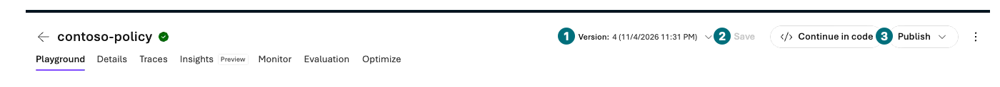
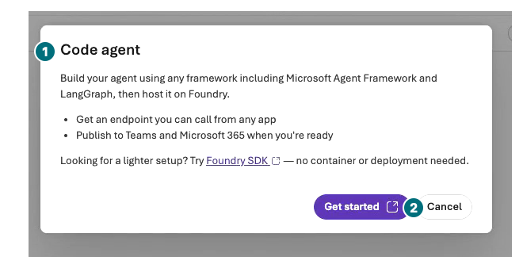

## 목표

Prompt Agent와 Hosted Agent를 포털에서 구분하고, 코드가 없는 현재 경로에서 무엇을 할 수 없는지 확인합니다.

**진행 방식:** 포털 관찰 실습. Hosted 코드 패키징·배포·원격 실행은 하지 않습니다.

**먼저 할 일:** `Build → Agents`에서 내가 만든 Prompt Agent를 엽니다.

**확인할 결과:** 에이전트 종류·모델·버전·지원 protocol·도구 실행 위치를 구분한 표.

## 개념과 실습 지도

**경험할 기능:** Managed Prompt Agent와 custom-code Hosted runtime의 구분.

**무엇이며 왜 중요한가요?** Hosted는 내가 작성한 코드/컨테이너를 실행합니다. 포털에서 Instructions를 저장하는 것만으로 구매 함수 서버가 배포되지 않습니다.

**어떻게 사용하나요?** 현재 에이전트 상세와 생성 옵션을 읽고 코드·실행 이미지가 필요한 경계에서 멈춥니다.

**어디서 실행하나요?** Microsoft Foundry → Build → Agents의 목록·상세·생성 화면. 개발 도구 설치는 하지 않습니다.

## 준비

내 프로젝트의 자원만 관찰합니다. 이미 **별도로 승인·배포된 내 Hosted Agent**가 있을 때만 그 상세를 읽습니다. 다른 사람의 Hosted agent를 시험 호출하지 않습니다.

## 실행

### 1. 목록의 Type·Version부터 확인

**Agents 목록: Running과 Hosted는 같은 뜻이 아님**

**1 Version:** 비교 agent 둘은 `2`, 정책 agent는 `4`입니다. **2 Type:** 세 대상 모두 `Prompt`입니다. `Running`만 보고 Hosted 배포라고 판단하지 않습니다. **3 New agent:** 3절에서 생성 경로만 관찰합니다.

[자막 영상 05 · 02:23](../downloads/portal/index.html?clip=05-inspection-retention&t=143&lang=ko#05-inspection-retention)

| 단계 | 클릭·입력 | 확인할 화면·값 | 실패하면 |
| --- | --- | --- | --- |
| 1 | `Build → Agents`에서 `contoso-policy`를 엽니다. | Instructions·model·File search로 구성된 Prompt Agent입니다. | Hosted라고 잘못 표기하지 않습니다. |
| 2 | `Details/Versions`에서 현재 표시된 종류·버전을 적습니다. | 실제 저장된 버전과 대화 ID가 구분됩니다. | 없는 protocol·runtime 값을 추정하지 않습니다. |

### 2. Prompt 설정과 저장된 버전 대조

**현재 대상 읽기: 모델·지시문·도구의 Prompt 구성**

**1 모델 / 2 File search:** 지금 쓰는 Prompt Agent의 설정입니다. 이 편집 화면을 Hosted 코드·컨테이너 배포 증거로 사용하지 않습니다.

[자막 영상 05 · 01:36](../downloads/portal/index.html?clip=05-inspection-retention&t=96&lang=ko#05-inspection-retention)

**상단 버전: 현재 정책 agent는 4**

**1 Version:** 위 목록의 정책 agent `4`와 맞춥니다. **2 Save:** Instructions 저장과 배포를 혼동하지 않습니다. **3 Publish:** 이번 관찰에서는 누르지 않습니다. 이 화면에는 Hosted protocol·container 상태가 없습니다.

[자막 영상 05 · 01:36](../downloads/portal/index.html?clip=05-inspection-retention&t=96&lang=ko#05-inspection-retention)

### 3. Code agent를 열고 개발 시작 전에 취소

| 단계 | 클릭·입력 | 확인할 화면·값 | 실패하면 |
| --- | --- | --- | --- |
| 1 | 목록으로 돌아가 `New agent → Code an agent`를 엽니다. | **Code agent** 대화상자의 framework·Microsoft Foundry hosting·SDK 링크를 읽습니다. | Get started로 개발 환경을 설치하거나 새 코드를 실행하지 않습니다. |
| 2 | `Cancel`을 누릅니다. | Hosted 코드/런타임을 만들거나 배포하지 않았습니다. | Prompt 생성 성공을 Hosted 성공으로 바꾸지 않습니다. |
| 3 | 내 기존 Hosted가 있으면 그 상세의 version·protocol·상태·연결을 읽습니다. | 실제 배포된 대상만 관찰합니다. | 없다면 `Hosted 미배포`로 적습니다. |
| 4 | 아래 비교표를 내 실제 상태로 채웁니다. | 실행한 것과 읽은 것이 나뉩니다. | Playgrounds 답변만으로 runtime 상태를 보완하지 않습니다. |

**Code agent: 개발 경계에서 Cancel**

**1 Code agent:** 여기서부터 코드/실행 이미지가 필요한 별도 경로입니다. **2 Cancel:** 개발 링크를 실행하지 않고 돌아갑니다. 녹화에서는 Hosted 배포·호출이 모두 0회입니다.

[자막 영상 05 · 02:19](../downloads/portal/index.html?clip=05-inspection-retention&t=139&lang=ko#05-inspection-retention)

| 항목 | 현재 Prompt Agent | Hosted에 추가로 필요한 것 |
| --- | --- | --- |
| 실행 정의 | 모델·Instructions·서비스 도구 | 코드/컨테이너·entrypoint·의존성 |
| 업무 함수 | 연결된 서버 도구가 있을 때만 | 런타임에 구현된 함수·권한·검사 |
| 버전 확인 | 포털에 저장된 agent version | 배포 코드/이미지와 정확한 원격 version |
| 통신 규약 | 대상이 지원하는 요청 경로 | Responses·Invocations·activity 등 실제 지원 protocol |
| 비용·종료 | 모델·파일·로그 비용 확인 | 추가 compute·세션·scale·중지 상태 확인 |

### 개발 경로는 이번 실습 밖

Hosted source/container 배포와 Microsoft Agent Framework 실행은 코드 기반 작업입니다. 이 포털 전용 가이드에서는 해당 개발 경로를 **참고**로만 분류합니다. Canvas·Visual Studio Code·DevPack·개발 skill을 설치하거나 실행할 필요가 없습니다.

Invocations 성공은 Responses·Voice·Teams의 `activity` 경로 성공을 뜻하지 않습니다. Agent Inspector와 브라우저 Chat도 같은 실행면이라고 가정하지 않습니다. 포털에서 지원되지 않는 필드를 임의 YAML이나 함수 schema로 채워 성공처럼 만들지 않습니다.

## 성공 기준

현재 대상의 종류를 실제 설정으로 확인했습니다. Hosted가 없다면 미배포라고 적었습니다. 코드 없이 실제 구매 함수를 배포·실행했다고 주장하지 않았습니다.

## 막혔을 때

Hosted 항목·상세가 없으면 지원 지역·권한·실제 배포 존재를 확인합니다. 기본 코스는 Prompt Agent만으로 이어갑니다. 브라우저 접근 문제 때문에 public access·identity·다른 프로젝트를 변경하지 않습니다.

## 정리

새 runtime·컨테이너·개발 환경을 만들지 않았습니다. 기존 Hosted가 있다면 관찰만 했고 임의 중지·삭제하지 않습니다. 세션·compute 비용은 소유 담당자와 L19에서 확인합니다.

**이 장에서 남길 것:** Prompt/Hosted 비교표와 실제 Hosted 배포·호출 **미실행** 표시.

**다음:** [L13 순차·독립 검토를 수동 비교](#l15).

