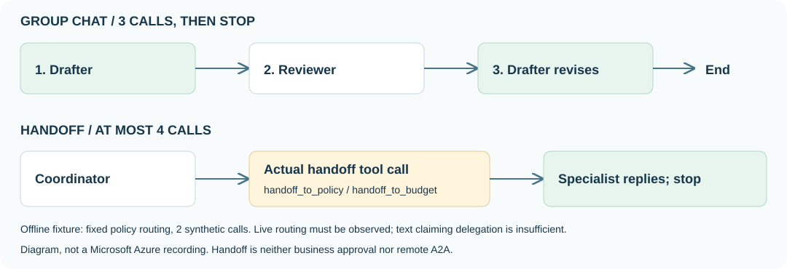

## 목표

실제 MAF의 **GroupChatBuilder·HandoffBuilder**를 실행합니다. 작성→검토→수정의 메시지 전달과 실제 handoff tool·다음 역할 응답을 찾아 종료 조건을 설명합니다.

<div class="lab-brief" markdown="1">

**진행 방식:** 터미널 SDK 실습. 기본 오프라인은 그룹 3회·핸드오프 2회 fixture 응답이며, 선택 live는 각각 최대 3회·4회입니다.

**먼저 할 일:** L13의 `.venv-maf`와 언어를 다시 선택합니다. 새 포털 agent·router·Hosted 배포는 만들지 않습니다.

**확인할 결과:** 작성/검토/수정 3원문과 `handoff_to_policy` 또는 `handoff_to_budget` 호출 뒤 실제 specialist 응답.

</div>

## 개념과 실습 지도

**경험할 기능:** bounded group chat, tool 기반 담당자 전환.

**무엇이며 왜 중요한가요?** Group chat은 검토를 작성자에게 돌려보내고, handoff는 제어를 다른 역할에 넘깁니다. “위임했습니다”라는 문장만으로는 전환 증거가 아닙니다.

**어떻게 사용하나요?** 같은 질문·정책으로 두 builder를 실행하고 역할 순서·도구 호출·다음 응답·종료를 로그에서 확인합니다.

**어디서 실행하나요?** 로컬 Python SDK. 별도 승인한 `--live`일 때만 기존 Microsoft Foundry 모델을 호출합니다.

[](../assets/maf-collaboration.svg)

흐름도를 선택하면 원본 크기로 볼 수 있습니다. 기존 영상에는 이 SDK 실행이 없으므로 다른 agent의 답변·복사 버튼을 실행 예시로 재사용하지 않습니다.

## 준비

[L13 환경 준비](#l15)를 완료합니다. 새 터미널에서는 `.venv-maf` 활성화와 언어 선택만 반복합니다. 오프라인은 로그인·`.env`·소유 receipt가 필요 없습니다. live는 [L13의 기존 모델·scope 검증](#maf-live-setup)을 그대로 사용하며 Hosted·Search·judge가 필요 없습니다.

## 실행

### 1. 실행·종료 코드를 먼저 대조

[multi_agent.py의 `build_workflow`](../samples/multi_agent.py)를 엽니다. 아래는 **읽기용 발췌**입니다. 역할 정의를 생략한 코드 조각을 따로 실행하지 않습니다.

```python
def select_speaker(state):
    names = list(state.participants)
    return names[state.current_round % len(names)]

group_chat = GroupChatBuilder(
    participants=[drafter, reviewer], selection_func=select_speaker, max_rounds=3,
    termination_condition=lambda messages: sum(message.role == "assistant" for message in messages) >= 3,
    intermediate_output_from=[drafter, reviewer],
).build()
```

speaker는 drafter → reviewer → drafter이며 assistant 메시지 3개에서 종료합니다. handoff의 핵심은 분류 문장이 아닌 아래 실제 SDK 연결입니다.

```python
handoff = (
    HandoffBuilder(
        participants=[coordinator, policy_agent, budget_agent],
        termination_condition=lambda messages: any(
            message.role == "assistant" and message.author_name in {"policy", "budget"} and message.text.strip()
            for message in messages
        ),
    )
    .with_start_agent(coordinator)
    .add_handoff(coordinator, [policy_agent, budget_agent])
    .build()
)
```

`CallAudit`가 전체 모델 호출 상한을 지키고, specialist의 비어 있지 않은 응답에서 종료합니다. handoff tool 없이 coordinator가 직접 답한 결과는 성공으로 대체하지 않습니다.

<div class="practice-block" markdown="1">

### 2. 작성 → 검토 → 수정을 실제 SDK로 실행

**직접 해보기:** L13과 같은 기본 purchase 질문을 유지하고 실행합니다.

```bash
python samples/multi_agent.py --mode group-chat --offline
```
<div class="command-explanation" markdown="1">

**명령 해설**

| 순서·명령 | 세부 동작과 옵션 | 결과·비용/변경 |
| --- | --- | --- |
| 1. `--mode group-chat --offline` | 진짜 `GroupChatBuilder`에 고정 응답 client를 연결해 세 턴을 실행합니다. | `fixture_calls: 3`, 네트워크·DNS 차단, 개인 `results/contoso-maf-fixture-....jsonl`. Microsoft Azure 호출 0. |

</div>

| 볼 위치 | 실제 확인 |
| --- | --- |
| `paths.group-chat.stages` | role 순서가 `drafter`, `reviewer`, `drafter` |
| reviewer의 `model_call_completed` 입력 | 첫 drafter의 `Synthetic fixture from drafter, call 1.` 원문 |
| 마지막 drafter의 입력 | reviewer의 `Synthetic fixture from reviewer, call 2.` 원문 |
| `workflow_state`·`final_messages` | 세 턴에서 종료했고 원문이 남았는지 |

fixture 문장은 고정 문자열이므로 **검토가 실제로 정책 오류를 찾아 개선했다는 증거가 아닙니다.** 메시지 전달·차례·종료만 검사합니다.

### 3. 실제 handoff tool과 다음 역할 응답 확인

```bash
python samples/multi_agent.py --mode handoff --offline
```
<div class="command-explanation" markdown="1">

**명령 해설**

| 순서·명령 | 세부 동작과 옵션 | 결과·비용/변경 |
| --- | --- | --- |
| 1. `--mode handoff --offline` | 실제 `HandoffBuilder`가 노출한 도구를 fixture가 호출하고 policy의 응답까지 실행합니다. | coordinator → policy 2회. 라우팅은 모델 판단이 아닌 **고정 policy fixture**입니다. |

</div>

출력에서 아래 필드의 조합을 찾습니다. 전체 JSON이 아닌 확인용 발췌입니다.

```output
"execution": "local_sdk_fixture"
"fixture_calls": 2
"routing_source": "fixed_policy_fixture_not_model_classification"
"handoff_calls": ["handoff_to_policy"]
"human_approval_performed": false
"quality_release": false
```

`handoff_calls`는 coordinator stage에 있고 다음 stage의 `role`은 `policy`여야 합니다. `final_messages`의 policy 응답도 함께 봅니다. 도구 이름만 있거나 다음 응답이 없으면 성공이 아닙니다.

**한 가지 바꾸기:** 실행 방식·정책·상한은 고정하고 `case`만 승인 경계 질문으로 바꿉니다.

```bash
python samples/multi_agent.py --mode group-chat --case boundary --offline
python samples/multi_agent.py --mode handoff --case boundary --offline
```
<div class="command-explanation" markdown="1">

**명령 해설**

| 순서·명령 | 세부 동작과 옵션 | 결과·비용/변경 |
| --- | --- | --- |
| 1. `group-chat --case boundary --offline` | 정확히 2,000,000원과 2,000,001원의 질문이 세 역할 입력에 전달되는지 봅니다. | fixture 3회. 질문 변경이 고정 응답을 정책 추론으로 바꾸지는 않습니다. |
| 2. `handoff --case boundary --offline` | 같은 경계 질문이 specialist까지 전달되는지 확인합니다. | fixture 2회. 이 모드의 고정 policy 라우팅은 그대로이며 분류 정확도 시험이 아닙니다. |

</div>

**결과 설명하기:** 어느 원문이 다음 역할에 갔는지, 어떤 도구가 제어를 넘겼는지, 무엇이 종료시켰는지를 제시합니다. 업무 승인·원격 A2A·HITL을 수행했다고 주장하지 않습니다.

</div>

### 4. 실제 모델로 비교 — 별도 승인

L13의 동일한 live 설정·소유·용량 검증을 재사용합니다. 두 기본 명령은 합계 **최대 7회**의 유료 모델 호출이며 각 실행 180초·출력 2048토큰/호출·최대 시작 6회/분·재시도 0입니다. 경계 질문까지 live로 반복하려면 추가 예산 승인이 필요합니다.

```bash
python samples/multi_agent.py --mode group-chat --live
python samples/multi_agent.py --mode handoff --live
```
<div class="command-explanation" markdown="1">

**명령 해설**

| 순서·명령 | 세부 동작과 옵션 | 결과·비용/변경 |
| --- | --- | --- |
| 1. `--mode group-chat --live` | 기존 모델로 drafter → reviewer → drafter를 실행합니다. | 유료 최대 3회. 실제 지적·수정·미반영을 원문으로 비교합니다. |
| 2. `--mode handoff --live` | 모델이 실제 handoff tool로 policy 또는 budget을 선택해야 합니다. | 유료 최대 4회. 도구·다음 응답이 없거나 상한에 도달하면 실패로 보존합니다. |

</div>

`execution=local_maf_with_azure_model`인지 확인합니다. `response_id`·`handoff_calls`·specialist 원문·시간·실제 usage가 같은 run에 있어야 합니다. 모델의 역할 선택 결과를 fixture의 고정 라우팅과 혼동하지 않습니다.

| 여기서 실행한 기능 | 여전히 실행하지 않은 기능 |
| --- | --- |
| 실제 SDK의 그룹 메시지 전달·종료 | 영구 서비스·포털-hosted workflow |
| 실제 SDK handoff tool과 specialist 응답 | 인증된 원격 A2A endpoint·원격 agent 호출 |
| `human_approval_performed: false` | 승인 주체·권한·이벤트·대기/재개가 있는 HITL |
| 합성 정책의 구매 안내 | 실제 주문·결제·업무 승인 |

포털 Workflows는 **2026-12-01 종료 예정**이므로 그 디자이너로 우회하지 않습니다.

## 성공 기준

그룹의 세 원문과 전달된 검토, handoff tool과 실제 specialist 응답을 찾았습니다. 오프라인/실제 모델 실행을 구분하고 종료·호출 상한을 지켰습니다. 품질 gate·업무 승인·원격 A2A·HITL 성공으로 합산하지 않았습니다.

## 막혔을 때

`PLAN ONLY`이면 아직 실행하지 않은 것입니다. SDK 누락은 L13 환경을 확인합니다. 모델이 handoff 대신 직접 답하면 실패이며 자동 대체하지 않습니다. 빈 specialist 응답·부분 결과·429·상한 초과는 원문을 보존하고 재귀·재시도·출력 상한을 늘려 통과시키지 않습니다.

## 정리

일회성 로컬 프로세스만 끝납니다. 자동 재귀·원격 서버·영구 router는 만들지 않습니다. 개인 증거와 모델/로그 잔여 비용은 L19에 넘깁니다.

<div class="lab-handoff" markdown="1">

**이 장에서 남길 것:** 작성/검토/수정 원문, tool·specialist·종료 기록, execution 종류와 미실행 A2A·HITL·업무 승인.

**다음:** [L15 Memory 관찰과 조건부 대화 비교](#l16).

</div>
