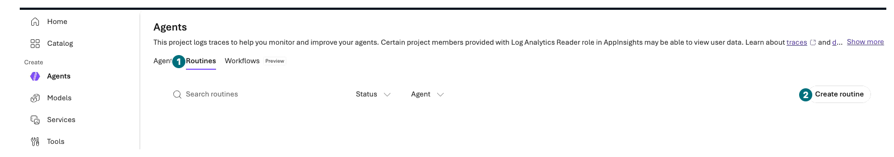
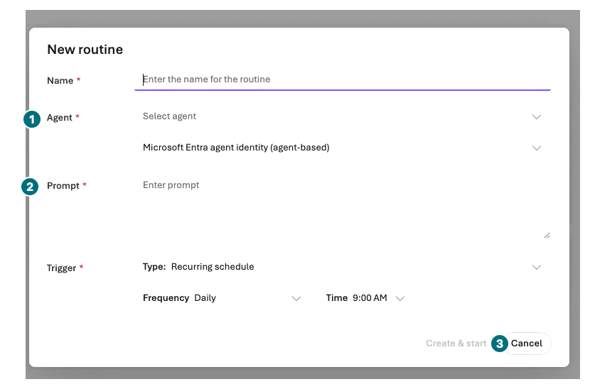
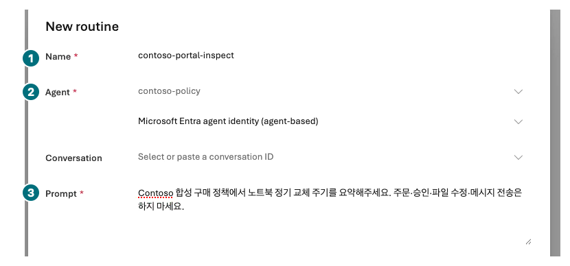
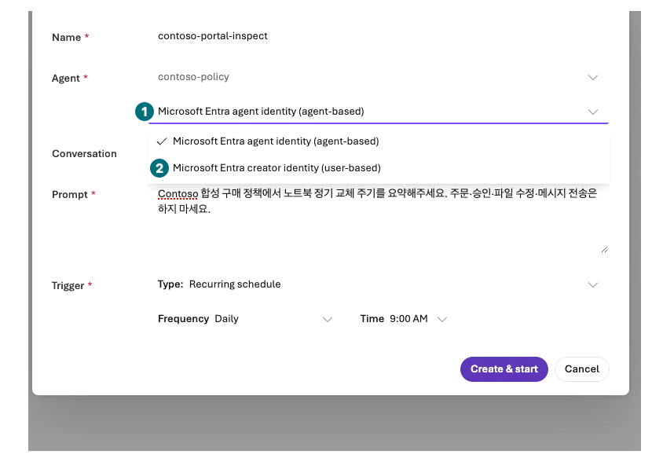
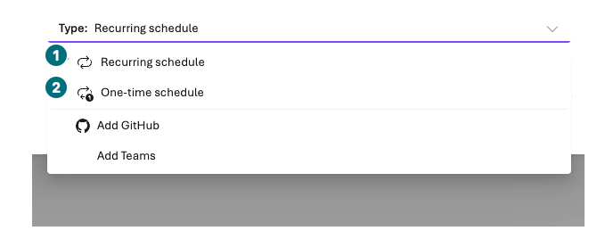
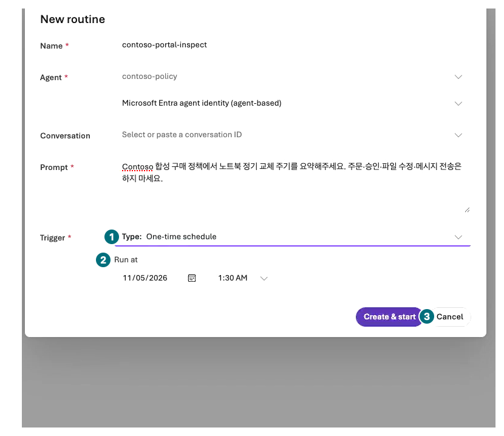
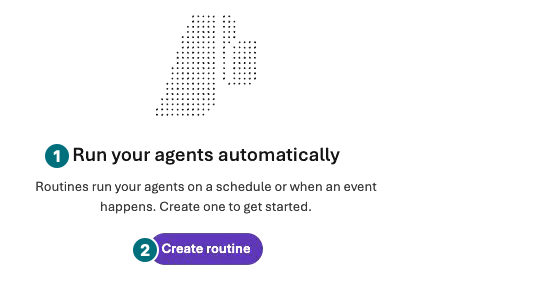

## 목표

Routines의 생성 화면을 포털에서 점검합니다. 기본 경로에서는 **Create & start·Test run을 누르지 않고** 비용·identity·시간대 위험을 확인합니다.

<div class="lab-brief" markdown="1">

**진행 방식:** 기본은 관찰. 현재 실제 녹화 범위는 routine 0개·자동 실행 0회입니다.

**먼저 할 일:** 자동 호출은 브라우저를 닫아도 계속될 수 있음을 확인합니다.

**확인할 결과:** agent·prompt·trigger·브라우저 시간대·identity·정지 계획과 미실행 상태.

</div>

## 개념과 실습 지도

**경험할 기능:** Routines의 Recurring/One-time schedule 생성 폼과 실행 기록.

**무엇이며 왜 중요한가요?** Routine은 정해진 때 agent를 호출합니다. 반복·재시도·연결 권한 때문에 Chat 한 번보다 비용과 영향이 큽니다.

**어떻게 사용하나요?** 생성 폼을 채워 읽고 취소합니다. 실제 생성·시험·Pause는 각각 별도 승인 범위에서만 수행합니다.

**어디서 실행하나요?** Microsoft Foundry의 내 프로젝트 → Build → Agents → Routines 탭. 메뉴가 없으면 해당 지역/구독 기능 미활성입니다.

## 준비

기존 Prompt Agent와 프로젝트의 Foundry User 이상 역할이 필요합니다. Workflow agent는 대상이 아닙니다. UK West·Switzerland West·Japan West·UAE North·Norway East는 공식 지원 제외 지역입니다. CMK 필수 업무에는 Routines를 사용하지 않습니다.

## 실행

### 1. Routines 탭과 생성 폼 열기

<div class="screen-step" markdown="1">

**진입점: 사이드바가 아니라 Agents 안의 Routines**



**1 Routines / 2 Create routine:** 내 목록에서 새 폼만 엽니다. 다른 사람이 만든 항목은 열거나 수정하지 않습니다. 빈 목록이라도 메뉴 위치는 같습니다.

[자막 영상 05 · 02:26](../downloads/portal/index.html?clip=05-inspection-retention&t=146&lang=ko#05-inspection-retention)

</div>

<div class="screen-step" markdown="1">

**New routine: 대상과 prompt 위치만 확인**



**1 Agent:** 내 Prompt Agent입니다. **2 Prompt:** 아래 합성 읽기 질문을 사용합니다. **3 Cancel:** 관찰을 마치면 취소합니다. 기본 Recurring schedule을 그대로 생성하지 않습니다.

[자막 영상 05 · 02:34](../downloads/portal/index.html?clip=05-inspection-retention&t=154&lang=ko#05-inspection-retention)

</div>

| 단계 | 클릭·입력 | 확인할 화면·값 | 실패하면 |
| --- | --- | --- | --- |
| 1 | 내 프로젝트의 `Build → Agents`를 열고 `Routines` 탭을 누릅니다. | 내 routine 목록입니다. | 사이드바가 아니라 Agents 안의 탭일 수 있습니다. 없으면 미활성으로 기록하고 CLI로 우회하지 않습니다. |
| 2 | `Create routine`을 엽니다. | `New routine` 대화상자의 Name·Agent·Authorization·Conversation·Prompt·Trigger입니다. | 기존 자동화를 선택·수정하지 않습니다. |

### 2. 이름·대상·읽기 전용 질문·identity 확인

| 단계 | 클릭·입력 | 확인할 화면·값 | 실패하면 |
| --- | --- | --- | --- |
| 1 | Name에 `contoso-portal-inspect`, Agent에 내가 만든 Prompt Agent를 고릅니다. | 정확한 agent·버전/대상이 확인됩니다. | Hosted·Workflow·타인의 agent로 대체하지 않습니다. |
| 2 | Prompt에 아래 합성 읽기 전용 질문을 넣습니다. | 실제 발주·메시지 전송이 없는 내용입니다. | 외부 쓰기 도구가 있으면 폼을 취소합니다. |
| 3 | `Authorization`을 펼쳐 두 선택지를 읽고 기본 agent-based를 그대로 둡니다. | `Microsoft Entra agent identity (agent-based)`와 `Microsoft Entra creator identity (user-based)`가 보입니다. | 선택지가 다른 포털에서는 실제 표시를 기록합니다. 권한·동의·identity를 바꿔 우회하지 않습니다. |

```prompt
Contoso 합성 구매 정책에서 노트북 정기 교체 주기를 요약해주세요. 주문·승인·파일 수정·메시지 전송은 하지 마세요.
```

<div class="screen-step" markdown="1">

**입력 후 비교: 실제로 채워진 세 필드**



**1 Name / 2 Agent / 3 Prompt:** 내 대상과 읽기 전용 내용을 다시 확인합니다. `Conversation`에 타인의 ID를 붙이지 않습니다. 폼 입력은 저장·활성화·전송이 아닙니다.

[자막 영상 05 · 02:55.5](../downloads/portal/index.html?clip=05-inspection-retention&t=175.5&lang=ko#05-inspection-retention)

</div>

<div class="screen-step" markdown="1">

**Authorization: 선택지가 보이는 것과 실행 권한은 다름**



**1 Agent identity / 2 Creator identity:** 이번 관찰은 기본 agent-based를 유지했습니다. 어떤 identity로도 dispatch하지 않았고 별도 동의·권한을 추가하지 않았습니다.

[자막 영상 05 · 02:49](../downloads/portal/index.html?clip=05-inspection-retention&t=169&lang=ko#05-inspection-retention)

</div>

### 3. Trigger·시간을 읽고 반드시 취소

| 단계 | 클릭·입력 | 확인할 화면·값 | 실패하면 |
| --- | --- | --- | --- |
| 1 | Trigger Type을 `One-time schedule`로 선택하고 Run at 필드를 읽습니다. | **브라우저의 현지 시간대**로 해석됩니다. | 포털에서 임의 IANA timezone을 고정했다고 쓰지 않습니다. |
| 2 | `Recurring schedule`도 선택해 Frequency·Time을 읽습니다. | 반복이 계속될 수 있고 최소 간격은 5분입니다. | 1분 반복·일정한 비용 상한을 가정하지 않습니다. |
| 3 | **`Create & start`를 누르지 말고 `Cancel`/닫기**를 선택합니다. | 새 routine·예약·호출이 없습니다. | 폼 관찰을 예약 성공이라고 보고하지 않습니다. |

<div class="screen-step" markdown="1">

**Trigger 선택: 기본 Recurring과 One-time은 다름**



**1 Recurring / 2 One-time:** 기본 반복 상태를 확인한 뒤 일회성의 Run at도 읽습니다. `Add GitHub`·`Add Teams`로 연결·동의를 만들지 않습니다. 어느 선택에서도 Create & start는 누르지 않습니다.

[자막 영상 05 · 02:55.5](../downloads/portal/index.html?clip=05-inspection-retention&t=175.5&lang=ko#05-inspection-retention)

</div>

<div class="screen-step" markdown="1">

**One-time: Run at을 읽고 Create & start 없이 종료**



**1 Type:** `One-time schedule`. **2 Run at:** 브라우저 현지 시간대의 입력입니다. 예시 날짜·시간을 내 예약으로 복사하지 않습니다. **3 Cancel:** routine 0개·실행 0회로 마칩니다.

[자막 영상 05 · 03:00.9](../downloads/portal/index.html?clip=05-inspection-retention&t=180.9&lang=ko#05-inspection-retention)

</div>

<div class="screen-step" markdown="1">

**취소 후: 새 routine 없이 처음 안내로 복귀**



**1 빈 목록 안내 / 2 Create routine:** 생성된 항목의 실행 기록이 아니라 시작 화면입니다. 다시 생성하지 않고 관찰을 끝냅니다. 이번 녹화의 생성·dispatch는 모두 0회입니다.

[자막 영상 05 · 03:02.4](../downloads/portal/index.html?clip=05-inspection-retention&t=182.4&lang=ko#05-inspection-retention)

</div>

### 별도 실행 승인이 있을 때만

실제 생성은 agent·미래 실행 시각·브라우저 시간대·최대 호출·비용·Pause 담당자를 승인한 뒤 **One-time schedule 1개**로 제한합니다. `Create & start`는 즉시 활성화합니다. 임시 폼 저장이나 disabled 생성 버튼이 아닙니다.

내 routine 상세의 `Test run`은 별도 유료 호출입니다. 승인 없이 누르지 않습니다. 실행했다면 실제 run history의 response ID·상태·시각·duration을 확인합니다. `Completed`는 dispatch 성공일 수 있으며, agent의 비동기 최종 답이나 실제 업무 완료는 별도 증거가 필요합니다.

지속 중지는 별도 승인된 대상의 `Pause`로 확인하고 실제 Paused 상태를 봅니다. 삭제는 추가 승인이 필요합니다. 이 기본 실습에서는 생성·시험·Pause·삭제 어느 것도 실행하지 않습니다.

### Identity와 포털 한계

녹화한 포털의 `Authorization`은 **agent identity**를 기본 선택하며 creator/user-based identity도 생성 폼에서 선택할 수 있습니다. 이 실습은 기본값을 유지하고 취소했으며 어느 identity로도 routine을 실행하지 않았습니다. 선택지가 보이는 것만으로 필요한 권한·동의가 준비됐다는 뜻은 아닙니다.

Delegated user 도구는 routine 생성자의 identity·동의·접근권한을 별도 확인해야 합니다. Connector 연결 소유자와 dispatch identity는 다릅니다. 이번 `Run at`에는 브라우저 시간대 `Asia/Seoul`이 표시됐습니다. 다른 학습자의 시간대까지 같다고 가정하지 않습니다.

GitHub/Teams 이벤트 연결의 포털 설정은 이벤트 routine 전체 생성 성공을 뜻하지 않습니다. 이 가이드에서는 해당 connector 생성·동의·외부 메시지 전송을 하지 않습니다.

## 성공 기준

폼·시간대·대상·identity·비용을 읽고 기본 경로에서 취소했습니다. 생성 수·호출 수 0을 기록했습니다. 별도 실행은 실제 run과 agent 결과를 구분했습니다.

## 막혔을 때

미지원 지역·메뉴 없음·권한 부족·agent 종류·연결 동의를 각각 기록합니다. 다른 지역 새 자원·권한·일정을 임의 생성해 우회하지 않습니다.

## 정리

Routines 목록에서 새 항목이 없음을 확인합니다. 실제 실행을 별도 승인했다면 잔여 일정·Pause·비용 상태를 L19에 인계합니다. 탭 닫기는 자동화 정지가 아닙니다.

<div class="lab-handoff" markdown="1">

**이 장에서 남길 것:** 폼 점검표, 브라우저 시간대, identity·정지 계획과 routine/dispatch 미실행.

**다음:** [L17 거버넌스·권한 경계 점검](#l21).

</div>
