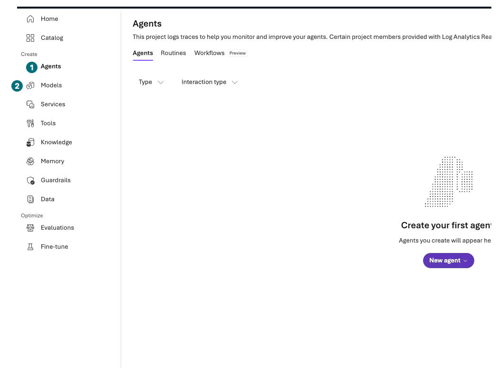

## Objectives

The core course builds a **Contoso purchasing-policy assistant grounded in documents** in two browser windows, without installation, terminal, Cloud Shell, Codespaces, or API keys. Only optional **L12–L14** use separate Python environments and explained terminal commands for code-required Hosted/MAF work.

**Format:** Portal walkthrough. L00–L10 take about **4 hours 45 minutes**, plus the shared 10-minute L19 wrap-up. Approval and provisioning waits are additional.

**Start here:** Open [Azure portal](https://portal.azure.com/) and [Microsoft Foundry](https://ai.azure.com/) in separate windows alongside this guide.

**What to check:** Record the permitted organization, subscription, cost approval, and execution scope. Do not create resources or send questions yet.

## Concepts and lab map

**What you will try:** Microsoft Azure resource management and Microsoft Foundry model, agent, and evaluation screens.

**What is it, and why does it matter?** Azure portal manages resources, access, and costs. Foundry portal manages models, instructions, document retrieval, and responses. Reading a catalog is different from deploying or invoking a paid service.

**How do you use it?** Follow each table one row at a time. Continue only when the expected screen or value matches.

**Where do you run it?** Core work uses the two portals, browser, and file picker. L12–L14 instead use the complete ZIP's source, diagrams, and command walkthroughs. Manual Chat does not substitute for code-required execution.

### Read each screen in order

Follow the numbered screen, short action cue, then the table's expected result. Select an image to enlarge it; `Captioned video` opens the same moment. Numbered screens are extracted from the **existing Korean execution**, with guidance numbers added. They do not represent a separate English run. Use your own approved suffix, time, and budget.

## Prerequisites

You need an organizational account, a permitted Microsoft Azure subscription, resource-creation permissions, and cost approval. Ask an administrator for the specific operations at the specific scope; do not request subscription-wide administration for convenience.

## Steps

### 1. Open the portals and your private notes

| Step | Click or enter | Expected screen or value | If it fails |
| --- | --- | --- | --- |
| 1 | Open Azure portal in a new window and sign in. | The account menu identifies the permitted lab organization. | Select the correct Directory; do not use someone else's account. |
| 2 | Search for `Subscriptions` in the top search and open that service. | Your chosen subscription is `Enabled`. | Ask the administrator or use the reading-only path. |
| 3 | Open Microsoft Foundry in another window with the same organization. | The new Microsoft Foundry experience appears. Enable `New Foundry` if a switch is shown. | Check the experience switch if you see Classic. |
| 4 | Privately record organization, subscription, allowed region, owner, approved costs, and request bounds. | Both windows point to the permitted scope. | Do not create resources while scopes disagree. |
| 5 | Read the boundaries below and choose hands-on or reading-only. | You distinguish execution, inspection, manual comparison, and not run. | Do not change security or region simply to reveal a menu. |

**Find the location first: Microsoft Azure resource creation**

**1 Name / 2 Region:** These fields are for L01. For now, prepare the two portals and approved scope without selecting `Create`.

[Captioned video 01 · 00:10](../../downloads/portal/index.html?clip=01-environment&t=10&lang=en#01-environment)

**Find your way: Microsoft Foundry Agents and Models**

**1 Agents / 2 Models:** The recorded UI groups these under `Create`. When a lab says `Build → feature`, find that same feature name. `Evaluations` is under `Optimize`; model discovery is in `Catalog`. `Traces` and `Monitor` are tabs inside an opened agent.

[Captioned video 01 · 03:02](../../downloads/portal/index.html?clip=01-environment&t=182&lang=en#01-environment)

Numbered images come from the corresponding scene in the [actual portal recordings](../../downloads/portal/index.html). Select an image to enlarge it; its video link opens that exact time. Verify your own project names, versions, and results. Inspected features are not successful executions.

### 2. Keep track of the target

| Modules | Your action | What the result means |
| --- | --- | --- |
| L01–L03 | Create a dedicated group, project, and model; send one model Chat question | A model response, not a purchasing-tool execution |
| L04–L05 | Create `contoso-policy`; upload three synthetic policies into File search | Document-grounded policy guidance |
| L06 | Test a purchase request without tools and inspect the draft boundary | **No real inventory lookup or draft function execution** |
| L07 | Conditionally connect an approved read-only remote MCP tool | Execution only when a real tool-call record exists |
| L08 | Evaluate separate v1/v2 agents with the same twelve dev questions | Learning comparison, not production release or replacement of historical validation |
| L09–L10 | Inspect safety and the same request's trace on the L05 policy agent | Separate answer, filtering, authorization, and tool results |
| L11, L15–L18 | Stated portal inspection, conditional tests, and decisions | Unsupported/not-run work is not success |
| L12 | Hosted source/offline packaging, separately approved deployment/one invocation | Packaging is distinct from Microsoft Azure deployment |
| L13–L14 | Actual MAF SDK transfer, fan-out, group chat, and handoff | Default fixtures are not Microsoft Azure model/quality evidence |
| L19 | Inventory your resources and remaining charges | Closing a browser does not stop or delete resources |

### 3. Set cost and execution boundaries

Agree on a personal budget first. An example action scope is one environment, two model deployments, three policy files, at most 48 Chat sends, two evaluations of twelve rows each, and zero automated dispatches, training jobs, PTU deployments, or orders. **These are example request bounds, not a monetary cap.** Evaluation judge calls, logging, and storage can incur additional charges.

That example covers the core course. L12 Search data, embeddings, Hosted deployment/access and L13–L14 live model calls each need additional approval/budget. Offline packaging/SDK fixtures create no cloud resources or billed model calls, but are still code execution, distinct from **Read without executing**.

If a model, version, or region is unavailable, record **blocked**. A substitute is a separate experiment, not evidence for the baseline model. Reading-only means reading screenshots, policies, and decision tables without selecting Create, Save, or Send.

## Success criteria

Explain the two portals, which target continues between labs, and the difference between paid actions and reading. A citation is not purchasing authorization. A browser completion checkmark is not Microsoft Azure execution evidence.

## Troubleshooting

If no login window appears, check popup blocking or open the portal link directly in a new window. Do not bypass certificate or organizational security warnings. Never record or share passwords, authentication codes, or account details.

## Cleanup

No resources have been created in this module. Keep notes private and mask emails, subscription IDs, and tenant IDs in public captures.

**Keep:** Permitted subscription, region, cost and request bounds, and the hands-on/reading-only choice.

**Continue:** [L01: create your dedicated lab environment](#l01).

