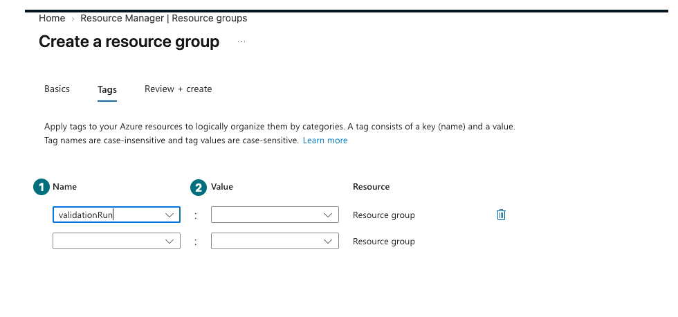
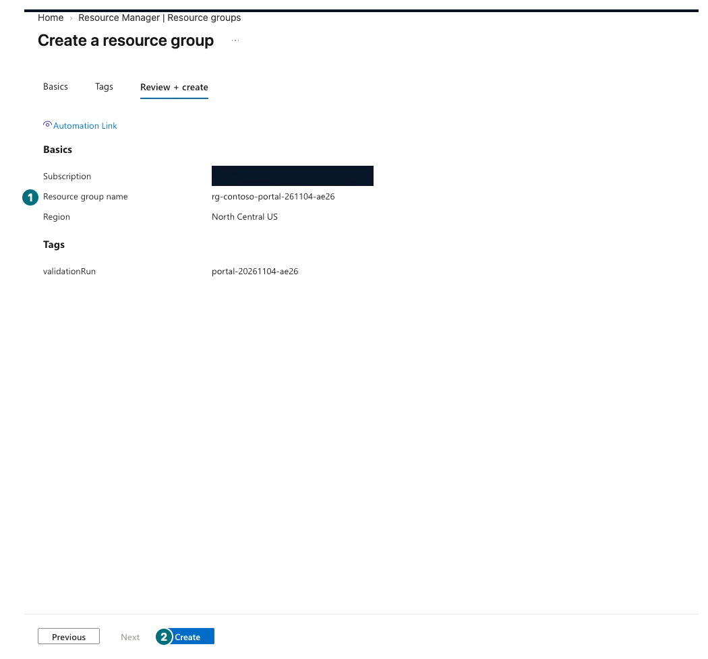
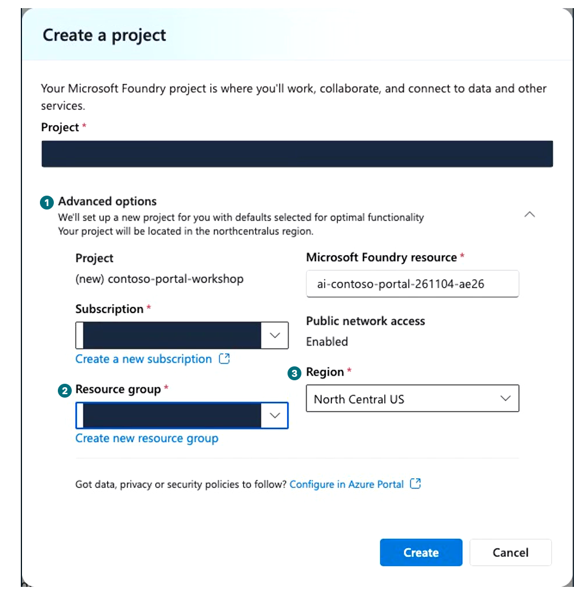
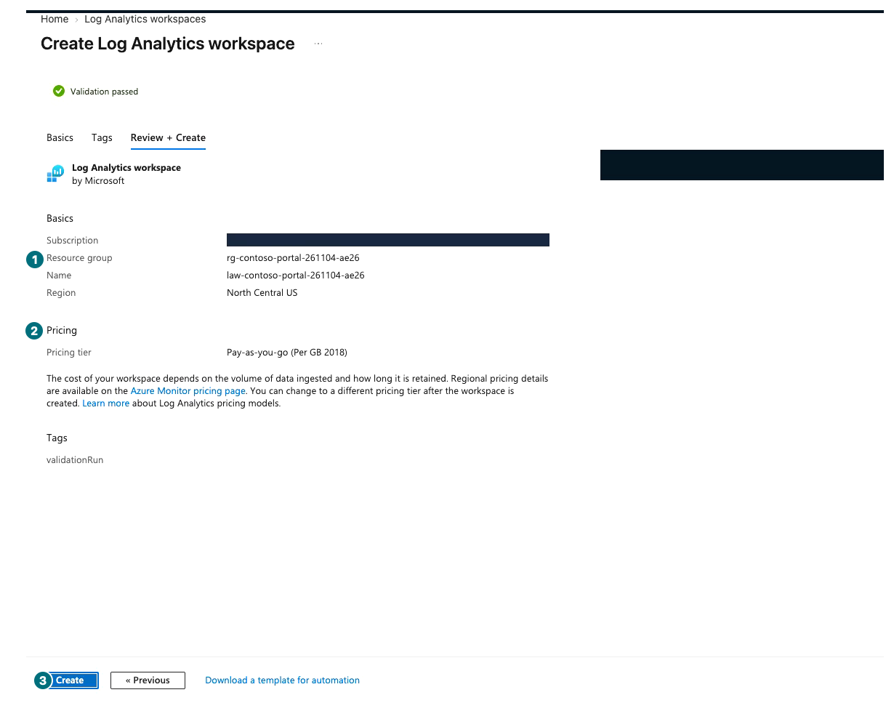
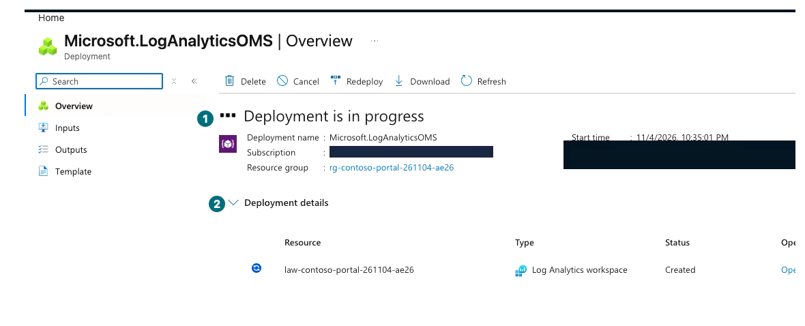
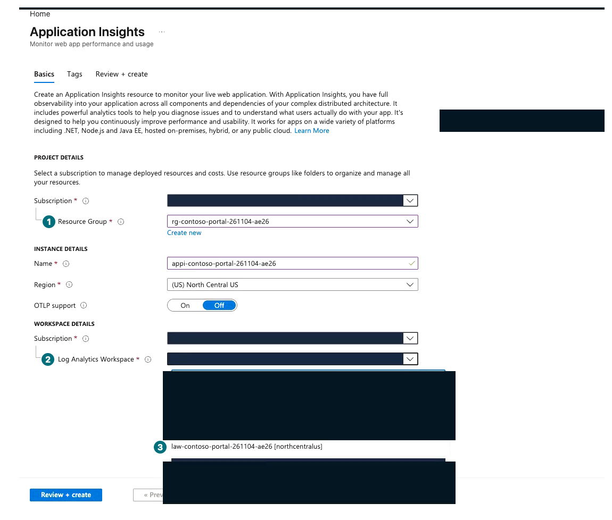
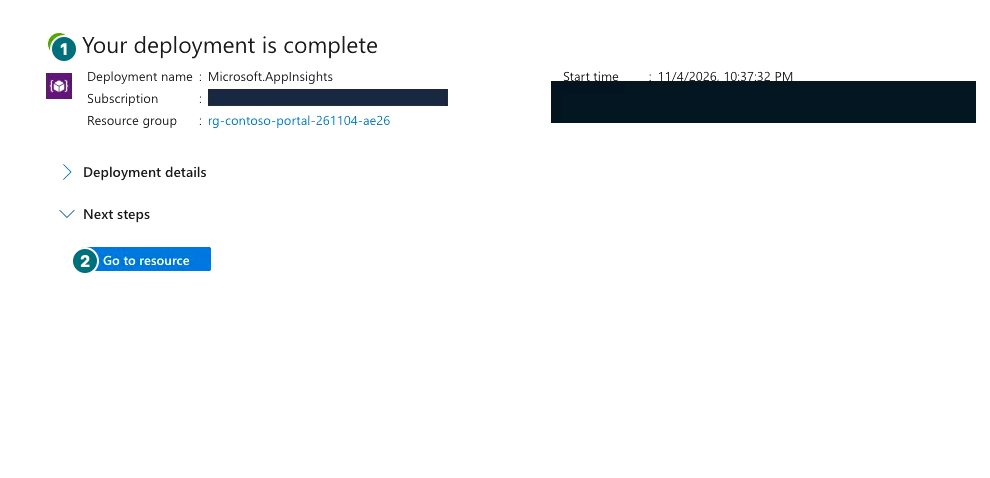

## Objectives

Create a **dedicated resource group** in Azure portal and a **Microsoft Foundry resource and project** in Microsoft Foundry. Check access and logging before agent requests.

**Format:** Portal creation of one environment in the approved subscription and region.

**Start here:** Confirm L00's cost/ownership scope and choose a unique `<suffix>`, for example `261104-a7b2`.

**What to check:** Group, Microsoft Foundry resource, and project share the permitted scope and appear in your private ownership record.

## Concepts and lab map

**What you will try:** Resource groups, projects, IAM inspection, and Application Insights connections.

**What is it, and why does it matter?** A resource group is an Microsoft Azure management boundary; a project is a workspace for agents, data, and connections. Sign-in does not grant every creation, invocation, or access-assignment permission.

**How do you use it?** Inspect subscription, group, region, and names instead of accepting automatic defaults.

**Where do you run it?** Azure portal and Foundry portal only, without installation, code, or environment files.

## Prerequisites

Prepare the permitted subscription, cost owner, region such as `North Central US`, and request bounds. Replace `<suffix>` with your own value. Do not reuse historical training or production resources based on their names.

| Private record | Example input |
| --- | --- |
| Resource group | `rg-contoso-portal-<suffix>` |
| Microsoft Foundry resource | `ai-contoso-portal-<suffix>` |
| Project | `contoso-portal-workshop` |
| Ownership tag | `validationRun=portal-<suffix>` |
| Logs | Application Insights and Log Analytics workspace in the same dedicated group |

If policy requires private networking, resolve that before creation. A default public-access setting is not organizational approval.

## Steps

### 1. Azure portal: create a dedicated group

**Basics: your name and approved region first**

**1 Name:** Enter `rg-contoso-portal-<suffix>`. **2 Region:** Select the approved region. Compare your subscription with your private record, not the masked example.

[Captioned video 01 · 00:10](../../downloads/portal/index.html?clip=01-environment&t=10&lang=en#01-environment)

**Tags: fill both sides**

**1 Name:** `validationRun`. **2 Value:** `portal-<suffix>`. This frame is before Value entry; complete both fields before Review.

[Captioned video 01 · 00:39](../../downloads/portal/index.html?clip=01-environment&t=39&lang=en#01-environment)

| Step | Click or enter | Expected screen or value | If it fails |
| --- | --- | --- | --- |
| 1 | Search `Resource groups` in [Azure portal](https://portal.azure.com/) and select `Create`. | `Create a resource group → Basics` opens. | Check directory and resource-creation permissions. |
| 2 | Explicitly select the permitted `Subscription`. | It matches L00. | Compare the private subscription ID for duplicate names. |
| 3 | Enter your `Resource group name`. | It is distinct from existing groups. | Choose a new suffix and update your record consistently. |
| 4 | Select the approved `Region`. | It matches your record. | Obtain approval before moving to another region. |
| 5 | Select `Next: Tags` and add the ownership tag above. | Both Name and Value are filled. | A tag is neither authorization nor a monetary cap. |
| 6 | Select `Review + create` and inspect subscription, group, region, and tag. | Validation completes and `Create` is enabled. | Preserve policy errors for the owner. |
| 7 | Select `Create` **once**. | Notifications shows `Resource group created`. | Do not duplicate a pending or failed submission. |
| 8 | Select `Go to resource group` in the notification. | Overview name, subscription, region, and Tags match. | Refresh stale lists before searching again. |

**Review: check scope, then create once**

**1 Review:** Compare your name, region, and tag. **2 Create:** Submit once only when they match. Do not resubmit while pending.

[Captioned video 01 · 00:47](../../downloads/portal/index.html?clip=01-environment&t=47&lang=en#01-environment)

**After creation: recheck ownership in Overview**

**1 IAM:** Use this for the later access inspection. **2 Tags:** Verify your `validationRun`. The pictured group is not automatically your owned resource.

[Captioned video 01 · 01:04](../../downloads/portal/index.html?clip=01-environment&t=64&lang=en#01-environment)

### 2. Microsoft Foundry: create a project

**Advanced options: select your existing group**

**1 Expand:** Inspect resource and subscription. **2 Group:** Select your new dedicated group. **3 Region:** Verify approval. Also compare public access with organizational policy before creation.

[Captioned video 01 · 01:20.5](../../downloads/portal/index.html?clip=01-environment&t=80.5&lang=en#01-environment)

| Step | Click or enter | Expected screen or value | If it fails |
| --- | --- | --- | --- |
| 1 | Open [Microsoft Foundry](https://ai.azure.com/) in a new window and sign in to the same organization. | Directory matches L00. | Exclude sign-in and MFA from recording. |
| 2 | Select `Create new project`, or `Create new` on the initial home page. | Project creation opens. | If the `New Foundry` switch requires an existing project, cancel and use Create new on home. |
| 3 | If asked for resource type, select `Microsoft Foundry resource (Recommended) → Next`. | `Create a project` opens. | Do not select `AI hub resource`. |
| 4 | Enter project `contoso-portal-workshop` and expand `Advanced options`. | Subscription, group, resource, and region are visible. | Do not submit generated defaults without inspection. |
| 5 | Select the subscription and the **existing dedicated group** just created. | It is your group, not the default `(new) rg-...`. | Check subscription and refresh if missing. |
| 6 | Enter resource `ai-contoso-portal-<suffix>`. | Resource-name validation succeeds. | Resolve global naming conflicts within your approved scope. |
| 7 | Inspect `Region` and public/private network conditions. | They match approved processing and access requirements. | Use `Configure in Azure Portal` with the owner for required security; do not bypass it. |
| 8 | Recheck every value and select `Create` once. | `Setting up Microsoft Foundry for you` eventually opens the project. | Wait a few minutes; inspect errors instead of submitting duplicates. |
| 9 | If needed, enable `New Foundry`, select **your new project**, then `Let's go`. | Your new project has Agents and Models; see L00 for navigation-group labels. | Record unsupported region/access as blocked. |
| 10 | Open `Manage → Project details`. | Parent resource, group, region, and project match your record. | Do not publish endpoints or keys. |

### 3. Read existing access

| Step | Click or enter | Expected screen or value | If it fails |
| --- | --- | --- | --- |
| 1 | On your Microsoft Foundry resource in Azure portal, open `Access control (IAM) → View my access`. | Inspect existing creation, deployment, agent/file, and invocation permissions. | `Contributor` does not automatically grant all data operations or access assignments. |
| 2 | Read role scope and record the required operations. | Management-plane, data-plane, and log-read access are distinguished. | Ask the owner for exact scope and operations; do not expand access yourself. |

Check actual supported actions and scope for roles such as `Foundry User` or `Azure AI User` in the RBAC documentation. Assigning roles separately requires `roleAssignments/write`. Traces may require `Log Analytics Reader`, with `Privileged Monitoring Data Reader` for protected logs. Do not grant Owner for the lab.

### 4. Azure portal: create dedicated logging resources

If both resources already match **your ownership record**, skip creation and continue to section 5. Otherwise create the workspace first to avoid an autogenerated or shared workspace. Log ingestion and retention can incur charges.

**Workspace Review: inspect group and pricing**

**1 Group:** Verify your dedicated group. **2 Pricing:** Read the approved consumption conditions. **3 Create:** Submit once after checking name, region, and tags too.

[Captioned video 01 · 01:51](../../downloads/portal/index.html?clip=01-environment&t=111&lang=en#01-environment)

| Step | Click or enter | Expected screen or value | If it fails |
| --- | --- | --- | --- |
| 1 | Search `Log Analytics workspaces` in Azure portal and open the exact Services result. | The workspace list opens. | Choose the service list, not a similarly named individual resource. |
| 2 | Select `Create` and the approved subscription. | `Create Log Analytics workspace → Basics` opens. | Do not submit a different subscription. |
| 3 | Select the **existing dedicated resource group**. | It is the group from section 1. | Do not select `(new)` or a shared group. |
| 4 | Enter `law-contoso-portal-<suffix>` and select the approved region. | Name and region match your ownership record. | Resolve naming conflicts before submission. |
| 5 | On `Next: Tags`, add the same `validationRun` tag. | Both Name and Value are filled. | An additional empty row is not a completed tag. |
| 6 | Select `Review + Create` and read subscription, group, region, and pricing tier. | Approved consumption pricing; no extra commitment or extended retention. | Defer if costs are unclear. |
| 7 | Select `Create` once and wait. | `Your deployment is complete`; the workspace can be opened. | Do not resubmit a pending or failed deployment. |

**Still in progress? Wait**

**1 Overall state:** Still `Deployment is in progress`. **2 Details:** One `Created` row is not overall completion. Wait for completion without submitting another Create.

[Captioned video 01 · 02:13.5](../../downloads/portal/index.html?clip=01-environment&t=133.5&lang=en#01-environment)

**Application Insights: choose the existing workspace**

**1 Group:** Use the same dedicated group. **2 Picker:** Expand Workspace. **3 Target:** Choose your `law-contoso-portal-<suffix>`, not an autogenerated `(new)` workspace.

[Captioned video 01 · 02:29](../../downloads/portal/index.html?clip=01-environment&t=149&lang=en#01-environment)

| Step | Click or enter | Expected screen or value | If it fails |
| --- | --- | --- | --- |
| 1 | Open Services' `Application Insights` from the top search and select `Create`. | `Create Application Insights → Basics` opens. | Do not confuse it with workspace creation. |
| 2 | Select the same subscription and existing dedicated group. | It is not a new or shared group. | Recheck automatically selected defaults. |
| 3 | Enter `appi-contoso-portal-<suffix>` and the same approved region. | Name and region match your record. | Do not silently switch region. |
| 4 | Expand Workspace and select **the existing `law-contoso-portal-<suffix>`**. | It is your new workspace, not an autogenerated `(new)` entry. | If absent, check subscription, region, and completed creation. |
| 5 | On `Next: Tags`, add the same ownership tag. | No unapproved OTLP feature or extended retention was enabled. | Obtain separate approval for extra features. |
| 6 | Select `Review + create`, compare the workspace, and select `Create` once. | The exact two-resource connection passes validation. | Correct the workspace before submitting. |
| 7 | After `Your deployment is complete`, open the resource and inspect its workspace. | Both resources belong to your dedicated group. | Creation does not establish actual trace ingestion. |

**Insights complete: creation is not trace ingestion**

**1 Completion:** This deployment completed. **2 Go to resource:** Recheck its workspace. Verify actual trace collection in L10 after connecting below.

[Captioned video 01 · 02:46](../../downloads/portal/index.html?clip=01-environment&t=166&lang=en#01-environment)

### 5. Microsoft Foundry: connect logs without keys

| Step | Click or enter | Expected screen or value | If it fails |
| --- | --- | --- | --- |
| 1 | Open `Manage → Project details → Connected resources`. | Your project's connection list opens. | Manage's default Users page is not the connection list. |
| 2 | Select `Add connection`, the `Application Insights` card, and `Continue`. | Authentication and resource selection appear. | If the radio is intercepted, select the card title. |
| 3 | Choose `Project Managed Identity` for `Auth Type`. | It is not the default `API Key`. | Do not copy keys or disable authentication restrictions. |
| 4 | Select your exact `appi-contoso-portal-<suffix>`. | It belongs to the same subscription and dedicated group. | If absent, inspect section 4's creation result; do not substitute shared logs. |
| 5 | Recheck scope and select `Connect` once. | The list shows the target and `Project Managed Identity`. | Preserve errors and defer without expanding permissions. |
| 6 | Reopen and record target, authentication, and retention conditions. | Saved connection and actual ingestion are distinguished. | Verify a new request's Trace in L10; connection is not retroactive. |

### Resume on another day

Sign in to both portals → verify your dedicated group → select your project → inspect model deployment state. **Do not recreate the environment.** Older installation bookmarks resolve to this portal-resumption section.

## Success criteria

Verify group creation and the existence and exact scope of the resource/project. Record logging connected or blocked separately. Keep resource IDs, tag, time, owner, retention, and review date privately, without secrets.

## Troubleshooting

For 403, preserve operation, target scope, and error ID. Do not bypass regional or policy restrictions with another subscription or public access. If creation was interrupted, first inspect the **same dedicated group's** resources, Deployments, and Activity log in Azure portal.

## Cleanup

Retain resources. Model consumption, files, logging, and search can incur charges; a new resource group does not automatically set a spending limit.

**Keep:** Owned group/resource/project record, existing access inspection, logging result, and retention date.

**Continue:** [L02: create your model deployments](#l02).

