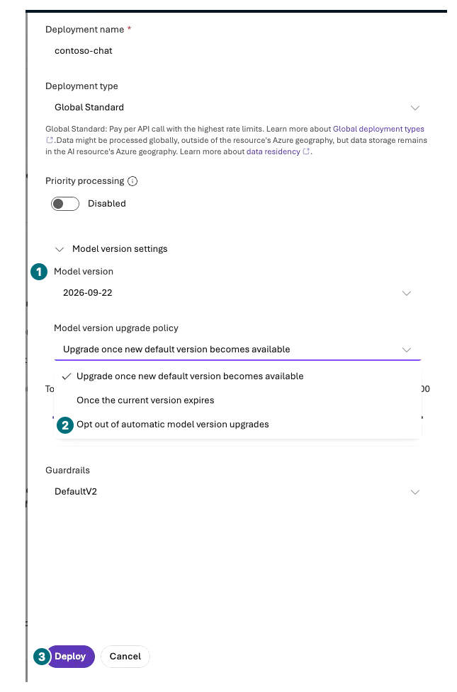
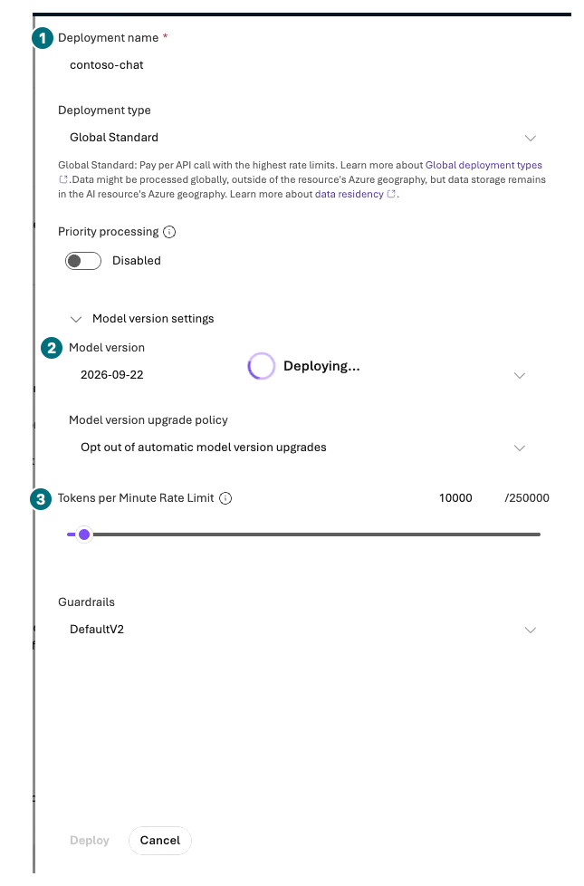
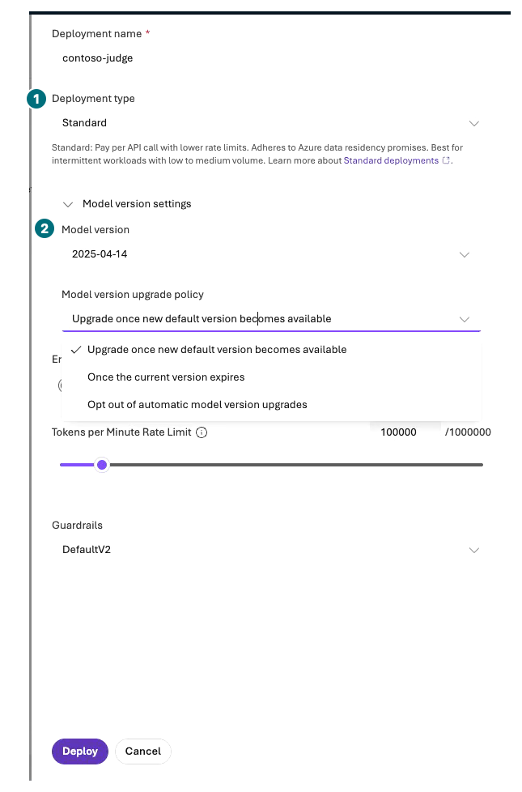

## Objectives

Deploy catalog models and distinguish **model ID, version, deployment name, deployment type, and TPM**. Prepare at most one answer deployment and one evaluation judge.

**Format:** Direct portal deployment, without PTU, training, or additional modality deployments.

**Start here:** Verify L01's project and approved model, region, processing geography, and costs.

**What to check:** Actual deployment state, version, and limits for `contoso-chat` and, if evaluating, `contoso-judge`.

## Concepts and lab map

**What you will try:** Model catalog, base-model deployment, quota, and versions.

**What is it, and why does it matter?** The model name identifies a product; a deployment name identifies your callable deployment. Global, Data Zone, and regional types have different processing boundaries. TPM is not a spending cap.

**How do you use it?** Open the exact model/version, inspect customized settings, and submit once.

**Where do you run it?** Microsoft Foundry → Build → Models → Deploy → Deploy a base model.

## Prerequisites

| Purpose | Model ID | Baseline version | Your deployment name |
| --- | --- | --- | --- |
| Answers | `gpt-6-sol` | `2026-09-22` | `contoso-chat` |
| L08 judge | `gpt-4.1` | `2025-04-14` | `contoso-judge` |

If unavailable, stop and record **baseline model unavailable**. A substitute cannot establish baseline validation. Label any separately approved substitute experiment with its actual model, version, region, and limitations.

## Steps

### 1. Deploy the answer model

| Step | Click or enter | Expected screen or value | If it fails |
| --- | --- | --- | --- |
| 1 | Verify the project and open `Build → Models`. | You see your project's deployments. | Distinguish the shared catalog from your deployment list. |
| 2 | Select `Deploy → Deploy a base model`. | Catalog's Models page opens. Check `Available in my project`. | No separate dialog is not a failure; inspect the current page and filter. |
| 3 | Search `gpt-6-sol` and select the **exact card**. | Provider and model ID match. | Do not substitute similarly named or recommended models. |
| 4 | On the model details page select `Deploy → Custom settings`. | The `Deploy gpt-6-sol` form opens; do not select quick `Default settings`. | Distinguish viewing a card from submitting a deployment. |
| 5 | Enter deployment name `contoso-chat`. | It does not duplicate another deployment. | Reuse your existing deployment if its conditions match. |
| 6 | Expand `Model version settings` and check `2026-09-22` and the upgrade policy. | If approved, select `Opt out of automatic model version upgrades` for a fixed comparison and record a review date before retirement. | Do not submit a missing version. Opting out does not guarantee permanent support. |
| 7 | Choose an approved consumption-based type such as `Global Standard/GlobalStandard`. | Processing geography is approved, this is not PTU, Priority stays off, and default guardrails remain. | Stop if permitted processing and supported deployment types do not match. |
| 8 | Set the allowed minimum suitable for individual practice and record the exact TPM. | It meets model/SKU minimum/increment and remaining quota. | Stop on insufficient quota; do not silently switch region/account. |
| 9 | Recheck costs/settings and select `Deploy` once. | Status becomes `Succeeded/Ready`. | Preserve deployment name and error code if Failed. |
| 10 | Reopen details and inspect version, type, TPM, and update policy. | Actual values match the plan. | Record a changed version as different conditions even if its name is unchanged. |

**Before submission: check the upgrade policy**

Check **1 version**; select **2 Opt out of automatic model version upgrades** only for an approved fixed comparison. **3 Deploy:** Submit once after checking cost, type, and TPM.

[Captioned video 02 · 00:28](../../downloads/portal/index.html?clip=02-model-agent&t=28&lang=en#02-model-agent)

**Deployment form: read name, version, and TPM separately**

**1 Name:** `contoso-chat`. **2 Version:** `2026-09-22`. **3 TPM:** Record your approved value. This frame is already `Deploying...`; its capacity may differ from the later evaluation adjustment. Do not click again; reopen Details after completion.

[Captioned video 02 · 00:33](../../downloads/portal/index.html?clip=02-model-agent&t=33&lang=en#02-model-agent)

### 2. Prepare the judge

If choosing L08's paid evaluation, repeat once for `gpt-4.1 / 2025-04-14 / contoso-judge`. Do not confuse target and judge models. Check both quotas before evaluation. If insufficient, **defer evaluation rather than reducing rows or relaxing scores**.

If this model's `Global Standard` shows `Unsupported region`, inspect support for **regional `Standard` in the same approved region** in the deployment-type picker. Select it only if its cost and processing location are approved, and record the actual SKU. Do not work around the restriction by creating another project or region. If L05's File search is incompatible with the baseline answer model, reuse this deployment for an explicitly separate tool experiment; do not change L08's answer model.

Twelve-row evaluation includes context, outputs, and judge requests. Single-user Chat and a class running concurrent evaluations need different TPM. Inspect the model's actual token/request units with the owner. Configured TPM is not consumed tokens or money.

**Judge: the SKU may differ from the answer deployment**

**1 Type:** This recording uses regional `Standard` in the same approved region. **2 Version:** `2025-04-14`. The upgrade picker is still open; verify the final policy and capacity in saved Details.

[Captioned video 03 · 00:37](../../downloads/portal/index.html?clip=03-retrieval-boundaries&t=37&lang=en#03-retrieval-boundaries)

### 3. Compare catalog information without invoking

Open comparison/benchmark information under `Discover → Models` and read supported tools, output formats, and modalities. Rankings are not quality scores for your purchasing task. Do not deploy or invoke Router, Batch, Flex, Priority, prompt caching, video, audio, or embeddings here.

L11 embeddings require separately approved additional scope. The default 3072 dimensions of `text-embedding-3-large` are not automatically compatible with a 1536-dimensional index. Do not silently submit another embedding deployment beyond the two manually deployed models. The portal may provision dependencies automatically: reinspect Models after agent/file creation and include every actual deployment in the resource and cost inventory.

## Success criteria

Record whether the exact baseline model/version deployed and its actual limits. Separate unavailable and failed states from success. No PTU, extra manual model deployments, or paid modalities were requested. Disclose automatic dependencies separately rather than claiming that only two deployments exist.

## Troubleshooting

Distinguish `InsufficientQuota`, `SkuNotAvailable`, and policy errors. Inspect the failed deployment before creating duplicates. A `429` may involve request rate, context size, or shared usage; raising limits is not always the solution.

## Cleanup

Keep deployment names and policies privately. Distinguish token consumption from other resource costs. Quota, Budget alerts, and TPM do not guarantee automatic monetary shutdown.

**Keep:** Each deployment's model ID/version/name/type/TPM/state/geography and any unavailability reason.

**Continue:** [L03: receive a first playground response](#l03).

