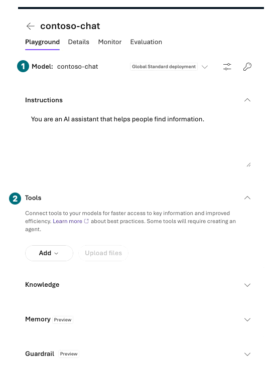
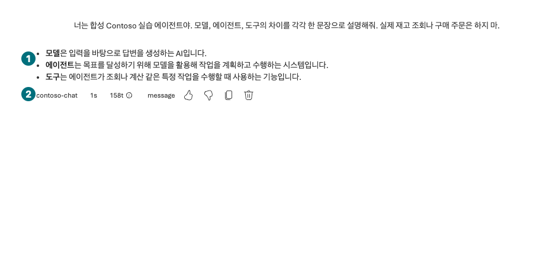

## Objectives

Send one question in the deployed model's Chat playground and inspect its input, response, and available usage details. Distinguish a model answer from tool execution.

<div class="lab-brief" markdown="1">

**Format:** Direct portal exercise: one send, plus one optional comparison.

**Start here:** Verify that L02's `contoso-chat` deployment is `Succeeded`.

**What to check:** Keep the actual response and send time for your selected deployment.

</div>

## Concepts and lab map

**What you will try:** Model playground, Chat, and supported model parameters.

**What is it, and why does it matter?** The playground sends a model request through the portal. One successful answer does not validate every Responses API feature, SDK path, or purchasing tool.

**How do you use it?** Select the deployment, paste a question, and send once. Record both settings and outcome.

**Where do you run it?** Microsoft Foundry → Build → Models → your deployment → playground. Do not open code view or a terminal.

## Prerequisites

Use your L01 project and L02 deployment. A matching deployment name in another project is not the same target. This module has no document or inventory tool. Do not attach real receipts or personal data.

## Steps

<div class="screen-step" markdown="1">

**Before sending: deployment and empty Tools**



**1 Model:** Verify your `contoso-chat`. **2 Tools:** Test without tools here. This is the state after removal, not a recording of the Remove action.

[Captioned video 02 · 01:18](../../downloads/portal/index.html?clip=02-model-agent&t=78&lang=en#02-model-agent)

</div>

| Step | Click or enter | Expected screen or value | If it fails |
| --- | --- | --- | --- |
| 1 | Select your project in Microsoft Foundry's project picker. | It matches your L01 record. | For duplicate names, compare the resource group in Manage. |
| 2 | Open `Build → Models → contoso-chat`. | Model ID, version, and deployment type match L02. | Return to L02 if the deployment is missing. |
| 3 | Select `Open in playground` or the model's Chat test action. | Chat selects `contoso-chat`. | Record blocked if the model/API combination is unsupported. |
| 4 | If Tools includes default `Web search`, use `Actions for Web search → Remove` in this test configuration. | The tool list is empty; do not connect Memory or Knowledge. | Do not mix differently scoped, separately billed Bing calls into this lab. |
| 5 | Open `Parameters`, set supported `Max Completion Tokens` to `512`, then press `Tab` and `Esc`. | Record the actual value and visible Reasoning Effort setting. | Do not add unsupported controls. Preserve truncated results as such. |
| 6 | Paste the question below into Chat. | It contains no secrets or real documents. | Review the text before sending. |
| 7 | Select `Send` once and wait for completion. | A completed response or an explicit error appears. | On 429, stop sending and inspect quota and deployment state. |
| 8 | Save response, time, deployment, and any visible usage, latency, or ID privately. | Unavailable values are marked `not shown in portal`. | Never invent response IDs or token counts. |

```prompt
You are a synthetic Contoso lab assistant. Explain the difference between a model, an agent, and a tool in one sentence each. Do not look up real inventory or place purchase orders.
```

<div class="screen-step" markdown="1">

**After sending: read the answer and deployment together**



**1 Answer:** Check the three actual explanations. **2 Footer:** Record the deployment and visible usage. This is not a purchasing-tool result. Use the English prompt above for your own exercise.

[Captioned video 02 · 01:18](../../downloads/portal/index.html?clip=02-model-agent&t=78&lang=en#02-model-agent)

</div>

### Optional: change one setting

Save the first answer, then select `New chat`. Reduce the **maximum output tokens** if your model exposes that control, and send the same question once. Verify the setting and compare length and completion. A truncated answer is not better merely because it is shorter. Skip unavailable controls and record why.

## Success criteria

Connect the deployment, input, and completion state to the actual answer, including any errors. An answer saying “I looked it up” is not a tool-call record. This request does not validate structured output, images, or embeddings.

## Troubleshooting

For `401/403`, inspect organization and project access. For `404`, inspect project and deployment names. For `429`, inspect quota, TPM, and concurrent requests. Keep error request/correlation IDs privately; exclude account and subscription details from public captures.

## Cleanup

New Chat separates conversation context; it does not stop billing or delete server records. Closing the browser leaves the deployment in place.

<div class="lab-handoff" markdown="1">

**Keep:** Send time, model/version/deployment, question, actual answer, and visible usage or its absence.

**Continue:** [L04: create a Prompt Agent](#l04).

</div>
