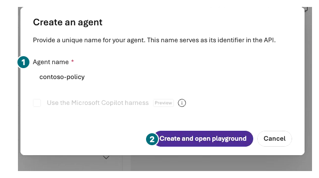
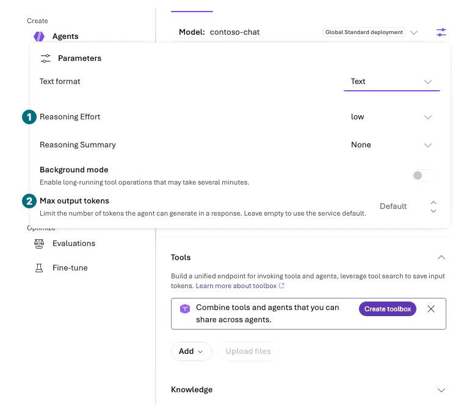
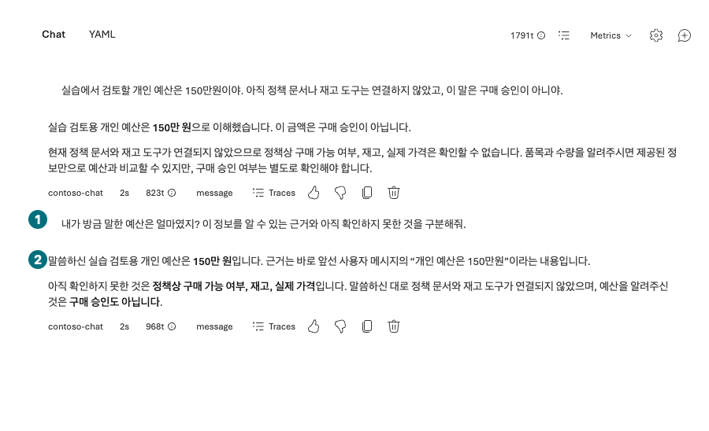
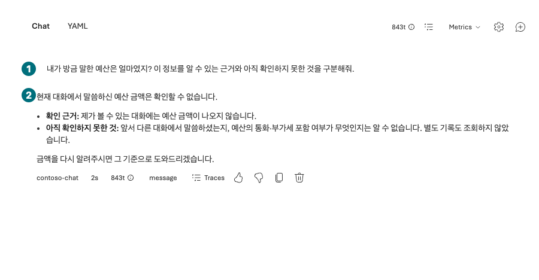

## Objectives

Create the `contoso-policy` Prompt Agent in the portal and distinguish Instructions from conversation context. Keep this same agent for L05, L09, and L10.

<div class="lab-brief" markdown="1">

**Format:** Direct portal exercise with at most three Chat sends.

**Start here:** Open `Build → Agents` in your project.

**What to check:** A saved name, deployment, and instructions, plus responses from separate conversations.

</div>

## Concepts and lab map

**What you will try:** Prompt Agent, Instructions, saved versions, and Conversations.

**What is it, and why does it matter?** Instructions define behavior across requests. A Conversation supplies context for this conversation. Neither grants data access or business approval.

**How do you use it?** Compare a question in the same and a new conversation, then reopen the saved configuration.

**Where do you run it?** Microsoft Foundry → Build → Agents → the editor and Chat.

## Prerequisites

Have the L02 deployment ready. Open [instructions v2](../../data/en/prompts/agent-v2.txt) in the browser and copy the complete text. No policy files or purchasing tools are connected yet. Invented policy figures or inventory are failures.

## Steps

### 1. Create the agent and save its settings

<div class="screen-step" markdown="1">

**Save as agent: name it and open the editor**



**1 Name:** `contoso-policy`. **2 Create:** Select once only if your agent does not already exist. Do not select the Copilot harness.

[Captioned video 02 · 01:39](../../downloads/portal/index.html?clip=02-model-agent&t=99&lang=en#02-model-agent)

</div>

| Step | Click or enter | Expected screen or value | If it fails |
| --- | --- | --- | --- |
| 1 | Verify the project and select `Build → Agents → New agent → Build an agent`; use `Save as agent` from L03. | A Prompt Agent creation page or `Create an agent` opens. | Use the plain Prompt Agent path, not Code an agent or an external-agent connection. |
| 2 | Enter Agent name `contoso-policy`, keep Text mode, and select `Create agent and open playground` once. The Save as agent path labels this button `Create and open playground`. | Your agent's version 1 editor opens. | Reopen an existing owned agent rather than duplicating it. Do not select Voice or the Copilot harness. |
| 3 | Select `contoso-chat` under Model. | It is the deployment from L02. | Distinguish a catalog model ID from a deployment name. |
| 4 | Paste the **entire** v2 file into Instructions. | First and last lines match the source file. | Correct incomplete copying before sending. |
| 5 | Recheck Tools. If a Web search toolbox was added automatically, use `Actions for <name> toolbox → Remove` to detach it. | Tools, Knowledge, and Memory are empty. | Recheck even after removing the model playground's Web search. Detaching is not deleting the toolbox resource. |
| 6 | In `Parameters`, set `Max output tokens` to `2048` and supported Reasoning Effort to `low`; press `Tab → Esc`, then `Save` once. | A saved numeric version appears; do not assume the playground's token limit was copied. | Do not send on failure or select Publish/Improve instructions. |

<div class="screen-step" markdown="1">

**Instructions: check the file's first and last lines**


**1 Model:** `contoso-chat`. **2 Instructions:** Paste your complete English v2 file. Scroll the field to compare the last line too, then Save; do not copy the screenshot's Korean text.

[Captioned video 02 · 02:04.5](../../downloads/portal/index.html?clip=02-model-agent&t=124.5&lang=en#02-model-agent)

</div>

<div class="screen-step" markdown="1">

**Parameters: Default is not a completed setting**



**1 Reasoning Effort:** `low` when supported. **2 Max output tokens:** This frame still shows `Default`. Enter `2048`, press Tab and Esc, Save, and reopen to verify.

[Captioned video 02 · 01:53](../../downloads/portal/index.html?clip=02-model-agent&t=113&lang=en#02-model-agent)

</div>

<div class="screen-step" markdown="1">

**After Save: verify the saved numeric version**


**1 Version:** This recording saved `2`; record your own actual number. **2 Save:** Save changed Instructions/output settings. **3 Publish:** Not part of this Chat exercise.

[Captioned video 02 · 02:04.5](../../downloads/portal/index.html?clip=02-model-agent&t=124.5&lang=en#02-model-agent)

</div>

### 2. Compare the same conversation with a new one

| Step | Click or enter | Expected screen or value | If it fails |
| --- | --- | --- | --- |
| 1 | Send the first question below once in `Chat`. | The budget is a user statement within this conversation. | Preserve any invented policy or approval claim as a failure. |
| 2 | Send the second question once in the same conversation. | The prior budget is remembered without executing a purchase. | Keep the actual answer rather than editing it to match expectations. |
| 3 | Select `New conversation` or `New chat`, then send the second question once. | The previous budget is unknown or clarification is requested. | Compare conversation IDs/times to ensure the conversation changed. |

First input:

```prompt
My personal budget for this synthetic exercise is KRW 1,500,000. No policy documents or inventory tools are connected yet. This statement is not purchasing approval.
```

Second input:

```prompt
What budget did I just mention? Distinguish your evidence from what you still cannot verify.
```

<div class="screen-step" markdown="1">

**Same conversation: the earlier user statement is evidence**



**1 Follow-up:** Same conversation as the budget statement. **2 Answer:** Check that the source is the user statement, not verified policy, stock, or purchasing approval.

[Captioned video 02 · 02:43](../../downloads/portal/index.html?clip=02-model-agent&t=163&lang=en#02-model-agent)

</div>

<div class="screen-step" markdown="1">

**Below the response: Traces and Copy**


**1 Traces:** Open this response's execution record. **2 Copy:** Preserve your own actual answer. Pictured model/token values belong to this recording, not your measurements.

[Captioned video 02 · 02:43](../../downloads/portal/index.html?clip=02-model-agent&t=163&lang=en#02-model-agent)

</div>

<div class="screen-step" markdown="1">

**New conversation: the same question no longer supplies the budget**



**1 Question:** The budget was not supplied again. **2 Answer:** The amount is absent from this conversation. This is not a long-term Memory recall test.

[Captioned video 02 · 03:01](../../downloads/portal/index.html?clip=02-model-agent&t=181&lang=en#02-model-agent)

</div>

### Reopen to verify persistence

Return to `Build → Agents`, then reopen `contoso-policy`. Verify the deployment and Instructions. A displayed numeric agent version is not a conversation ID. Starting a new Chat is not saving long-term Memory.

Also reopen `Build → Models` to inspect automatic dependencies. In the recorded environment, an additional `text-embedding-ada-002` deployment appeared around agent creation. Its cause was not attributed through Activity log; this is not evidence of a manually deployed or invoked embedding model. Include automatic deployments and the detached-but-not-deleted toolbox in the actual resource and cost inventory.

## Success criteria

The saved `contoso-policy` uses the intended model and instructions. You retain actual same/new-conversation responses. With no purchasing tools, claims such as “confirmed eight in stock” or “order completed” are not execution evidence.

## Troubleshooting

If creation succeeds but invocation returns 403, distinguish management-plane creation permissions from data-plane invocation permissions. Do not paste keys or enable public access as a workaround. Check autosave before leaving the editor.

## Cleanup

Keep the agent for the next module's three policy files. Store only synthetic content in conversation records.

<div class="lab-handoff" markdown="1">

**Keep:** Project, `contoso-policy` name/version, instructions v2, and the same/new-conversation comparison.

**Continue:** [L05: answer from policy files](#l05).

</div>
