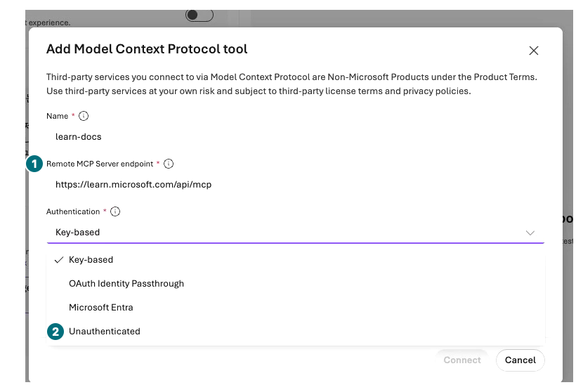
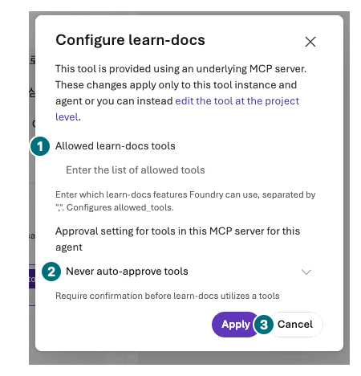

## Objectives

Conditionally connect a real read-only remote tool, distinguishing saved connection, call approval, and execution success. Do not use fictional purchasing APIs or localhost endpoints.

<div class="lab-brief" markdown="1">

**Format:** Conditional remote MCP exercise. OpenAPI, Toolbox, and Skills are configuration inspection only.

**Start here:** Confirm organizational permission to use the public Microsoft Learn MCP server.

**What to check:** Allowed tools, authentication, and an actual call record or a specific blocking reason.

</div>

## Concepts and lab map

**What you will try:** MCP servers, tool allowlists, call approval, and OpenAPI prerequisites.

**What is it, and why does it matter?** MCP and OpenAPI describe connections; they do not automatically provide a server or authorization. A saved connection can still fail when called.

**How do you use it?** Allow only public-document search and inspect one call's arguments and result.

**Where do you run it?** Microsoft Foundry → Build → Agents → a separate test agent → Tools → Add → Add tools → Custom.

## Prerequisites

Avoid changing L05's evaluation conditions: create `contoso-docs` using L04's steps. Select the same `contoso-chat`; save Instructions saying “Search only public Microsoft Learn documents and cite sources. Do not perform purchasing or ordering actions.” The public endpoint is `https://learn.microsoft.com/api/mcp`. Do not add arbitrary external servers without approval.

This recording covers **connection/configuration inspection only**. One anonymous Connect to the official endpoint was inspected in an unsaved policy-agent draft, then canceled and reloaded to verify that saved version 4 still had File search only. The project-level `learn-docs` tool was retained; **zero MCP search calls** ran. Perform the invocation steps only with a separate test agent, supported model, and organizational approval.

## Steps

<div class="screen-step" markdown="1">

**Connection form: official endpoint and authentication**



**1 Endpoint:** `https://learn.microsoft.com/api/mcp`. **2 Unauthenticated:** For this official public server. This intermediate frame still has default Key-based selected; change and verify your own selection.

[Captioned video 05 · 00:24](../../downloads/portal/index.html?clip=05-inspection-retention&t=24&lang=en#05-inspection-retention)

</div>

| Step | Click or enter | Expected screen or value | If it fails |
| --- | --- | --- | --- |
| 1 | Open `contoso-docs → Tools → Add → Add tools`. | The **Select a tool** dialog opens. | Check permission, model compatibility, and regional support. |
| 2 | On `Custom`, select `Model Context Protocol (MCP)`. | The bottom Create button becomes available. | Record unavailable/blocked if missing. |
| 3 | Select `Create` to open **Add Model Context Protocol tool**. | This is the name/endpoint/authentication form. | Do not confuse it with final agent Save or a search invocation. |
| 4 | Enter Name `learn-docs` and Remote MCP Server endpoint `https://learn.microsoft.com/api/mcp`. | Official HTTPS Microsoft Learn endpoint. | Reuse an approved existing tool if the name already exists; do not create duplicates. |
| 5 | Replace default Key-based Authentication with **Unauthenticated**. | Credential fields disappear; no key/token is required. | Never bypass certificate warnings or invent credentials. |
| 6 | Select `Connect` once, then click the added `learn-docs` name under Tools. | **Configure learn-docs** opens. Connect creates a project tool/draft association, not a successful search. | Preserve connection failures without repeated submissions. |
| 7 | Enter exactly `microsoft_docs_search` in the **Allowed learn-docs tools** textbox. | `allowed_tools` restricts the instance to one search tool. | Do not continue with a blank allowlist or every tool. |
| 8 | Keep Approval setting **Never auto-approve tools**, then select `Apply → Save`. Reopen the saved agent and inspect settings. | Every tool call requires confirmation. | Do not send Chat unless restrictions and approval are verified. |
| 9 | Send the question below once in a new Chat. | A search-call approval request appears. | Otherwise inspect details to determine whether a tool ran. |
| 10 | Inspect server, tool, and search terms; approve only that read. | A tool result with official documentation URLs returns. | Reject unexpected tools or writes and preserve the record. |
| 11 | Open run details and inspect arguments, result, and status. | Tool call and final answer belong to the same run. | A URL in answer text alone is not call evidence. |

```prompt
Find the Microsoft Learn documentation for Foundry Agent Service server-side tracing. Use only microsoft_docs_search. Give the official link and where to connect Application Insights.
```

<div class="screen-step" markdown="1">

**Inspection: a blank allowlist is not a saved restriction**



**1 Allowlist:** Empty in the recording. Only in a separately approved exercise, enter and verify `microsoft_docs_search`. **2 Approval:** `Never auto-approve tools`. **3 Cancel:** The recorded configuration was canceled; zero MCP calls ran.

[Captioned video 05 · 01:07](../../downloads/portal/index.html?clip=05-inspection-retention&t=67&lang=en#05-inspection-retention)

</div>

<div class="screen-step" markdown="1">

**Reopen: the policy agent keeps only File search**


**1 Model / 2 File search:** This is the recorded saved policy configuration. A retained project connection is different from a saved agent association or an executed call.

[Captioned video 05 · 01:36](../../downloads/portal/index.html?clip=05-inspection-retention&t=96&lang=en#05-inspection-retention)

</div>

### How OpenAPI and Toolbox differ

<details class="optional-path" markdown="1">
<summary>Inspection only: open other connection dialogs</summary>

Reopen `Tools → Add → Add tools → Custom` and choose `OpenAPI tool`. Inspect the required schema, actual HTTPS server, and supported authentication fields, then select **Cancel**. Do not save without a real approved backend, authentication, permissions, and a safe operation. Never register `example.com` or a purchasing API example as a real service.

If Toolbox/Skills appear, inspect connection, allowed tools, pinned version, and permissions, then cancel. Viewing a dialog does not execute a Toolbox or Skill. This module does not deploy servers, issue tokens, or expand permissions.

</details>

## Success criteria

If available, inspect the real allowed `microsoft_docs_search` call, arguments, result, and sources. Otherwise identify connection, authentication, network, or tool-visibility failure. **Documentation search success is not Contoso inventory execution.**

## Troubleshooting

Check endpoint URL, authentication, organizational egress policy, then server support. Do not paste tokens into screenshots or guides or enable public access as a workaround. Preserve incorrect tool queries rather than retrying indefinitely.

## Cleanup

Do not configure scheduled calls or write tools. Record the test connection privately, and do not delete shared connections.

<div class="lab-handoff" markdown="1">

**Keep:** Server URL, allowlist, authentication type, approval scope, and actual call/blocking outcome, excluding secrets.

**Continue:** [L08: evaluate the twelve fixed questions](#l08).

</div>
