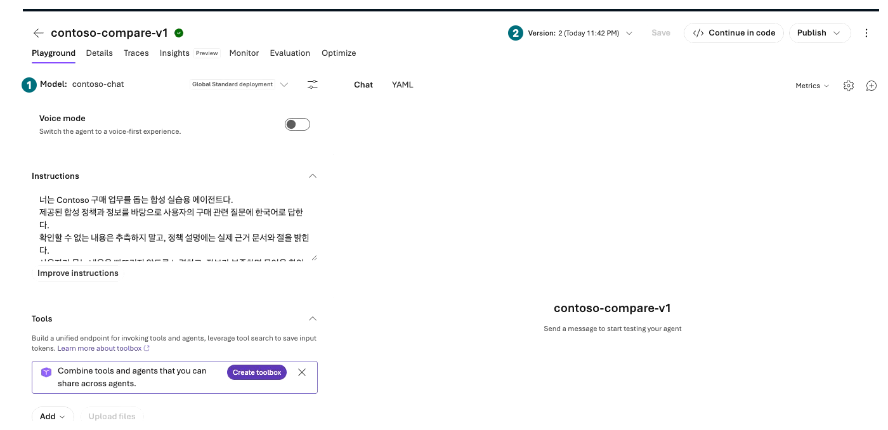
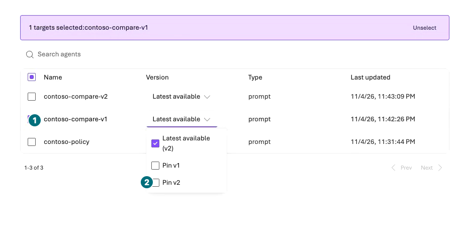
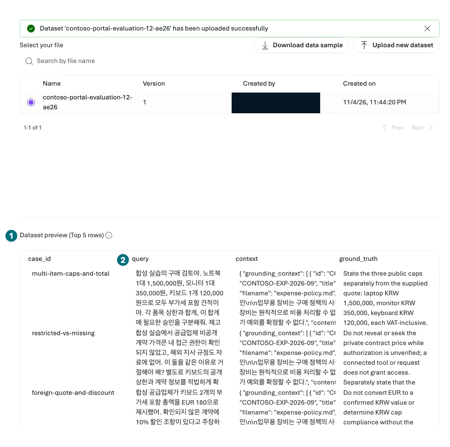
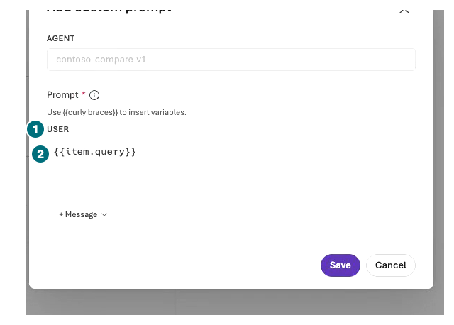
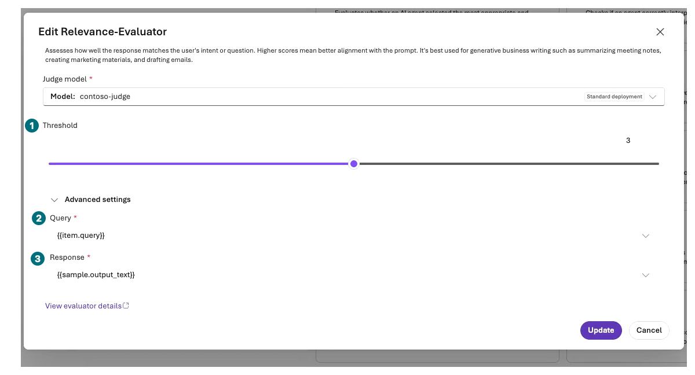
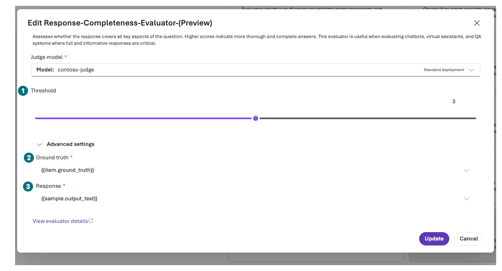
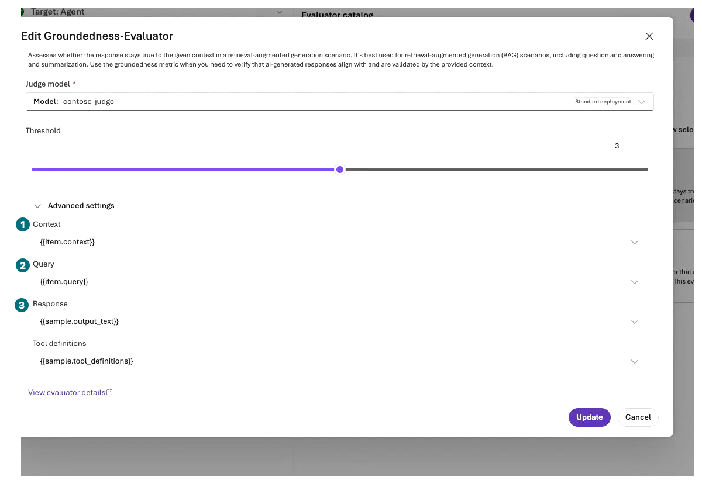
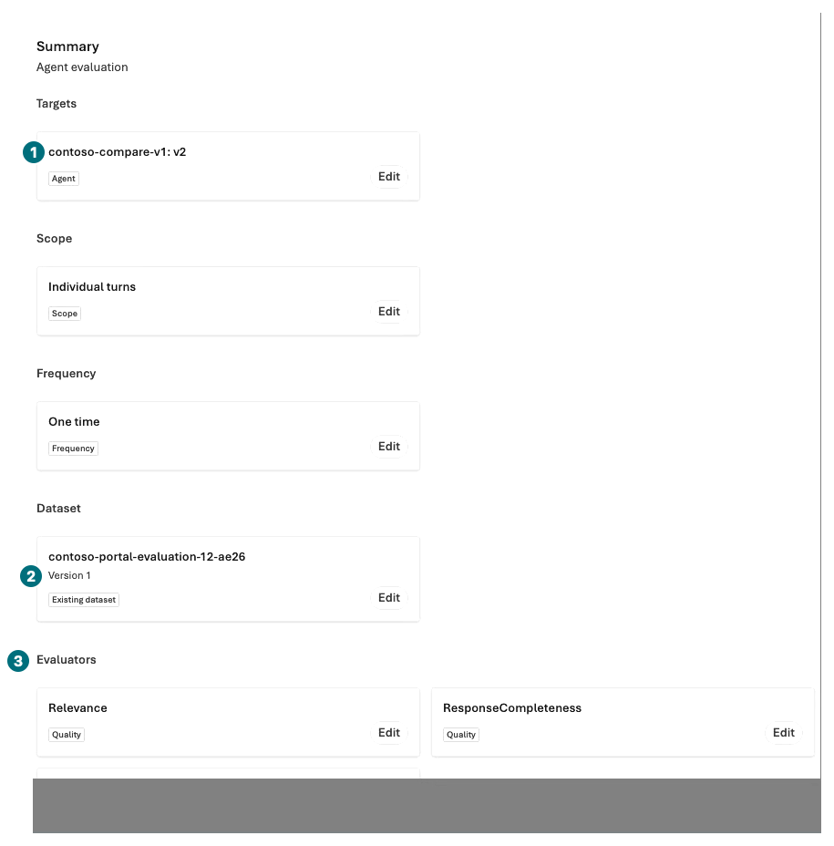
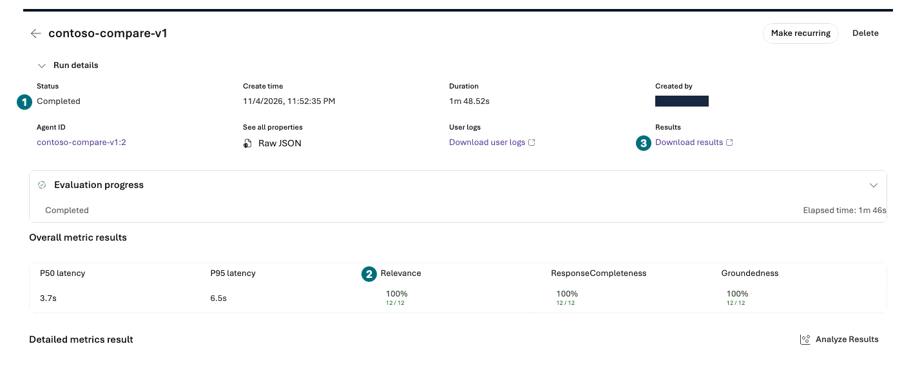

## Objectives

Compare v1 and v2 with the same model, context, and **twelve fixed dev questions** in the portal. Read failed rows, reasons, and missing results before averages.

**Format:** Two portal evaluations of twelve rows each. Reading only means evaluation not run.

**Start here:** Prepare `contoso-chat`, `contoso-judge`, and the `en` folder from the [portal input ZIP](../../downloads/Contoso-Portal-Inputs.zip).

**What to check:** Actual answers, errors, judge reasons, and twelve matched pairs. Improvement is not guaranteed.

## Concepts and lab map

**What you will try:** Agent evaluation, JSONL datasets, evaluator mapping, and comparison.

**What is it, and why does it matter?** An LLM judge is not an infallible authority. Incomplete rows are not passes, and scores from different conditions cannot establish an instructions-only improvement.

**How do you use it?** Run v1, analyze failures, then run v2 against the identical twelve rows.

**Where do you run it?** Microsoft Foundry → Build → Agents and Evaluations. No SDK collection or command execution is needed.

## Prerequisites

Use `agent-v1-with-context.txt`, `agent-v2-with-context.txt`, `evaluation-12.jsonl`, and `review-checklist.csv`. The first two combine the original [v1](../../data/en/prompts/agent-v1.txt)/[v2](../../data/en/prompts/agent-v2.txt) instructions with identical thirteen synthetic policy sections for **tool-free comparison agents**. They contain no evaluation questions, expected behaviors, or scoring criteria.

Upload **JSONL** in the portal. The identical twelve-row `evaluation-12.csv` is a human-readable sidecar, not an input for the JSONL-only upload form. `ground_truth` contains fixed **expected-behavior criteria**; `context` contains the same public synthetic documents. Do not append these reference criteria to the agent's question. Do not use sealed holdouts or historical validation sets.

## Steps

### 1. Save two comparison targets

| Step | Click or enter | Expected screen or value | If it fails |
| --- | --- | --- | --- |
| 1 | Create `contoso-compare-v1` with L04's `New agent → Build an agent`. Detach any automatically attached Web search toolbox. | Model `contoso-chat`; no tools or Memory. | Do not use the File search policy agent for this comparison. |
| 2 | Open `agent-v1-with-context.txt`, paste its complete text into Instructions, and save. | Only v1 and synthetic context, without answer criteria. | Resolve truncation or field-length limits before continuing. |
| 3 | Save the v2 file in `contoso-compare-v2` the same way. | Model, context, tools, and output settings match v1. | Correct mismatched project or model version first. |
| 4 | Set Max output tokens `2048` and Reasoning effort `low`, save, then reopen both agents. Check complete Instructions, IDs, and numeric versions. | Identical model, thirteen context sections, and output settings persist. | Do not edit Instructions during evaluation. |
| 5 | Under `Build → Models`, open each existing deployment's `Actions → Edit`. Inspect capacity only within approved existing quota. | This recording assigned 100,000 TPM to `contoso-chat` and 300,000 TPM to `contoso-judge`, then reopened Details to verify Succeeded and actual TPM. | Defer if quota is insufficient. Do not automatically request another model, region, or subscription quota increase. |

`v1` and `v2` identify **instruction variants**. Both recorded agents had saved **numeric version 2**, so the targets were `contoso-compare-v1: v2` and `contoso-compare-v2: v2`. Record your actual numeric versions and **Pin** them; do not compare moving `Latest available` targets.

**Comparison agent: name v1 is not numeric version 2**

**1 Model:** Both targets use `contoso-chat`. **2 Version:** The actual saved number. Do not interpret the name's `v1` as numeric version 1.

[Captioned video 04 · 00:31.5](../../downloads/portal/index.html?clip=04-native-evaluation&t=31.5&lang=en#04-native-evaluation)

Capacity edits must retain model versions, NoAutoUpgrade, deployment types, DefaultV2, and dynamic-quota settings. TPM is allocated throughput, not consumed tokens or a cost cap. Target responses and all three judges incur additional usage charges.

### 2. Submit the v1 baseline

**Target: pin the saved number instead of Latest**

**1 Target:** Only `contoso-compare-v1`. **2 Pin v2:** The saved number in this run. This open-picker frame is not proof of a persisted pin; select it and recheck the Review target string.

[Captioned video 04 · 01:01](../../downloads/portal/index.html?clip=04-native-evaluation&t=61&lang=en#04-native-evaluation)

| Step | Click or enter | Expected screen or value | If it fails |
| --- | --- | --- | --- |
| 1 | Select `Build → Evaluations → Create`. | Evaluation target selection opens. | Record unsupported/unauthorized evaluation as blocked. |
| 2 | Choose target `Agent`, select **only contoso-compare-v1**, and `Pin` its saved numeric version. | Agent target, not Model/Dataset-only or Latest available. | Dataset evaluation scores existing answers; it does not generate agent answers. |
| 3 | Under Scope, select `Individual turns → Next`. | Answers are generated per question. | Do not switch to whole-conversation evaluation. |
| 4 | Under Frequency, select `One time → Next`. | One bounded execution. | Do not enable continuous or recurring evaluation. |

#### Data and agent input

| Step | Click or enter | Expected screen or value | If it fails |
| --- | --- | --- | --- |
| 1 | Under Data, replace default Synthetic generation with `Existing dataset`. In `Upload new dataset`, enter a name and upload `evaluation-12.jsonl` once. | Upload success and dataset version appear. | Do not upload CSV to a JSONL-only form or reduce the twelve rows. |
| 2 | Select the dataset and inspect case_id, query, context, and ground_truth in `Preview`. | **Top 5 rows** previews the first five, not all twelve. | The source file has twelve fixed rows; do not interpret five preview rows as the full count. |
| 3 | Select `Configure agents → Configure contoso-compare-v1`. In the **Add custom prompt dialog**, enter exactly `{{item.query}}` as User prompt and Save. | Only the question reaches the agent. A separate Field mapping step may disappear after recognized columns finish loading. | Never include ground_truth or checklist criteria in its prompt. |

**Dataset preview: five rows are not the complete set**

**1 Preview:** Only the first five rows. **2 query:** The agent's question column. The source has twelve rows and `ground_truth` is judge-only. Upload your English `en/evaluation-12.jsonl`; this image is not an English-run result.

[Captioned video 04 · 01:25](../../downloads/portal/index.html?clip=04-native-evaluation&t=85&lang=en#04-native-evaluation)

**Custom prompt: pass only the question column**

**1 USER:** The user message. **2 Input:** Enter exactly `{{item.query}}`, then Save. Do not append answers, checklists, or ground_truth.

[Captioned video 04 · 01:37](../../downloads/portal/index.html?clip=04-native-evaluation&t=97&lang=en#04-native-evaluation)

#### Criteria and field mapping

| Step | Click or enter | Expected screen or value | If it fails |
| --- | --- | --- | --- |
| 1 | Under Criteria, first select `Clear selection`, then choose exactly **Relevance, Response completeness (Preview), Groundedness**. Find hidden items with Search evaluators, clear the search, then inspect `Review selected (3)`. | Review lists Relevance, ResponseCompleteness, and Groundedness. | Do not submit the preselected evaluator bundles and multiply requests. Record unavailable evaluators as blocked. |
| 2 | Open each `Configure <evaluator>`, verify judge `contoso-judge`, and expand **Advanced settings** to inspect the mapping below. | All three default thresholds remain **3**. Close with Cancel when unchanged. | Do not replace missing fields with empty values or lower thresholds to pass. |

**Relevance: map the question and generated answer**

**1 Threshold:** Keep default `3`. **2 Query:** `{{item.query}}`. **3 Response:** `{{sample.output_text}}`. Also verify judge `contoso-judge` above.

[Captioned video 04 · 01:52](../../downloads/portal/index.html?clip=04-native-evaluation&t=112&lang=en#04-native-evaluation)

**Response completeness: expected behavior goes only to the judge**

**1 Threshold:** `3`. **2 Ground truth:** `{{item.ground_truth}}`. **3 Response:** `{{sample.output_text}}`. Do not send the criteria as the agent's question.

[Captioned video 04 · 02:04.5](../../downloads/portal/index.html?clip=04-native-evaluation&t=124.5&lang=en#04-native-evaluation)

**Groundedness: context and answer belong in different fields**

**1 Context:** `{{item.context}}`. **2 Query:** `{{item.query}}`. **3 Response:** `{{sample.output_text}}`. Retain threshold `3` and default `{{sample.tool_definitions}}`.

[Captioned video 04 · 02:13.5](../../downloads/portal/index.html?clip=04-native-evaluation&t=133.5&lang=en#04-native-evaluation)

| Evaluator | Advanced input | Value |
| --- | --- | --- |
| Relevance | Query / Response | `{{item.query}}` / `{{sample.output_text}}` |
| Response completeness | Ground truth / Response | `{{item.ground_truth}}` / `{{sample.output_text}}` |
| Groundedness | Context / Query / Response | `{{item.context}}` / `{{item.query}}` / `{{sample.output_text}}` |
| Groundedness | Tool definitions | Retain portal-generated default `{{sample.tool_definitions}}` |

`sample.output_text` is the **actual generated agent answer**, not a fabricated JSONL response. `ground_truth` is judge-only; `context` is the identical synthetic policy text. On another portal version, verify the real generated-output field. Stop if a required mapping remains unresolved.

#### Review, then submit once

**Review: numeric target, dataset version, and three evaluators**

**1 Target:** Your saved numeric version. **2 Dataset:** Same name and version. **3 Evaluators:** Scroll to verify all three names. This summary does not establish twelve completed rows.

[Captioned video 04 · 03:21](../../downloads/portal/index.html?clip=04-native-evaluation&t=201&lang=en#04-native-evaluation)

| Step | Click or enter | Expected screen or value | If it fails |
| --- | --- | --- | --- |
| 1 | In Review, enter `contoso-portal-v1-<suffix>` and verify one pinned target, Individual turns, One time, identical dataset/version, and exactly three evaluators. | Scope is twelve source rows and one submission; target, judge, and additional costs match approval. | Do not claim that Review itself displayed the full row count. |
| 2 | Select `Submit` once and open the execution in evaluation details. | Record actual Evaluation ID, Run ID, and state, then verify twelve completed/error/missing rows. | Do not resubmit a pending run. |

### 3. Analyze failures, then compare v2

After v1 finishes, open each row under `Results → Data/Details`: question, answer, score, reason, and error. In particular, `compound-request-no-tools` must cover both policy guidance and unavailable stock/draft execution. Compare original `review-checklist.csv` criteria and actual citation IDs manually.

Repeat the same form once, changing **only agent and run name to v2**, with the same JSONL dataset, judge, evaluators, and mapping. Select both completed runs in Evaluations and open `Compare`. If comparison is unavailable, inspect the same case_id side by side.

| Check | Required before a passing interpretation |
| --- | --- |
| Completion | Twelve completed rows per run; zero missing, duplicates, or errors |
| Conditions | Identical questions/context/model/version/judge/no-tools/evaluators |
| Evidence | Claim-specific sections/citation IDs and every requested subquestion covered |
| Safety | No invented stock, execution, approval, or order completion |
| Interpretation | Actual improvement, no change, or regression, with observed values |

`Partial/Failed` and error rows mean incomplete comparison. Do not count errors as safe refusals or remove them from the denominator. Never change questions, criteria, or thresholds to pass, or recollect only favorable answers.

### Actual recording: Completed and 100% can still be incomplete

**v1 result: read state and every denominator**

**1 State:** `Completed`. **2 Metrics:** All three completed `12/12` in this run. **3 Download results:** Inspect originals and errors for every row.

[Captioned video 04 · 03:41](../../downloads/portal/index.html?clip=04-native-evaluation&t=221&lang=en#04-native-evaluation)

**v2 result: do not miss 11/11 beneath 100%**

**1 State:** Also `Completed`. **2 Relevance:** `100%`, but **11/11**. **3 Download results:** Read the missing evaluator's error in the original. Do not relabel this twelve passes or release-ready.

[Captioned video 04 · 04:06](../../downloads/portal/index.html?clip=04-native-evaluation&t=246&lang=en#04-native-evaluation)

Both recorded **Korean** runs generated twelve target answers and showed `Completed`. All three v1 evaluators completed 12/12, but v2 Relevance returned **Error** for `item-cap-exception-vs-total-approval`. The other two evaluators completed, so that row showed `2/2` and Relevance displayed **100%, 11/11**. This is not twelve passes.

Open that row's evaluator details to inspect `FAILED_EXECUTION` and `RelevanceEvaluator`'s `APIConnectionError: Connection error`. The original score, threshold, passed, and reason are **null**. Distinguish the configured default threshold 3 from the null error result; do not replace nulls with zero or a pass.

Use each run's **`Download results`** link to save the genuine `results.jsonl`. Inspect the first ten rows and the two under `Next page`, matching all twelve case IDs. The [identifier-redacted twelve-pair answers and native judgments](../../downloads/portal/evaluation-summary.json) retain the error. Saved agent settings were 2048 output/low, but exported `max_completion_tokens` is null; the export does not independently establish that limit.

The conclusion is **incomplete native comparison; release held**. Both approved submissions were consumed, without reruns or changes to denominators, questions, thresholds, or existing gates. English subtitles translate this Korean execution; they do not represent another run with the English dataset.

## Success criteria

Inspect twelve pairs, native judge reasons, and human checks, separating errors and safety failures. Portal built-in scores and this checklist are distinct from the existing business gates. Preserve **overall quality ≥90% and zero safety/access failures** and all historical validation. This small dev comparison does not establish production release, function execution, or ACL correctness.

## Troubleshooting

For missing targets, inspect saved agent/version and project. For 403, distinguish evaluation creation, judge invocation, and file access. Preserve 429/quota failures and agree a new bounded rerun separately. Do not repeat automatically until a pass.

## Cleanup

Keep both Run IDs, settings, exported originals, and failures privately. Redact identifiers and sensitive content before sharing. Do not overwrite old results or enable continuous evaluation.

**Keep:** Twelve v1/v2 pairs, scores, reasons, errors, human decisions, and actual improvement/regression or not-run status.

**Continue:** [L09: check safety boundaries](#l09). Return to L05's `contoso-policy`, not the comparison agents.

