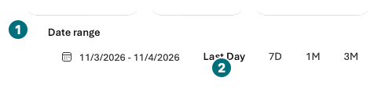
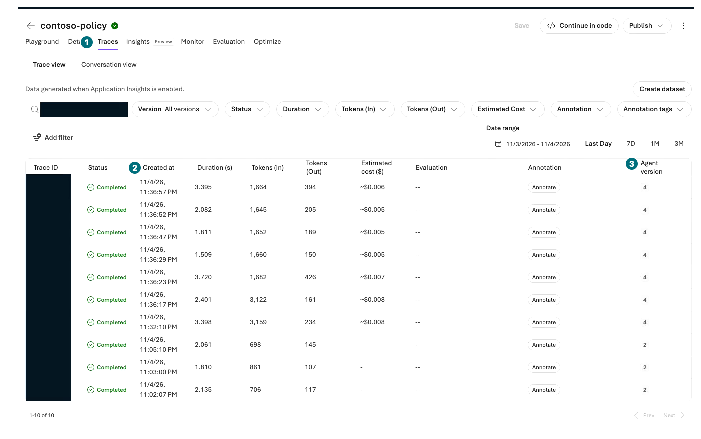
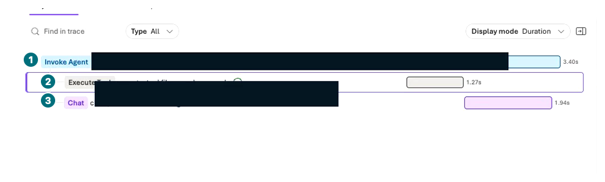
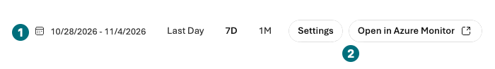

## Objectives

Find one of your requests in Traces and connect input, retrieval, response, latency, and errors. Never substitute an unrelated successful trace for a failed request.

<div class="lab-brief" markdown="1">

**Format:** Direct portal inspection, with one synthetic request only if none exists after logging connection.

**Start here:** Verify L01's Application Insights connection and L05/L09's send time, agent/version, and visible identifiers.

**What to check:** The same request's actual trace/spans, or a specific collection, permission, or connection blocker.

</div>

## Concepts and lab map

**What you will try:** Server-side tracing, spans, Application Insights, and monitoring.

**What is it, and why does it matter?** A trace represents a request path; spans represent operations such as retrieval and generation. Dashboard averages cannot prove a particular answer's evidence or function success.

**How do you use it?** Narrow by time, agent, and ID, then inspect parent/child spans from the same execution.

**Where do you run it?** Microsoft Foundry → Agents → target → Traces, and optionally the connected Application Insights in Azure portal.

## Prerequisites

Logging applies to requests **after connection**. Portal-connected server tracing does not automatically instrument local client functions. Trace access is not permission to retain or disclose all original content.

## Steps

### 1. Match the request, target, and time range

| Step | Click or enter | Expected screen or value | If it fails |
| --- | --- | --- | --- |
| 1 | Open `Build → Agents → contoso-policy → Traces`. | The intended agent/version is selected. | Check project and duplicate names. |
| 2 | If `Connect` appears, verify L01's Application Insights connection. | The dedicated log resource is connected. | Record blocked if access or cost approval is missing. |
| 3 | Narrow the time filter around the last request. | L05/L09's send time is included. | Distinguish local time from UTC. |
| 4 | Only if needed, send the question below **once after connection**. | Record its new time and response. | Reuse an existing post-connection request when available. |
| 5 | Allow a few minutes for ingestion, then select `Refresh`. | A matching time/agent/conversation or response row appears. | Do not repeatedly send Chat because the list is empty. |

```prompt
Use the policy documents to give Contoso's laptop cap and approvers for an order strictly above KRW 2,000,000. Do not look up inventory or execute an order.
```

<div class="screen-step" markdown="1">

**Time first: do not assume Last Day includes your request**



**1 Date range:** Include the send time. **2 Last Day:** Only a quick default range. For an empty list, check timezone, post-connection requests, and ingestion delay before sending anything again.

[Captioned video 03 · 04:06](../../downloads/portal/index.html?clip=03-retrieval-boundaries&t=246&lang=en#03-retrieval-boundaries)

</div>

<div class="screen-step" markdown="1">

**Trace list: find the same time and agent version**



**1 Traces:** The tab inside your target agent. **2 Created at:** Match the send time. **3 Agent version:** Compare the saved number before opening that row.

[Captioned video 03 · 04:06](../../downloads/portal/index.html?clip=03-retrieval-boundaries&t=246&lang=en#03-retrieval-boundaries)

</div>

### 2. Open parent and child spans from that trace

| Step | Click or enter | Expected screen or value | If it fails |
| --- | --- | --- | --- |
| 1 | Open the matching trace and expand its spans. | The actual RAG request showed `Execute Tool file_search.msearch` and `Chat gpt-4.1-2025-04-14` beneath `Invoke Agent`. | Do not invent business-function spans. |
| 2 | Select `Execute Tool`; read queries and returned policy text in **Input + Output**. | Actual `procurement-policy.md` text was verified. Citation preview did not open, so this trace was compared with the uploaded original. | Tool names or input questions alone do not establish returned evidence. |

<div class="screen-step" markdown="1">

**Span tree: whole request, retrieval, then generation**



**1 Parent / 2 Retrieval / 3 Generation:** Selecting retrieval changes the right-hand details. Match your private IDs and time; do not infer masked identifiers. This image contains no inventory or ordering-function span.

[Captioned video 03 · 04:18](../../downloads/portal/index.html?clip=03-retrieval-boundaries&t=258&lang=en#03-retrieval-boundaries)

</div>

<div class="screen-step" markdown="1">

**Search span: actual Input and Output, not just a name**


**1 Input + Output:** Inspect queries and results together. **2 Content source:** Compare the returned text with the answer's claims. Public identifiers are masked; match your own request using private records.

[Captioned video 03 · 04:18](../../downloads/portal/index.html?clip=03-retrieval-boundaries&t=258&lang=en#03-retrieval-boundaries)

</div>

### Interpret one execution

| Observation | Interpretation | Next action |
| --- | --- | --- |
| Retrieval span returns 403 | Retrieval may have failed authorization | Inspect connection, runtime identity, and data access; do not call a model-only fallback successful retrieval |
| Model span is slow, retrieval short | Generation is a latency candidate | Inspect input/output length, model, quota; no unbounded resends |
| No function span | This trace has no function-execution evidence | Preserve L06's not-run status |
| Response exists, trace absent | Connection, ingestion, or read-access issue possible | Inspect time, connection, retention, and permissions |

### 3. Match Monitor's period before reading aggregates

| Step | Click or enter | Expected screen or value | If it fails |
| --- | --- | --- | --- |
| 1 | Inspect the same period in the agent's `Monitor → Overview/Tools`. | Separate aggregates from individual traces. Do not select automatic-evaluation/red-teaming Configure. | Empty/delayed metrics do not mean zero charges or no errors. |

<div class="screen-step" markdown="1">

**Monitor period: reconcile the trace date again**



**1 Date range:** Use the same observation period as the trace. **2 `Open in Azure Monitor`:** An entry to separate log inspection; no direct log query was executed in the recording.

[Captioned video 03 · 04:33](../../downloads/portal/index.html?clip=03-retrieval-boundaries&t=273&lang=en#03-retrieval-boundaries)

</div>

<div class="screen-step" markdown="1">

**Monitor: read a partial agent-and-period aggregate**


**1 Estimated cost / 2 Total token usage:** Values for the selected agent and period, not total billing for model Chat, later evaluations, storage, and logs, or proof of zero charges. Do not create automatic jobs with Configure.

[Captioned video 03 · 04:33](../../downloads/portal/index.html?clip=03-retrieval-boundaries&t=273&lang=en#03-retrieval-boundaries)

</div>

The pre-evaluation observation showed ten policy-agent requests, two File search calls, and about 19K tokens / $0.04 estimated cost. This is a partial aggregate for that agent and period, **not total Microsoft Azure billing** for the first model Chat, subsequent evaluations, files, logging, or retention. No direct `Azure Logs` query or client-function instrumentation was performed.

## Success criteria

Identify one response and its matching trace, recording actual spans, states, timings, and causes. Do not mark an empty trace successful. Feedback collection, trace-to-dataset creation, continuous evaluation, and alerts are not executed here.

## Troubleshooting

Logs may require `Log Analytics Reader`, and protected tables additional `Privileged Monitoring Data Reader`. Contributor does not automatically grant all log access. Ask the owner for the exact operation and scope rather than expanding IAM.

## Cleanup

Do not publish account, tenant, subscription identifiers, or raw personal content. Logging and retention costs remain. Capture only synthetic questions and the minimum necessary trace region.

<div class="lab-handoff" markdown="1">

**Keep:** Response-to-trace link, actual span/time/status/cause, or the specific inspection blocker.

**Continue:** Core learners go to [L19 shared wrap-up](#l12). For electives, start at [L11 Search and Foundry IQ](#l13).

</div>
