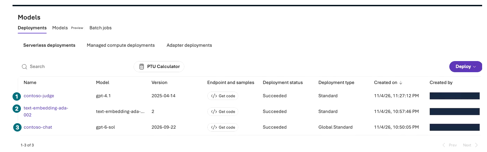
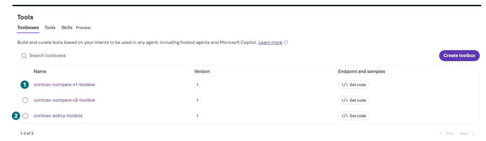
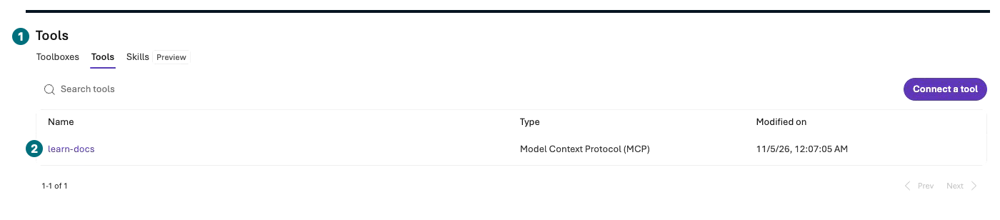

## Objectives

Inspect owned resources, automation, retention, and continuing costs in the portal. Retain by default; **delete nothing without explicit deletion approval**.

**Format:** Read-only handoff by default. Deletion, schedule stopping, and data removal need separate approval.

**Start here:** Recheck the exact dedicated resource group in Azure portal.

**What to check:** Actual inventory, remaining charges, retention owner/date, and execution/inspection/not-run coverage.

## Concepts and lab map

**What you will try:** Resource inventory, Cost analysis, Routines state, and retention inspection.

**What is it, and why does it matter?** Closing a tab leaves Search, compute, logs, files, and schedules. Budget alerts do not enforce a spending cap.

**How do you use it?** Reconcile exact owned scope and hand off cost, retention, and deletion decisions explicitly.

**Where do you run it?** Dedicated Azure portal group/Microsoft Cost Management and your Microsoft Foundry project.

## Prerequisites

Use L00's names, creation scope, and bounds. Keep resource IDs, subscription/tenant, and personal account identifiers private. Share generalized types/status only.

## Steps

**Start with your scope: reconcile group name and Tags**

**1 IAM / 2 Tags:** Inspect your owned scope only. The pictured group is a recording example, not your deletion target. Retention is the default.

[Captioned video 01 · 01:04](../../downloads/portal/index.html?clip=01-environment&t=64&lang=en#01-environment)

| Step | Click or enter | Expected screen or value | If it fails |
| --- | --- | --- | --- |
| 1 | Open `Resource groups → dedicated group → Overview`. | Exact group, subscription, tags. | Stop without changes on default/shared groups. |
| 2 | Refresh and reconcile actual resources with L00. | Account/project, Application Insights/workspace, additional resources. | Record workspaces/Storage outside the group. |
| 3 | Inspect owned `Build → Models/Agents/Knowledge` objects. | Include deployments, agents, three-file store, connections not listed as top-level resources. | Never infer deletion scope from names alone. |
| 4 | Inspect your `Routines` schedules. | Default path created zero. | Obtain separate stopping approval/owner if active. |
| 5 | Open scoped `Cost Management → Cost analysis`. | Correct date, currency, group filters, actual/forecast charges. | Zero can reflect aggregation delay; disclose remaining costs. |
| 6 | Read existing budgets/alerts if present. | Alerts are not a hard spending cap. | Do not create notification recipients/subscriptions without approval. |
| 7 | Record files, conversations, Memory, evaluations, traces, and retention. | Configured policy differs from verified deletion. | TTL alone does not prove removal. |
| 8 | Complete the handoff inventory below. | Retention owner and review date are explicit. | Without approval: `retained; charges may continue`. |

| Type | Inspect | Default end state |
| --- | --- | --- |
| Models | Names, versions, SKU, TPM, calls | Retained, no further requests |
| Agents/File search | Targets, file counts, evaluations, connections | Retained, review retention |
| Application Insights/workspace | Actual connection, ingestion, retention, costs | Retained, restrict log access |
| Conditional Search/Storage/embedding | Tier, replicas, indexer schedule, retention | Ongoing costs if created |
| Conditional Hosted/Memory/Routines | Compute, items, schedule/run state | Not run or separately approved stopping plan |
| Recordings/screenshots | Login, email, keys, people lists, subscription | Private raw footage; reviewed exports only |

**Models: inventory automatic dependencies as well as manual deployments**

**1 Judge / 2 Embedding / 3 Chat:** Record all three actual states. The embedding's automatic-creation cause was not attributed, and it does not establish Memory success. Do not delete here.

[Captioned video 05 · 03:09](../../downloads/portal/index.html?clip=05-inspection-retention&t=189&lang=en#05-inspection-retention)

**Toolboxes: detaching from an agent is not resource deletion**

**1 Comparison / 2 Policy:** Including the middle v2 toolbox, three rows remain. Detaching an agent association can leave project objects behind. Hand off the inventory without deleting them.

[Captioned video 05 · 03:25](../../downloads/portal/index.html?clip=05-inspection-retention&t=205&lang=en#05-inspection-retention)

**MCP: include an unused retained connection**

**1 Tools / 2 learn-docs:** Retained connection, zero search calls. Connection existence is not saved agent association or search execution.

[Captioned video 05 · 03:45](../../downloads/portal/index.html?clip=05-inspection-retention&t=225&lang=en#05-inspection-retention)

**Cost interpretation: this is not full Cost analysis**

**1 Estimate / 2 Tokens:** Partial, pre-evaluation agent metrics. Inspect total charges separately in scoped Microsoft Azure Cost analysis as instructed above. Missing/delayed costs are not zero.

[Captioned video 03 · 04:33](../../downloads/portal/index.html?clip=03-retrieval-boundaries&t=273&lang=en#03-retrieval-boundaries)

### Only after separate deletion approval

Approve the **exact dedicated group and consequence of deleting all contained resources/data** first. Inspect out-of-group workspaces/connections, shared resources, and required logs.

For the approved target only, read `Resource group → Delete resource group`, enter the exact name, and submit. Verify notification and actual inventory afterward. Reading these instructions is not executing deletion. This recorded run has no deletion approval and **retains resources**.

## Success criteria

Hand off all actual resources, costs, retention, and automation state. Distinguish execution, inspection, manual comparison, and unsupported/blocked tasks. New portal results are neither historical SDK validation nor successful live execution of every module.

## Troubleshooting

Record missing cost access or delayed aggregation. An invisible resource is not verified deleted. Never delete on shared/default groups or mismatched names.

## Cleanup

Default final state: **resources retained, further requests stopped, charges may continue**. Public HTML/Markdown/ZIP include only reviewed synthetic materials and privacy-reviewed footage.

**Keep:** Actual inventory/cost/retention handoff, recording review, and unapproved operations not performed.

**Continue:** Finish with [Troubleshooting](#troubleshooting) or [official sources and execution boundaries](#sources).

