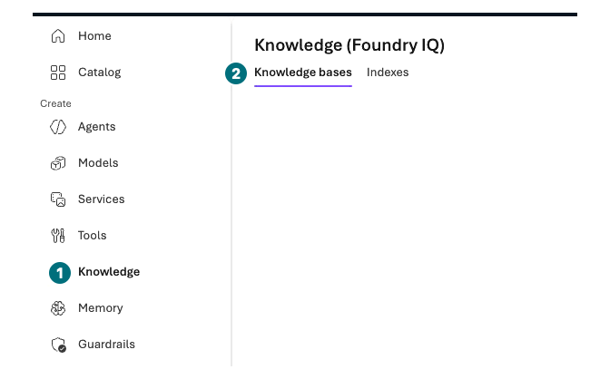

## Objectives

Distinguish File search from Azure AI Search and Foundry IQ in the portal. With separately approved resources, index the three policies and compare actual retrieval for the same question.

<div class="lab-brief" markdown="1">

**Format:** Knowledge inspection by default; conditional execution only with approved Search, Storage, embeddings, and data access.

**Start here:** Record ongoing costs and additional model/permission scope. Do not silently add embeddings beyond L00's two-model example.

**What to check:** Service/index/source connections and actual retrieval, or explicitly not run.

</div>

## Concepts and lab map

**What you will try:** Indexes, keyword/vector/hybrid retrieval, knowledge sources/bases.

**What is it, and why does it matter?** File search quickly connects small file collections. Search manages indexes and retrieval; IQ connects knowledge sources. Distinguish Partially GA capabilities from the portal's Preview experience.

**How do you use it?** Compare actual returned documents with the same three policies and question, not service names or raw scores.

**Where do you run it?** Azure portal Storage/Search and Microsoft Foundry → Build → Knowledge.

## Prerequisites

Separately approve Storage, Search, embeddings, ongoing costs, networking, managed identities, and scoped data operations in the **same dedicated group**. Check exact actions for roles such as `Search Service Contributor`, `Search Index Data Contributor/Reader`, and `Storage Blob Data Reader`. Do not use keys, public blobs, or subscription-wide access for convenience.

Without additional approval, inspect sections 1–2 and read sections 3–4 without submitting. **The recordings contain no Search/Storage creation, indexer execution, or IQ query screens.** Connection forms and L05 File search are not substitutes for those results.

## Steps

### 1. Distinguish the three inputs and retrieval paths

Before creating resources, check L05's three synthetic policy files. A File search upload and a Search Blob container are different input locations.

<div class="screen-step" markdown="1">

**Inputs: only the three policy files**


**1 Names / 2 Success:** Match your three synthetic policies. **3 Attach:** This is L05's File search form, not Search Blob Upload or indexer processing. Do not upload again here.

[Captioned video 03 · 01:17](../../downloads/portal/index.html?clip=03-retrieval-boundaries&t=77&lang=en#03-retrieval-boundaries)

</div>

### 2. Inspect Knowledge connections

<div class="screen-step" markdown="1">

**Open Knowledge: find the menu and two tabs**



**1 Knowledge:** Open it inside your project. **2 Knowledge bases / Indexes:** Tabs for different objects. Their visibility does not establish an existing index or knowledge base.

[Captioned video 05 · 01:43.5](../../downloads/portal/index.html?clip=05-inspection-retention&t=103.5&lang=en#05-inspection-retention)

</div>

| Step | Click or enter | Expected screen or value | If it fails |
| --- | --- | --- | --- |
| 1 | Open `Build → Knowledge`. | Actual heading `Knowledge (Foundry IQ)` with `Knowledge bases` and `Indexes` tabs. | Do not use another project's knowledge. |
| 2 | Read the existing Foundry IQ/Search connection screen. | Search resource selection, Auth type, Connect, Create resource. | An empty list means no existing Search resource is ready. |
| 3 | Inspect the authentication default. | The recording defaulted to **API Key**, without entering a key or connecting. | A default does not authorize keys or another resource. |
| 4 | Without additional approval, leave without Connect or Create resource; cancel any opened form. | Search service/index/knowledge-base creation and IQ queries remain not run. | File search success is not Foundry IQ success. |

<div class="screen-step" markdown="1">

**IQ form: an authentication default is not approval**


**1 Resource:** Your prepared Search resource. **2 Auth Type:** The recording defaulted to `API Key` but did not connect. **3 Create new resource:** Additional resource creation; do not select it in this inspection.

[Captioned video 05 · 01:46](../../downloads/portal/index.html?clip=05-inspection-retention&t=106&lang=en#05-inspection-retention)

</div>

<div class="screen-step" markdown="1">

**Compare L05: File search under Tools is not IQ**


**1 Model / 2 File search:** The configuration actually used in L05. Its success is not IQ service, index, knowledge-base creation, or query success.

[Captioned video 05 · 01:36](../../downloads/portal/index.html?clip=05-inspection-retention&t=96&lang=en#05-inspection-retention)

</div>

### 3. Separately approved: prepare Search input — not recorded

These steps are for learners with approved additional resources. The current video stopped at connection inspection. Verify creation, processing, and retrieval separately in your own portal.

| Step | Click or enter | Expected screen or value | If it fails |
| --- | --- | --- | --- |
| 1 | Search `Storage accounts → Create` in Azure portal. | Approved subscription/group/region and a unique name. | Cancel on unmet security or cost conditions. |
| 2 | Inspect security and select `Review + create → Create` once. | Deployment succeeds for your Storage account. | Preserve failure; do not create repeated accounts. |
| 3 | Select `Data storage → Containers → + Container`, name `contoso-policies`, private access. | Anonymous public access is disabled. | Never solve access errors by making the container public. |
| 4 | Upload only the three synthetic Markdown files from `en/policies`. | Three names and sizes match. | No real documents, evaluation files, or entire ZIP. |
| 5 | Open `Azure AI Search → Create` in the same dedicated group. | Approved training tier, replicas, partitions, and region. | Remember Search can bill without requests. |
| 6 | Review settings/costs and create Search once. | Search Overview reports healthy state. | Resolve provider, region, or quota restrictions with the owner. |
| 7 | Deploy the separately approved embedding model using L02. | Record `text-embedding-3-large`, actual version/name/limits. | Do not deploy before approving the additional model. |
| 8 | Verify approved managed-identity Storage read and Search permissions. | Exact existing roles and scopes meet requirements. | Stop if missing; do not automatically expand access. |

### 4. Separately approved: index and retrieve — not recorded

| Step | Click or enter | Expected screen or value | If it fails |
| --- | --- | --- | --- |
| 1 | Open Search Overview's `Import data/Import and vectorize data`. | A supported import wizard opens. | Check current official steps if the experience differs. |
| 2 | Select `Azure Blob Storage` and your private container. | Only the three synthetic files are in scope. | Inspect identities/data permissions instead of copying keys. |
| 3 | Select the approved embedding deployment in Vectorize. | Model output and index vector dimensions match. | Do not mix default 3072 with the legacy code index's 1536. If 1536 is unavailable in UI, use matching defaults in a new index. |
| 4 | Give index/indexer/skillset distinct `contoso-portal-<suffix>` names; review and submit. | New owned objects, not overwritten existing indexes. | Portal chunking is not the canonical thirteen-section code index. |
| 5 | Inspect `Indexers` status and processed/failed counts. | All three source documents processed without failure. | Do not proceed as successful retrieval with failed ingestion. |
| 6 | Open `Indexes → your index → Search explorer` and try supported keyword/vector/hybrid modes with the question below. | Actual documents, text, scores, and mode are recorded. | Mark unsupported modes not run. |
| 7 | Connect your Search/index as a source under Microsoft Foundry `Build → Knowledge`. | Correct service, index, and identity. | Cancel if required access/support is absent. |
| 8 | Send the same question once in the knowledge test UI if provided. | Inspect returned sources, sections, and answer. | Without a test UI, mark remote IQ retrieval not run. |

```prompt
What is the standard laptop cap, and which approval is required when the total is exactly KRW 2,000,000?
```

Do not directly rank keyword, vector, and reranker scores from different scales. Check whether procurement §2/§3 actually returned. Document ACLs, user tokens, freshness, and deletion propagation require separate tests; public-policy retrieval does not validate them.

## Success criteria

Separate inspection, creation, and retrieval. If executed, keep service, dimensions, indexer state, modes, and original sources. Portal inspection does not execute the GA minimal/extractive IQ API or Preview query planning.

## Troubleshooting

Check indexer, document count, fields/dimensions, then wording. Separate user, Search identity, and project runtime identity access. Never disable networking or ACL controls to proceed.

## Cleanup

Add Search, Storage, embeddings, and connections to L19. Inspect indexer schedules and ongoing Search costs. Do not delete or enable recurring reindexing without approval.

<div class="lab-handoff" markdown="1">

**Keep:** Inspection/execution scope, source/index/dimensions/state, retrieval evidence, and remaining costs.

**Continue:** [L12: inspect Hosted Agent boundaries](#l14).

</div>
