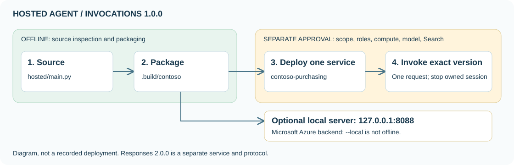
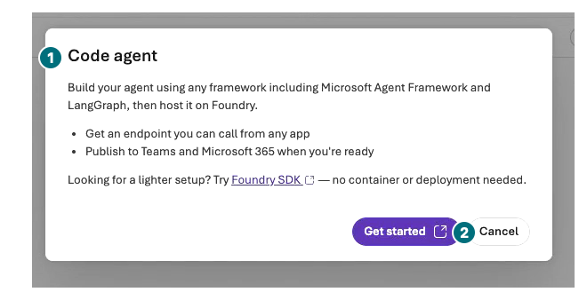

## Objectives

Find the portal's Hosted boundary, then follow **source → local package → one approved service deployment → one exact-version invocation**. Do not substitute manual Chat for code execution.

<div class="lab-brief" markdown="1">

**Format:** Portal plus terminal. Start with offline packaging and SDK checks; paid deployment, access changes, and invocation each require separate approval.

**Start here:** Extract the complete workshop ZIP and open a terminal at the **repository root**, containing `azure.yaml`, `hosted/`, `samples/`, and `scripts/`. The small portal-input ZIP contains no code.

**What to check:** Package manifest and SDK results. If you choose live execution, also verify the remote version, actual response, and owned-session stop record.

</div>

## Concepts and lab map

**What you will try:** Hosted code deployment and Invocations requests.

**What is it, and why does it matter?** Prompt uses instructions/model settings; Hosted runs your server code. Portal Save does not deploy code.

**How do you use it?** Inspect a local package first, then deploy one service only to an approved existing scope.

**Where do you run it?** Inspect resources/kinds in the portal; use the terminal for Python, packaging, and azd deployment. SDK installation is limited to this elective.

[](../../assets/hosted-lifecycle.svg)

Select the diagram to enlarge it. **The existing footage contains no Hosted deployment or invocation.** Portal images show only the development boundary, not recorded terminal execution.

## Prerequisites

Use Python **3.13**. Live execution additionally needs Azure CLI, Azure Developer CLI (azd) with the `azure.ai.agents` extension, the existing L01 project/L02 model, an approved dedicated Search service, and an **embedding deployment callable with 1536 dimensions**. A development skill, Docker, and ACR are not learner prerequisites for this code deployment.

Hosted pins `azure-ai-projects==2.7.0` in `requirements-hosted.txt`; MAF pins **2.6.0** in `requirements-advanced.txt`. **Never install both profiles into one environment.** Use `.venv-hosted` here and a separate `.venv-maf` in L13.

## Steps

### 1. Find the point where the portal requires code

| Step | Click or enter | Expected screen or value | If it fails |
| --- | --- | --- | --- |
| 1 | Read `Type` under your project's `Build → Agents`. | The existing `contoso-policy` is Prompt. | Running does not establish Hosted deployment. |
| 2 | Open `New agent → Code an agent`, read framework/hosting information, and return with `Cancel`. | Continue with source code in section 2. | Creating another Prompt Agent is not Hosted execution. |

<div class="screen-step" markdown="1">

**List: inspect Type before names**


**1 Version / 2 Type:** All three pictured targets are Prompt. **3 New agent:** Locate Code an agent here; this is not a Hosted execution result.

[Captioned video 05 · 02:23](../../downloads/portal/index.html?clip=05-inspection-retention&t=143&lang=en#05-inspection-retention)

</div>

<div class="screen-step" markdown="1">

**Code agent: continue in the terminal**



**1 Developer path:** Continue with checked-in source instead of stopping at inspection. **2 Cancel:** Close this portal dialog and go to section 2. The footage itself still contains zero deployments/invocations.

[Captioned video 05 · 02:19](../../downloads/portal/index.html?clip=05-inspection-retention&t=139&lang=en#05-inspection-retention)

</div>

### 2. Prepare the dedicated environment and package — offline

In macOS/Linux Bash or zsh:

```bash
python3.13 -m venv .venv-hosted
source .venv-hosted/bin/activate
python -m pip install -r requirements-hosted.txt
export FOUNDRY_LAB_LANGUAGE=en
```
<div class="command-explanation" markdown="1">

**Command walkthrough**

| Order and command | Operation and options | Result, cost, or change |
| --- | --- | --- |
| 1. `python3.13 -m venv` | Create the dedicated Hosted environment at the root once. | Local files only; do not recreate an existing environment. |
| 2. `source` | Select that environment's Python for this terminal. | Not a Microsoft Azure login. |
| 3. `pip install -r` | Install the checked-in Hosted SDK pins. | Package downloads, not resource deployment/model requests. |
| 4. `export` | Select this terminal's synthetic-data language. | Keep Korean/English live folders and receipts separate. |

</div>

In Windows PowerShell, use this **instead**:

```powershell
py -3.13 -m venv .venv-hosted
.\.venv-hosted\Scripts\Activate.ps1
python -m pip install -r requirements-hosted.txt
$env:FOUNDRY_LAB_LANGUAGE = "en"
```
<div class="command-explanation" markdown="1">

**Command walkthrough**

| Order and command | Operation and options | Result, cost, or change |
| --- | --- | --- |
| 1. `py -3.13 -m venv` | Create a dedicated Python 3.13 environment. | One-time local preparation. |
| 2. `Activate.ps1` | Select it in this terminal. | If policy blocks activation, do not weaken security; replace later `python` commands with `.venv-hosted\Scripts\python.exe`. |
| 3. `pip install -r` | Install only Hosted dependencies. | Do not add the MAF requirements. |
| 4. `$env:` | Select the language for this terminal. | Other terminals do not inherit this selection automatically. |

</div>

Subsequent single-line `python`, `az`, and `azd` commands work in both shells. In a new terminal, reselect the environment/language without reinstalling.

| Source to open first | What to inspect |
| --- | --- |
| [hosted/main.py](../../hosted/main.py) | `InvocationAgentServerHost`, `/invocations`, input validation, one request at a time, and failed HTTP responses |
| [samples/hosted_runtime.py](../../samples/hosted_runtime.py) | Actual Search grounding, synthetic inventory/draft functions, and per-request authorization. No ordering, payment, or approval |
| [azure.yaml](../../azure.yaml) | This service's entrypoint/protocol and 0.5 CPU/1Gi. Responses is a separate service |

Read this configuration excerpt in the source; do not overwrite the YAML or deploy only this fragment.

```yaml
codeConfiguration:
  runtime: python_3_13
  entryPoint: main.py
  dependencyResolution: remote_build
protocols:
  - protocol: invocations
    version: 1.0.0
```

```bash
python scripts/build_hosted.py
python -m scripts.check_sdk
```
<div class="command-explanation" markdown="1">

**Command walkthrough**

| Order and command | Operation and options | Result, cost, or change |
| --- | --- | --- |
| 1. `build_hosted.py` | Package synthetic sources, allowlisted files, and pinned dependencies for both protocols. | `.build/contoso/package-manifest.json` and the Responses package. **Both are local files, not deployments.** |
| 2. `scripts.check_sdk` | Check installed SDK contracts without credentials/network access. | `sdk_contracts: passed`, `azure_calls: 0`. Neither live Microsoft Azure nor quality evidence. |

</div>

Without a configured `.env`, the package model is `CONFIGURE-MODEL-BEFORE-DEPLOY`. Offline packaging works, but **do not deploy/invoke that package**. If you stop offline, continue to section 5 and the success criteria.

<a id="l12-azd"></a>

### 3. Connect the existing portal environment — approved optional path

**Do not create another group/project.** Portal notes are not a CLI receipt. Reuse an existing `results/azure-environment.json` only if scope/language match; do not repeat adoption.

| Step | Click or enter | Expected screen or value | If it fails |
| --- | --- | --- | --- |
| 1 | Open your dedicated RG's Overview and Tags in Azure portal. | L01's `validationRun` and `repository=microsoft-foundry-labs-v1.5`. | Add/save a missing repository tag **only with approval to change your own group's tags**. Never label someone else's group as owned. |
| 2 | Compare the project endpoint and actual deployment names in Microsoft Foundry. | `contoso-chat`, approved embedding, same account/subscription. | An automatically observed ada-002 deployment is not presumed compatible. |
| 3 | In the file explorer/editor, copy `.env.example` to `.env` and replace the placeholders below. Do not overwrite an existing `.env`. | Endpoints/names only, no secrets. | Never paste keys, tokens, or passwords. |

```env
FOUNDRY_PROJECT_ENDPOINT=https://YOUR_RESOURCE.services.ai.azure.com/api/projects/YOUR_PROJECT
FOUNDRY_MODEL_DEPLOYMENT_NAME=contoso-chat
FOUNDRY_SEARCH_ENDPOINT=https://YOUR_SEARCH_SERVICE.search.windows.net
FOUNDRY_SEARCH_INDEX=
FOUNDRY_KNOWLEDGE_BASE=
FOUNDRY_EMBEDDING_DEPLOYMENT_NAME=YOUR_EMBEDDING_DEPLOYMENT
FOUNDRY_EMBEDDING_ENDPOINT=https://YOUR_RESOURCE.openai.azure.com
FOUNDRY_AUTH_MODE=cli
```

Search is the **existing dedicated service** approved in L11. This Hosted implementation requires canonical policy sections/hashes and a 1536-dimensional schema, not an arbitrary portal index. Leave index/knowledge-base values empty for first initialization; reuse an existing matching `results/search.json`. Your user needs Search Service Contributor, Search Index Data Contributor, and model inference access at the appropriate scopes. Missing access requires separate least-scope approval, not keys or a shared-service workaround.

If needed, the login command opens a browser window. Exclude credentials/authentication codes from recordings.

```bash
az login --tenant YOUR_TENANT_ID
python scripts/adopt_portal.py --subscription YOUR_SUBSCRIPTION_ID --resource-group YOUR_RESOURCE_GROUP --run-id YOUR_VALIDATION_RUN --search-service YOUR_SEARCH_SERVICE --embedding-deployment YOUR_EMBEDDING_DEPLOYMENT --live
```
<div class="command-explanation" markdown="1">

**Command walkthrough**

| Order and command | Operation and options | Result, cost, or change |
| --- | --- | --- |
| 1. `az login --tenant` | Replace the tenant placeholder and authenticate in the browser. Skip if already correctly signed in. | CLI authentication cache; do not arbitrarily change organization/subscription defaults. |
| 2. `adopt_portal.py ... --live` | Replace every `YOUR_...`. Verify existing RG tags, account, project, chat, Search, and embedding with at most seven read commands. | Private ownership receipt; **zero** resource creations, role grants, or model invocations. Existing receipts are never overwritten. |

</div>

**The next step is not read-only.** Run the first command once only with approval for a policy index, knowledge source/base, and one embedding batch. Skip it when a healthy matching `search.json` already exists.

```bash
python samples/search_lab.py initialize --live
python scripts/build_hosted.py
python scripts/configure_hosted.py
```
<div class="command-explanation" markdown="1">

**Command walkthrough**

| Order and command | Operation and options | Result, cost, or change |
| --- | --- | --- |
| 1. `search_lab.py initialize --live` | Create the three synthetic policies' sections/vectors and knowledge source/base in existing Search; budget: 15 requests, 300 seconds. | Microsoft Azure data writes and embedding charges, not another Search service. |
| 2. `build_hosted.py` | **Rebuild** with the actual deployment name from the edited `.env`. | Verify the actual model in `.agent_configs/baseline/metadata.yaml` and the manifest's file hashes. |
| 3. `configure_hosted.py` | Match the verified receipt, `.env`, and Search settings to bind the local azd environment. | Local `.azure/` configuration only; no provisioning, deployment, or role changes. |

</div>

### 4. Deploy one service and invoke its exact version — separate approval

Deployment, runtime least-privilege roles, and the invocation **each need approval**. Target only `contoso-purchasing`. Do not use service-less `azd deploy` or `azd up`: both services might be deployed.

```bash
azd deploy contoso-purchasing --timeout 1200
azd ai agent show contoso-purchasing --output json
```
<div class="command-explanation" markdown="1">

**Command walkthrough**

| Order and command | Operation and options | Result, cost, or change |
| --- | --- | --- |
| 1. `azd deploy contoso-purchasing` | Deploy only the Invocations code service in `azure.yaml`, waiting at most 1200 seconds. | Creates/changes paid Hosted compute. Timeout does not cancel the Microsoft Azure deployment; inspect state instead of redeploying. |
| 2. `azd ai agent show` | Read the same service's actual version, endpoint, and state. | Retain the exact numeric version, not a Prompt save version or `latest`. |

</div>

Run this only after separately approving the runtime identity's project role, Search Index Data Reader, and account-level Cognitive Services OpenAI User at their **minimum scopes**. Skip existing matching assignments.

```bash
python scripts/runtime_roles.py --agent contoso-purchasing --live
```
<div class="command-explanation" markdown="1">

**Command walkthrough**

| Order and command | Operation and options | Result, cost, or change |
| --- | --- | --- |
| 1. `runtime_roles.py ... --live` | Assign three minimum project/Search/model roles to the agent identity in the ownership receipt. | **Changes access.** Stop without approval/roleAssignments/write; never grant a subscription-wide role. |

</div>

Replace `YOUR_DEPLOYED_VERSION` with the verified **number** and invoke once.

```bash
python samples/hosted_client.py invoke --version YOUR_DEPLOYED_VERSION --live
```
<div class="command-explanation" markdown="1">

**Command walkthrough**

| Order and command | Operation and options | Result, cost, or change |
| --- | --- | --- |
| 1. `hosted_client.py invoke` | Request policy/stock for two NB-14 units and a synthetic draft in your exact-version session. | **One** paid invocation; internal model/Search operations also incur charges. Runtime budget: 12 requests, 60,000 tokens, 300 seconds, at most eight tools. Preserve originals/errors; stop and verify only its own session. |

</div>

Inspect `status`, `response_id`, `citations`, `tool_calls`, and `contract.sha256` in `results/contoso-hosted-client-...-responses.jsonl`, plus `stopped_session` in the execution log. Drafts must remain `draft_requires_human_approval` with `order_submitted=false`. Do not run `evaluate` or collect holdout data.

### 5. Optional local server — not offline

Choose this **instead of** the remote invocation. Section 3's real Search/model/access and `.env` are still required. Select the Hosted environment/language in **terminal A**, then:

```bash
python scripts/run_hosted_local.py --protocol invocations --port 8088
```
<div class="command-explanation" markdown="1">

**Command walkthrough**

| Order and command | Operation and options | Result, cost, or change |
| --- | --- | --- |
| 1. `run_hosted_local.py` | Run the generated package's actual server at `127.0.0.1:8088`. | Leave this terminal running. Do not create a tunnel or public binding. |

</div>

Select the same Hosted environment/language in **terminal B**; after approving one paid request:

```bash
python samples/hosted_client.py invoke --local --live
```
<div class="command-explanation" markdown="1">

**Command walkthrough**

| Order and command | Operation and options | Result, cost, or change |
| --- | --- | --- |
| 1. `invoke --local --live` | Send once to local `/invocations`; the server calls Azure AI Search and a Microsoft Azure model. | **Local execution with a Microsoft Azure backend**, not remote Hosted deployment evidence. Stop terminal A with Ctrl+C afterward. |

</div>

Invocations does not validate the separate `contoso-purchasing-responses` **Responses 2.0.0** service, Voice, or Teams `activity`. Code deployment and portal Chat are different execution surfaces.

## Success criteria

| Path actually completed | Required result | Do not claim |
| --- | --- | --- |
| Offline package/SDK checks | Manifest, installed versions, `azure_calls: 0` | Microsoft Azure deployment, tool execution, or quality approval |
| Optional local invocation | Actual response/contract/Search/tool originals, labeled local | Successful remote Hosted deployment |
| Optional remote deployment/invocation | Exact service/version, original response, confirmed session stop | Ordering, payment, business approval, or other protocols |

## Troubleshooting

Separate Hosted/MAF environments on dependency conflicts. Missing receipts require verification of the existing portal scope, not duplicate `create`/`foundation`. Search hash/schema mismatch may mean an arbitrary portal index was reused. Separate user/runtime access when investigating 403; never bypass with keys/public access. Preserve failures, 429s, and timeouts without automatic retries.

## Cleanup

Stop local servers with Ctrl+C. The remote client stops **only its own session**, without deletion; an unconfirmed stop is not cleanup success. Coordinate remaining owned sessions using [stop_sessions.py](../../scripts/stop_sessions.py) and its receipt checks. A stopped session does not prove all agent/compute, Search, file, or logging charges ended. Hand these to L19.

<div class="lab-handoff" markdown="1">

**Keep:** Source/package contract and execution-path labels. For optional live work, privately retain scope, version, originals, role changes, and session end state.

**Continue:** [L13: real MAF sequential/concurrent execution](#l15). A separate MAF environment needs no Hosted deployment.

</div>
