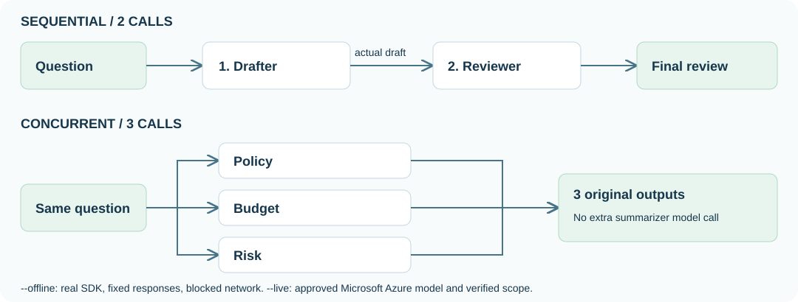

## Objectives

**Execute SequentialBuilder and ConcurrentBuilder** in Microsoft Agent Framework (MAF), then inspect transfer, fan-out, and termination. Do not replace SDK execution with human copying.

<div class="lab-brief" markdown="1">

**Format:** Real SDK in the terminal, using an offline fixture by default. Separately approve the same code's connection to an existing Microsoft Azure model.

**Start here:** Create a dedicated MAF environment at the complete ZIP's repository root. **No Hosted deployment, Search, judge, or extra Prompt Agents are required.**

**What to check:** Actual SDK records for two sequential calls and three independent branches. Keep fixture and paid-model outcomes separate.

</div>

## Concepts and lab map

**What you will try:** Sequential review and concurrent fan-out.

**What is it, and why does it matter?** Sequential passes the draft to the next role. Concurrent distributes the same question independently and preserves three originals.

**How do you use it?** Execute real builders offline, then optionally compare the same roles, policy, and question with an approved model.

**Where do you run it?** Workflows and Agent objects run in **your Python process**; only the optional model runs in Microsoft Foundry. Two portal Chat windows are not runtime concurrency.

[](../../assets/maf-patterns.svg)

Select the flow diagram to enlarge it. **The existing portal footage contains no MAF execution.** Unrelated Prompt creation/copy controls are not execution evidence.

## Prerequisites

Use Python **3.13** and the complete ZIP's `samples/`, `scripts/`, `data/`, and `requirements-advanced.txt`. Package installation needs internet access; the default fixture needs no Microsoft Azure login, `.env`, or ownership receipt.

Do not reuse L12's `.venv-hosted`. Its `azure-ai-projects==2.7.0` conflicts with this profile's **2.6.0**. Keep requirements separate in `.venv-maf`.

## Steps

### 1. Select the MAF environment and read the actual builders

macOS/Linux Bash or zsh:

```bash
python3.13 -m venv .venv-maf
source .venv-maf/bin/activate
python -m pip install -r requirements-advanced.txt
export FOUNDRY_LAB_LANGUAGE=en
```
<div class="command-explanation" markdown="1">

**Command walkthrough**

| Order and command | Operation and options | Result, cost, or change |
| --- | --- | --- |
| 1. `python3.13 -m venv` | Create the dedicated MAF environment at the root once. | Local files; do not recreate an existing environment. |
| 2. `source` | Select MAF Python in this terminal. | Separate from Hosted. |
| 3. `pip install -r` | Install pinned MAF packages and SDKs. | Package downloads only; no model invocation. |
| 4. `export` | Select English synthetic policies/questions. | Reselect in a new terminal. |

</div>

In Windows PowerShell, use this **instead**:

```powershell
py -3.13 -m venv .venv-maf
.\.venv-maf\Scripts\Activate.ps1
python -m pip install -r requirements-advanced.txt
$env:FOUNDRY_LAB_LANGUAGE = "en"
```
<div class="command-explanation" markdown="1">

**Command walkthrough**

| Order and command | Operation and options | Result, cost, or change |
| --- | --- | --- |
| 1. `py -3.13 -m venv` | Create a separate Python 3.13 environment. | Local preparation only. |
| 2. `Activate.ps1` | Select MAF Python. | If policy blocks it, do not weaken security; replace later `python` with `.venv-maf\Scripts\python.exe`. |
| 3. `pip install -r` | Install advanced requirements only. | Do not add Hosted requirements. |
| 4. `$env:` | Select the terminal's synthetic-data language. | Keep live folders/receipts separate by language. |

</div>

Subsequent single-line `python` commands work in both shells. In a new terminal, reselect the environment/language without reinstalling.

Open [`build_workflow` in multi_agent.py](../../samples/multi_agent.py). This **read-only excerpt** connects roles defined elsewhere in that file; do not run the fragment by itself.

```python
from agent_framework.orchestrations import ConcurrentBuilder, SequentialBuilder

sequential = SequentialBuilder(
    participants=[drafter, reviewer], intermediate_output_from=[drafter],
).build()
concurrent = ConcurrentBuilder(
    participants=[policy_agent, budget_agent, risk],
    intermediate_output_from=[policy_agent, budget_agent, risk],
).build()
```

`build_role` supplies the same synthetic purchasing policy to each role. `CallAudit` middleware records actual call IDs, input hashes, roles, times, and usage. These are local SDK objects, not two newly created portal Prompt Agents.

<div class="practice-block" markdown="1">

### 2. Execute sequential transfer offline first

**Try it:** Check SDK contracts and the plan, then execute the workflow using `--offline`.

```bash
python -m scripts.check_sdk --advanced
python samples/multi_agent.py --mode sequential
python samples/multi_agent.py --mode sequential --offline
```
<div class="command-explanation" markdown="1">

**Command walkthrough**

| Order and command | Operation and options | Result, cost, or change |
| --- | --- | --- |
| 1. `scripts.check_sdk --advanced` | Check installed SDK workflow, transfer, and comparison contracts with networking blocked. | `sdk_contracts: passed`, `azure_calls: 0`; not a real-model measurement. |
| 2. `--mode sequential` | Print options and the call ceiling only. | `PLAN ONLY` is not executed SDK workflow evidence. |
| 3. `--mode sequential --offline` | Connect a fixed-response client to the real `SequentialBuilder`: drafter → reviewer. | Two synthetic responses, blocked network/DNS, private `results/contoso-maf-fixture-....jsonl`. |

</div>

The default `--case purchase` sends this actual question. Compare it with `QUESTIONS` in the source; do not send another portal Chat request.

```text
I need two laptops at KRW 1,450,000 each. Explain the purchasing policy and approval process.
```

Inspect these output fields. Answers say `Synthetic fixture from ...`; **they do not measure policy-answer quality or billed tokens**.

```output
"execution": "local_sdk_fixture"
"azure_calls": 0
"fixture_calls": 2
"usage_source": "synthetic_fixture_not_billing"
"quality_release": false
```

The reviewer's `model_call_completed` input must contain the **actual drafter fixture response**. Two outputs alone do not prove transfer.

### 3. Fan out the same question and compare a baseline

```bash
python samples/multi_agent.py --mode concurrent --offline
```
<div class="command-explanation" markdown="1">

**Command walkthrough**

| Order and command | Operation and options | Result, cost, or change |
| --- | --- | --- |
| 1. `--mode concurrent --offline` | Fan out the same question to policy, budget, and risk; retain every original. | `fixture_calls: 3`, three roles, and `maximum_active_fixture_calls` for local overlap. No extra summarizer call. |

</div>

**Change one thing:** Keep the question/policy fixed and select the single-versus-sequential comparison mode.

```bash
python samples/multi_agent.py --mode compare --offline
```
<div class="command-explanation" markdown="1">

**Command walkthrough**

| Order and command | Operation and options | Result, cost, or change |
| --- | --- | --- |
| 1. `--mode compare --offline` | Run single once plus sequential twice with the same input. | Three fixture calls and `sequential_minus_single`. Synthetic usage differences do not establish savings or quality improvement. |

</div>

**Explain the result:** Show the draft received by the reviewer versus independent inputs/three originals. Calls, overlap, transfer, and answer quality are separate checks. The fixture does not interpret questions as a model; do not calculate policy accuracy from it.

</div>

<a id="maf-live-setup"></a>

### 4. Execute with an existing Microsoft Foundry model — separate approval

This optional path is separate from offline evidence. **Do not create another project, agent, Hosted runtime, or Search service.** Reuse L01/L02's chat deployment with approved inference access.

| Step | Click or enter | Expected screen or value | If it fails |
| --- | --- | --- | --- |
| 1 | Inspect your dedicated RG's Overview and Tags in Azure portal. | Exact L01 subscription/`validationRun`, plus `repository=microsoft-foundry-labs-v1.5`. | Add/save a missing repository tag only after approval to change your own group's tags. Never label another group as owned. |
| 2 | Read the project endpoint and `Models → contoso-chat → Details` in Microsoft Foundry. | Same account/project, model version, Succeeded, actual TPM/RPM. | Stop on mismatches/insufficient capacity; no automatic increase or silent model replacement. |
| 3 | Copy `.env.example` to `.env` at the root and edit the fields below without overwriting an existing file. | Project endpoint and actual chat deployment name. | Do not use the model's `/openai/v1` endpoint or paste API keys. |
| 4 | Reuse a matching ownership receipt; otherwise run read-only adoption below. | `.env`, receipt, and portal agree on scope/language. | Do not hand-author an ownership claim or rerun `create`/`foundation`. |

```env
FOUNDRY_PROJECT_ENDPOINT=https://YOUR_RESOURCE.services.ai.azure.com/api/projects/YOUR_PROJECT
FOUNDRY_MODEL_DEPLOYMENT_NAME=contoso-chat
FOUNDRY_AUTH_MODE=cli
```

```bash
az login --tenant YOUR_TENANT_ID
python scripts/adopt_portal.py --subscription YOUR_SUBSCRIPTION_ID --resource-group YOUR_RESOURCE_GROUP --run-id YOUR_VALIDATION_RUN --live
```
<div class="command-explanation" markdown="1">

**Command walkthrough**

| Order and command | Operation and options | Result, cost, or change |
| --- | --- | --- |
| 1. `az login --tenant` | Replace the approved tenant ID and authenticate in the browser window. Reuse an already correct CLI login. | Do not record authentication screens/codes. |
| 2. `adopt_portal.py ... --live` | Replace every placeholder; verify existing subscription, RG tags, account, project, and chat using five read commands. | Local ownership receipt only; no resource changes/model invocations or existing-file overwrites. |

</div>

Both baseline paths permit at most **2+3=5 calls**; optional `compare` adds three. Each execution allows 180 seconds, 2048 output tokens/call, at most six starts/minute, and zero retries. Separate capacity preflight permits at most 24 reads/180 seconds without capacity changes. Counts are not a monetary cap; shared deployments need combined learner budgets.

```bash
python samples/multi_agent.py --mode sequential --live
python samples/multi_agent.py --mode concurrent --live
```
<div class="command-explanation" markdown="1">

**Command walkthrough**

| Order and command | Operation and options | Result, cost, or change |
| --- | --- | --- |
| 1. `--mode sequential --live` | Verify receipt and actual TPM/RPM before running drafter → reviewer on the existing model. | At most two paid model calls; retain actual IDs, usage, and transferred input. |
| 2. `--mode concurrent --live` | Fan out the same model/policy/question to policy, budget, and risk. | At most three paid calls; start-rate limits mean simultaneous starts are not guaranteed. |

</div>

Live `execution` is `local_maf_with_azure_model`: **local workflow, Microsoft Azure model**, not Microsoft Foundry-hosted orchestration. Inspect actual overlapping intervals using `started_after_seconds` and `elapsed_seconds`. Missing usage is `null`, not zero. Portal Workflows/in-portal execution retire on **2026-12-01**; this path does not depend on that designer.

## Success criteria

Execute real SDK sequential transfer and concurrent fan-out, locating each role's originals. Distinguish `local_sdk_fixture` from `local_maf_with_azure_model`. Plans, fixture usage, and example screens are not live-model/quality evidence. `quality_release` remains false.

## Troubleshooting

For missing SDKs, check `.venv-maf` and `requirements-advanced.txt`. `PLAN ONLY` means no execution. Missing receipts/tags/TPM/RPM leave live execution blocked; return to offline. Preserve 429s, partial results, duplicate IDs, and timeouts without increasing bounds to pass.

## Cleanup

No persistent agent, server, or remote A2A endpoint is created. Existing model/logging resources remain after the process ends. Keep fixture and live `.jsonl` files separate and private; never commit them.

<div class="lab-handoff" markdown="1">

**Keep:** Execution kind, mode/case/policy hash, transfer originals, roles, call counts, timings, usage evidence, and unverified limits.

**Continue:** [L14: real MAF group chat and handoff](#l15-collaboration), reusing the same MAF environment.

</div>
