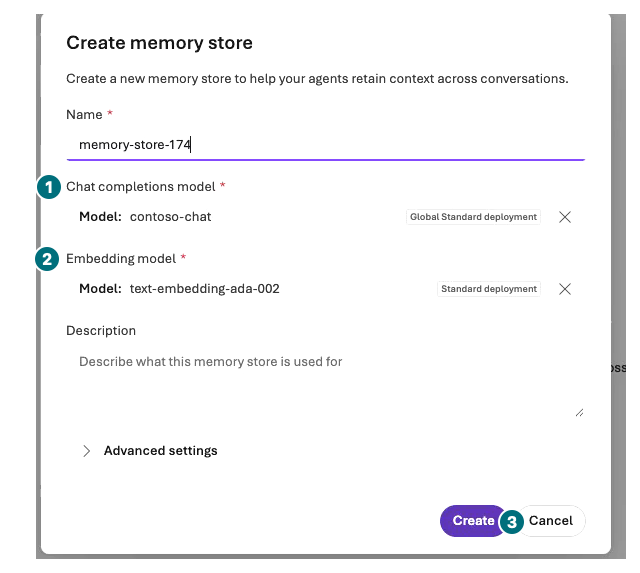
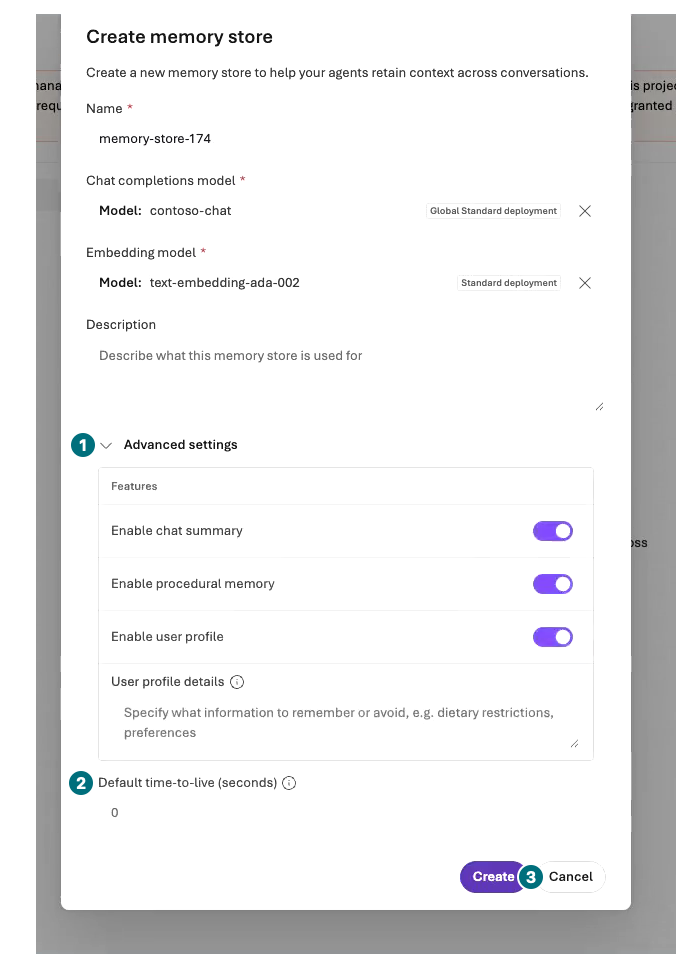

## Objectives

Distinguish conversation context from server Memory. Inspect the actual `Memory stores` page, creation form, and runtime-identity warning, then **cancel without Create**.

<div class="lab-brief" markdown="1">

**Format:** Inspection by default. This recording created zero stores and performed zero Memory writes/recalls. Conditional comparison with a separately approved existing connection is not CRUD, isolation, or deletion validation.

**Start here:** Read `Memory stores (0)` and `Setup incomplete` under `Build → Memory`.

**What to check:** Visible settings, actual new-conversation results, and what the portal cannot establish.

</div>

## Concepts and lab map

**What you will try:** Memory Preview connections, retention, and cross-conversation recall.

**What is it, and why does it matter?** Conversation context is not long-term Memory. “I remembered” alone does not establish persistence or user isolation.

**How do you use it?** Read exposed store/tool/scope/TTL fields. Compare a synthetic preference only after separate authorization.

**Where do you run it?** Your Microsoft Foundry project → Build → Memory and owned agent Details/Tools. Only the conditional comparison uses Chat; no code or direct API requests.

## Prerequisites

Server Memory requires chat/embedding deployments and permissions for the **project managed identity**. The recorded `Setup incomplete` warning required **Foundry User** on the project and Owner or User Access Administrator to assign it. Personal Contributor access is not runtime-identity access. **Do not select Resolve or add roles.**

L00's two manually deployed models do not authorize a new embedding deployment or Memory creation. The already observed automatic `text-embedding-ada-002` deployment is not evidence of a newly created store or successful recall. The creation form and TTL field can be inspected below; persistence, item CRUD, and isolation remain separate.

## Steps

### 1. Read the count and runtime-identity warning

<div class="screen-step" markdown="1">

**Memory list: read the zero count and runtime warning separately**


**1 Count:** `Memory stores (0)`. **2 Warning:** Signed-in-user access differs from project runtime access. Do not select `Resolve` or assign roles.

[Captioned video 05 · 01:58](../../downloads/portal/index.html?clip=05-inspection-retention&t=118&lang=en#05-inspection-retention)

</div>

| Step | Click or enter | Expected screen or value | If it fails |
| --- | --- | --- | --- |
| 1 | Open `Build → Memory`. | Preview `Memory stores` list and actual count; the recording showed `Memory stores (0)`. | Record missing navigation as unsupported; no CLI workaround. |
| 2 | Read any `Setup incomplete` runtime-identity and role warning. | Project managed identity requires Foundry User. | Do not select `Resolve`, assign roles, or bypass with a personal token. |

### 2. Inspect model and retention fields

| Step | Click or enter | Expected screen or value | If it fails |
| --- | --- | --- | --- |
| 1 | Open `Create memory store` without submitting. | Name, Chat completions model, Embedding model, Description. | Model selection does not authorize another deployment. |
| 2 | Inspect existing models and expand `Advanced settings`. | Enabled Chat Summary, Procedural Memory, User Profile; User profile details; **Default time-to-live (seconds)**. | Record different actual UI. Do not save arbitrary settings or TTL. |

<div class="screen-step" markdown="1">

**Basic form: chat and embeddings are different dependencies**



**1 Chat / 2 Embeddings:** The recording exposes existing `contoso-chat` and `text-embedding-ada-002`. Visible names do not establish store creation. Inspect Name and Description without saving. **3 Cancel:** Leave without Create.

[Captioned video 05 · 02:05](../../downloads/portal/index.html?clip=05-inspection-retention&t=125&lang=en#05-inspection-retention)

</div>

<div class="screen-step" markdown="1">

**Advanced settings: inspect retention, then Cancel**



**1 Expand:** Read default-enabled features and User profile too. **2 TTL:** The recorded pre-entry value is `0`, not evidence of saved retention, expiry, or deletion. **3 Cancel:** Leave without Create; zero writes/recalls ran.

[Captioned video 05 · 02:10.4](../../downloads/portal/index.html?clip=05-inspection-retention&t=130.4&lang=en#05-inspection-retention)

</div>

### 3. Cancel, then inspect the agent's connections

| Step | Click or enter | Expected screen or value | If it fails |
| --- | --- | --- | --- |
| 1 | Select `Cancel`, not `Create`. | Zero stores and zero writes/recalls remain. | Form inspection does not establish persistence or TTL expiry. |
| 2 | Inspect `Build → Agents → your agent → Details/Tools`. | The current policy agent has File search only, without Memory. | File search and same-conversation context are not Memory. |

<div class="screen-step" markdown="1">

**Return to the agent: File search differs from Memory**


**1 Model / 2 File search:** The saved policy-retrieval configuration. The separate Memory area below does not establish store creation, connection, or recall. The default inspection ends here.

[Captioned video 05 · 01:36](../../downloads/portal/index.html?clip=05-inspection-retention&t=96&lang=en#05-inspection-retention)

</div>

### 4. Separately approved: same-user new-Chat comparison — not run

| Step | Click or enter | Expected screen or value | If it fails |
| --- | --- | --- | --- |
| 1 | Run the comparison below only with an approved existing store, connection, writes, and test UI. | Synthetic data, at most four Chat sends. | Otherwise mark Chat comparison not run. |
| 2 | Separate settings inspection, natural-language recall, item evidence, and isolation tests. | Unexposed scope, update delay, or items remain unverified. | Recall does not establish CRUD or A/B isolation. |

Only with an existing store and **separately approved Memory writes**, send this synthetic preference once in a new Chat.

```prompt
Synthetic Contoso workshop persona A prefers a blue keyboard for this demo. Please remember this demo preference. It is not a real person's preference or purchasing approval.
```

After the configured update delay, open a new Chat and ask once: “What keyboard color does workshop persona A prefer?” Compare with a **separate agent without Memory**, using the same model/Instructions and the two questions in separate new Chats, one send each. Do not paste the preference again into the recall question.

Record recall separately from actual Memory tool/item evidence. Different Instructions/context make the comparison uncontrolled. Do not log in as another user or modify arbitrary scopes to probe access.

<div class="screen-step" markdown="1">

**Conditional input: preference and recall use separate new Chats**


**1 Input / 2 Send:** Use only after separate authorization. Do not repaste the preference into the new recall Chat. This image locates controls; it is not Memory write/recall evidence. The recording performed zero Memory calls.

[Captioned video 02 · 02:43](../../downloads/portal/index.html?clip=02-model-agent&t=163&lang=en#02-model-agent)

</div>

## Success criteria

Distinguish same-conversation context, new conversations, and server stores. Persistence, update/list/delete, A/B isolation, and TTL expiry not directly verified in the portal remain unverified.

## Troubleshooting

Separate missing connection/UI/embeddings, unexposed scope, and runtime permissions. `Setup incomplete` does not authorize permission changes. Never bypass with keys, personal tokens, or shared scope. Do not repeat until recall succeeds.

## Cleanup

If saved, add synthetic preference store/time/retention to L19. “Forget” can trigger deletion; do not send it without approval. TTL configuration is not immediate deletion evidence. Changes/deletion require separate authorization.

<div class="lab-handoff" markdown="1">

**Keep:** Visible Memory settings, conditional recall results, unverified CRUD/isolation/deletion, and retention state.

**Continue:** [L16: inspect Routines before execution](#l17).

</div>
