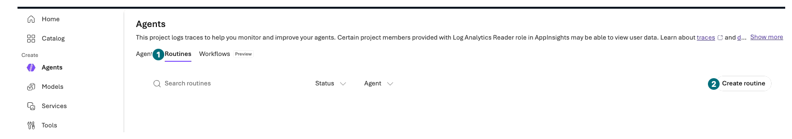
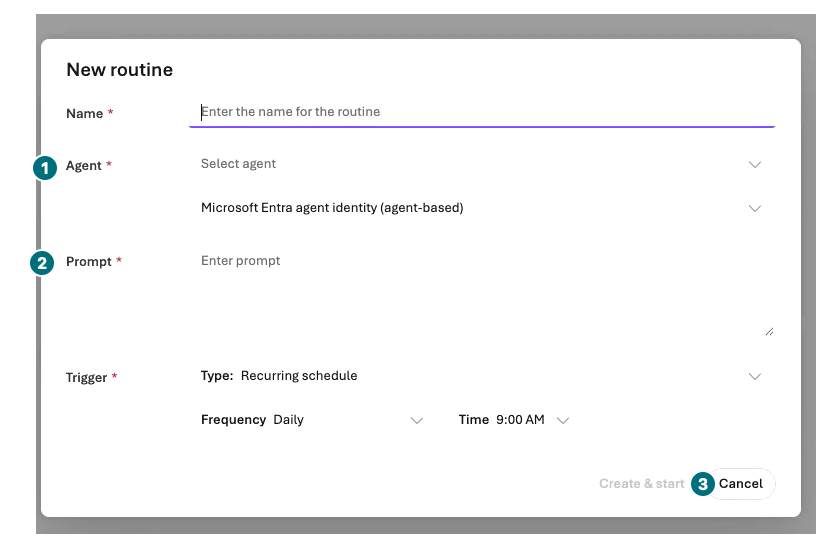
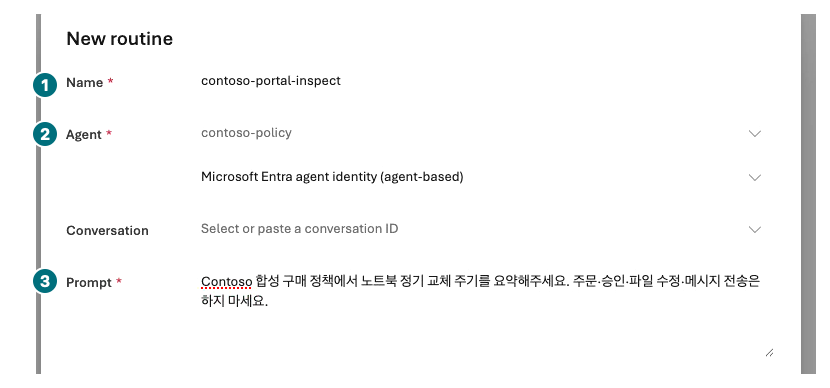
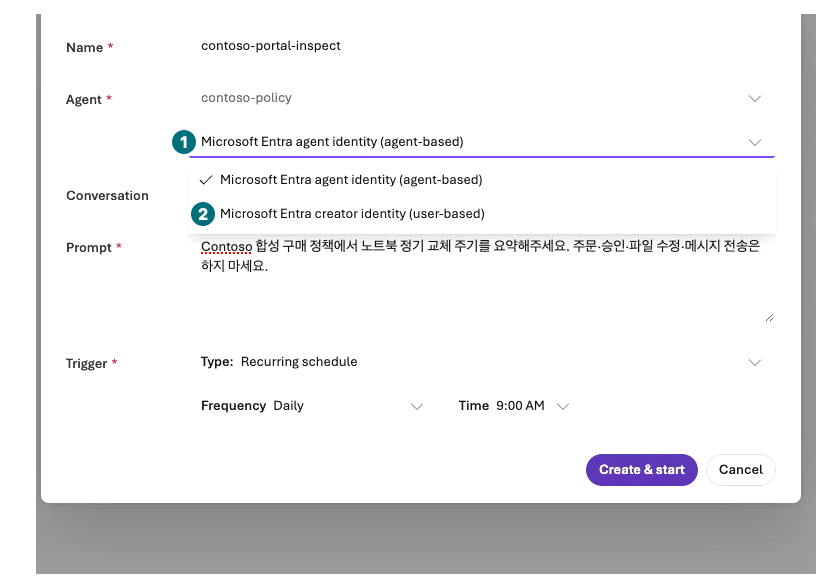
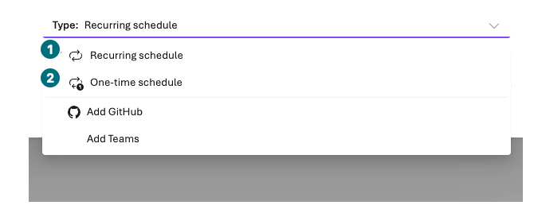
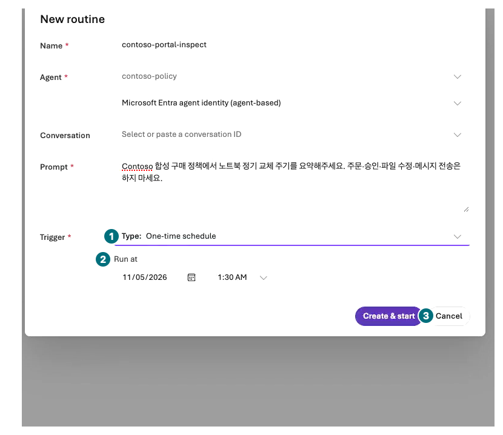
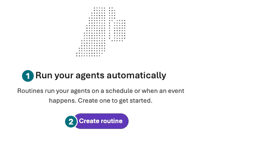

## Objectives

Inspect the Routines form in the portal. The default path **does not select Create & start or Test run**; inspect identity, timezone, and cost risks.

<div class="lab-brief" markdown="1">

**Format:** Inspection by default. This recording's live scope permits zero routines and zero automatic dispatches.

**Start here:** Automatic calls can continue after the browser closes.

**What to check:** Agent, prompt, trigger, browser timezone, identity, stopping plan, and not-run status.

</div>

## Concepts and lab map

**What you will try:** Recurring/one-time schedule forms and run-history interpretation.

**What is it, and why does it matter?** Routines invoke agents on triggers. Repetition, retries, and access increase impact beyond one Chat request.

**How do you use it?** Inspect and cancel. Creation, tests, and Pause each require separately approved scope.

**Where do you run it?** Your Microsoft Foundry project → Build → Agents → Routines tab. Missing navigation means the feature is not enabled for that region/subscription.

## Prerequisites

An existing Prompt Agent and Foundry User or higher on the project. Workflow agents are not supported. UK West, Switzerland West, Japan West, UAE North, and Norway East are excluded regions. Do not use Routines for CMK-required workloads.

## Steps

### 1. Find Routines and open the form

<div class="screen-step" markdown="1">

**Entry point: Routines is a tab inside Agents**



**1 Routines / 2 Create routine:** Open only a new form from your list. Do not inspect or modify another person's routine. The entry point is the same for an empty list.

[Captioned video 05 · 02:26](../../downloads/portal/index.html?clip=05-inspection-retention&t=146&lang=en#05-inspection-retention)

</div>

<div class="screen-step" markdown="1">

**New routine: locate the target and prompt**



**1 Agent:** Your Prompt Agent. **2 Prompt:** Use the synthetic read-only question below. **3 Cancel:** Leave after inspection. Do not create the default recurring schedule.

[Captioned video 05 · 02:34](../../downloads/portal/index.html?clip=05-inspection-retention&t=154&lang=en#05-inspection-retention)

</div>

| Step | Click or enter | Expected screen or value | If it fails |
| --- | --- | --- | --- |
| 1 | Open your project's `Build → Agents`, then the `Routines` tab. | Your routine list. | Look inside Agents, not only the sidebar; record absent navigation without a CLI workaround. |
| 2 | Select `Create routine`. | The `New routine` dialog has Name, Agent, Authorization, Conversation, Prompt, and Trigger. | Do not modify existing automation. |

### 2. Inspect name, target, read-only prompt, and identity

| Step | Click or enter | Expected screen or value | If it fails |
| --- | --- | --- | --- |
| 1 | Enter `contoso-portal-inspect`; select your Prompt Agent. | Exact approved agent/version/target. | Do not substitute Workflow or another person's agent. |
| 2 | Enter the synthetic read-only prompt below. | No ordering, messaging, or writes. | Cancel if the target has external write tools. |
| 3 | Expand `Authorization`, inspect both choices, and retain the agent-based default. | `Microsoft Entra agent identity (agent-based)` and `Microsoft Entra creator identity (user-based)`. | Record different UI honestly. Do not change permissions, consent, or identities as a workaround. |

```prompt
Summarize the regular laptop replacement interval from synthetic Contoso policy. Do not order, approve, modify files, or send messages.
```

<div class="screen-step" markdown="1">

**After entry: reconcile the three populated fields**



**1 Name / 2 Agent / 3 Prompt:** Recheck your target and read-only content. Do not paste someone else's Conversation ID. Populating a form is not saving, activation, or dispatch.

[Captioned video 05 · 02:55.5](../../downloads/portal/index.html?clip=05-inspection-retention&t=175.5&lang=en#05-inspection-retention)

</div>

<div class="screen-step" markdown="1">

**Authorization: visible choices are not execution permission**



**1 Agent identity / 2 Creator identity:** The inspection retained default agent-based identity. Neither identity dispatched, and no consent or permissions were added.

[Captioned video 05 · 02:49](../../downloads/portal/index.html?clip=05-inspection-retention&t=169&lang=en#05-inspection-retention)

</div>

### 3. Inspect trigger and time, then cancel

| Step | Click or enter | Expected screen or value | If it fails |
| --- | --- | --- | --- |
| 1 | Select `One-time schedule` and inspect Run at. | Interpreted in the **browser's local timezone**. | Do not claim a pinned IANA timezone in this UI. |
| 2 | Inspect `Recurring schedule`, Frequency, and Time. | Recurrence can continue; minimum interval is five minutes. | Do not assume one-minute intervals or a financial ceiling. |
| 3 | **Cancel/close without selecting `Create & start`.** | No routine, schedule, or dispatch was created. | Form inspection is not successful scheduling. |

<div class="screen-step" markdown="1">

**Trigger choices: default Recurring differs from One-time**



**1 Recurring / 2 One-time:** Inspect the default recurrence and the one-time Run at fields. Do not create connections or consent through Add GitHub/Add Teams. Never select Create & start in this inspection.

[Captioned video 05 · 02:55.5](../../downloads/portal/index.html?clip=05-inspection-retention&t=175.5&lang=en#05-inspection-retention)

</div>

<div class="screen-step" markdown="1">

**One-time: inspect Run at, then leave without Create & start**



**1 Type:** `One-time schedule`. **2 Run at:** Browser-local time; do not copy this example as your appointment. **3 Cancel:** Finish with zero routines and zero dispatches.

[Captioned video 05 · 03:00.9](../../downloads/portal/index.html?clip=05-inspection-retention&t=180.9&lang=en#05-inspection-retention)

</div>

<div class="screen-step" markdown="1">

**After Cancel: the empty-list introduction returns**



**1 Empty-list introduction / 2 Create routine:** A starting screen, not an existing routine's run history. Finish without creating again. The recording created and dispatched zero routines.

[Captioned video 05 · 03:02.4](../../downloads/portal/index.html?clip=05-inspection-retention&t=182.4&lang=en#05-inspection-retention)

</div>

### Only with separate execution approval

Approve exact agent, future time, browser timezone, request/cost bounds, and Pause owner before creating **one one-time schedule**. `Create & start` activates immediately; it is not a disabled draft.

`Test run` in the owned routine details is an additional billable call. With approval, inspect actual response ID, state, time, and duration in history. `Completed` can mean successful dispatch, not final asynchronous agent output or business completion.

For an approved stop, use `Pause` on the exact owned target and verify Paused. Deletion needs additional approval. This default exercise executes none of creation, tests, Pause, or deletion.

### Identity and portal boundaries

The recorded portal's `Authorization` defaults to **agent identity** and also exposes creator/user-based identity in the creation form. This exercise retained the default and canceled; it dispatched with neither identity. An available choice does not establish the necessary permissions or consent.

Delegated tools require separate routine-creator identity, consent, and resource access checks. Connector connection owner differs from dispatch identity. The recorded `Run at` displayed browser timezone `Asia/Seoul`; do not assume another learner uses the same timezone.

Portal connector setup does not establish successful GitHub/Teams event-routine creation. This path creates no connectors/consent or external messages.

## Success criteria

Inspect form, timezone, target, identity, and costs, then cancel. Record zero creations/dispatches. Separate any independently approved execution from final agent/business completion.

## Troubleshooting

Distinguish unsupported regions, missing navigation, roles, agent types, and connector consent. Do not create regions/resources/permissions/schedules as workarounds.

## Cleanup

Verify no new routine in the list. Separately approved executions need schedule/Pause/cost handoff in L19. Closing a tab does not stop automation.

<div class="lab-handoff" markdown="1">

**Keep:** Form checklist, browser timezone, identity/stop plan, and routine/dispatch not run.

**Continue:** [L17: inspect governance and access boundaries](#l21).

</div>
